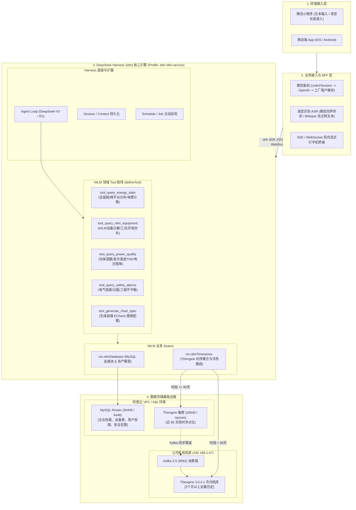

# 非侵入式负荷监测（NILM）工厂端 AI Agent 系统架构方案

## 1. 项目背景与业务目标

工厂配电与用电管理面临设备繁杂、高能耗、人工巡检成本高及安全盲区多等痛点。我司自研的**非侵入式负荷监测（NILM, Non-Intrusive Load Monitoring）设备**仅需在变压器或车间总进线处采集电压、电流与电气特征（包含功率因数、谐波、负荷启停等稳态特征），即可通过算法分解识别出内部细分设备的运行状态与用能明细。

本项目旨在借助 **DeepSeek Harness (dsh)** 开源 Agent 框架，搭建工业级后台 AI Agent 服务程序。工厂管理者与配电运维人员可通过微信小程序或 App 发送文字或语音诉求，Agent 自动解析意图、调用数据接口进行深度分析，流式输出专业且通俗易懂的用能分析、安全隐患诊断与图表结论。

---

## 2. 现场数据底座与拓扑模型

### 2.1 工厂多级空间与多终端拓扑
现场设备与空间呈现典型的工业树状拓扑：
- 一家工厂或企业（`sys_tenant_info`）拥有多个车间、厂房或楼宇（`building/floor/house_basic_info`）；
- 一个车间/厂房内部，通常根据变压器低压出线、进线总柜或配电干线的划分，安装**多台非侵入式监测终端**（`nilmd_basic_info`）；
- 每台终端支持扩展**多个采集通道**（`nilmd_channel_basic_info`，覆盖不同的相别与支路）；
- 每个通道通过 NILM 算法分解出该支路下的**细分用电设备**（`nilmdc_appliance_identification`）。

```text
┌────────────────────────────────────────────────────────┐
│ 企业 / 工厂 (Tenant, 租户级别隔离)                     │
└──────────────────────────┬─────────────────────────────┘
                           │ 1:N
┌──────────────────────────▼─────────────────────────────┐
│ 车间 / 厂房 / 楼宇 (Workshop / Building)               │
└──────────────────────────┬─────────────────────────────┘
                           │ 1:N (一个车间装有多台终端)
┌──────────────────────────▼─────────────────────────────┐
│ NILM 监测终端 (Terminal / MW-A900 主机)                │
└──────────────────────────┬─────────────────────────────┘
                           │ 1:N (每台终端多通道)
┌──────────────────────────▼─────────────────────────────┐
│ 监测通道 (Channel / device_id 如 0281..._1, ..._2)      │
└──────────────────────────┬─────────────────────────────┘
                           │ 1:N (NILM 算法分解结果)
┌──────────────────────────▼─────────────────────────────┐
│ 细分用电设备 (Appliance, 如 空压机、注塑机、空调)      │
└────────────────────────────────────────────────────────┘
```

这种拓扑结构决定了系统计算规则：
- **全厂级能耗**：遍历全厂所有车间、所有终端通道的电能并汇总求和；
- **车间级能耗**：检索该车间下挂载的所有 NILM 终端，批量聚合求和（`WHERE device_id IN (...)`）；
- **设备级能耗**：定位具体终端通道下的算法分解点位。

### 2.2 业务元数据与关系库（MySQL: `tpim_system`）
- **连接通道**：K8s 集群内路由 `mysql.mysql.svc.cluster.local:6446`（读写），公网节点映射 `121.41.8.7:30446`。
- **核心数据表**：
  - `sys_tenant_info`：企业租户信息表（包含 11 家企业租户，如 `tenant_id: TN20230816...`，企业名称、地址、电话）。
  - `sys_wechat_user` 与 `sys_user_tenant`：微信用户绑定表（包含 76 位用户，关联 `openId`、`userId` 与 `tenant_id`）。
  - `root/building/floor/house_basic_info`：工厂物理空间树（2253+ 点位，层级：厂区 -> 楼宇/车间 -> 配电室/房间）。
  - `nilmd_basic_info`：NILM 硬件主机档案（658 台设备，记录 `device_id`、型号 `MW-A900`、接线方式 `wiring_method`、所属空间位置）。
  - `nilmd_channel_basic_info`：监测通道表（3941 个通道，记录 `device_id` 如 `02810068230600002_1`、相别 `phase`、关联负荷 `association_asset`）。
  - `nilm_unsafe_record` 与 `nilm_unsafe_type`：安全隐患记录表（3764 条历史告警，包括单设备过载、违规充电、异常用电）。
  - `appliance_category` 与 `nilm_appliance_feature_record`：负荷类型字典（空压机、电炉、注塑机、空调等）与 35 万+ 条启停特征记录。

### 2.2 高频时序数据库（TDengine 3.0: `tpim_system`）
- **连接通道**：阿里云公网与集群内服务，TDengine 3.0.4.1。
- **存储周期**：云端保留近 90 天高频数据。
- **核心超表（STable，共 23 张）**：
  - `nilmdc_energy_data`：电能计量底座。字段包括 `ts`, `energy_value`（累计用电度数 kWh），标签包含 `device_id`, `association_asset`, `wiring_method`。
  - `nilmdc_realtime_data`：实时电气参数与电能质量。字段包括 `urms`（电压）, `irms`（电流）, `power`（有功功率 kW）, `reactive_power`（无功功率 kvar）, `apparent_power`（视在功率 kVA）, `power_factor`（功率因数）, `power_angle`, `freq`（频率）, `ih1/ih2/ih3/ih5/ih7`（1~7次谐波电流）。
  - `nilmdc_appliance_identification`：NILM 细分负荷分解表。字段包括 `appliance_num`（细分电器编号）, `appliance_state`（1=运行/0=停机）, `realtime_power`（实时功率）, `irms`, `feature_power`（稳态特征功率）, `harmonic_current_2/3/5`。
  - `nilm_unsafe_record`：时序告警表。字段包含 `asset_id`, `unsafe_type`, `unsafe_desc`, `power`, `current`, `appliance_name`。
  - **预聚合统计超表**：`consum_energy_hour_statistics_info`（小时能耗）、`consum_energy_day_statistics_info`（日能耗）、`consum_energy_week_statistics_info`（周能耗）。

### 2.3 冷历史归档与内网中心（192.168.1.67）
- **数据同步**：数据通过 Kafka 3.5（9092 端口，KRaft 模式）持续由阿里云同步落盘至公司内网服务器。
- **冷存形态**：内网部署独立 TDengine 3.0.4.1，保留超过 3 个月的全量历史时序与预聚合数据。

---

## 3. 总体系统架构设计

系统划分为四个核心层次：



---

## 4. DeepSeek Harness (dsh) 模块与插件实现

按照 dsh 框架标准，系统以纯插件方式实现，封装在 `packages/nilm/` 下。

### 4.1 自定义 Profile 配置
创建 `profiles/nilm-service/cordis.yml`：
```yaml
name: dsh-nilm-service
plugins:
  # 1. 大模型适配器 (DeepSeek 官方 API)
  - '@deepseek-ai/dsh-llm-deepseek':
      apiKey: '!!js process.env.DEEPSEEK_API_KEY'
      defaultModel: 'deepseek-chat'      # 日常能耗统计走 V3
      reasoningModel: 'deepseek-reasoner' # 复杂因果分析与节能诊断走 R1

  # 2. 会话管理与通信底座
  - '@deepseek-ai/dsh-session':
      storage: 'sqlite'
  - '@deepseek-ai/dsh-sdk-jsonrpc-server':
      transport: 'stdio'

  # 3. NILM 领域数据连接插件
  - 'dsh-plugin-nilm-database':
      host: '!!js process.env.MYSQL_HOST || "121.41.8.7"'
      port: '!!js Number(process.env.MYSQL_PORT || 30446)'
      user: '!!js process.env.MYSQL_USER'
      password: '!!js process.env.MYSQL_PASSWORD'
      database: 'tpim_system'

  # 4. NILM 时序数据库连接插件
  - 'dsh-plugin-nilm-timeseries':
      cloudUrl: '!!js process.env.TAOS_CLOUD_URL || "taosws://121.41.8.7:20641"'
      coldUrl: '!!js process.env.TAOS_COLD_URL || "taosws://192.168.1.67:6041"'
      database: 'tpim_system'

  # 5. Tool 矩阵与提示词插件
  - 'dsh-plugin-nilm-tools': {}
  - 'dsh-plugin-nilm-prompt': {}
```

---

### 4.2 核心 Tool 矩阵实现代码

所有 Tool 遵循 `defineTool` 规范，集成参数强校验、执行信号取消与统一结构输出：

#### Tool 1：能耗与电费查询 (`tool_query_energy_stats`)
```typescript
import { defineTool } from '@deepseek-ai/dsh-tools'

export const queryEnergyStatsTool = defineTool({
  name: 'tool_query_energy_stats',
  description: '查询工厂、车间或单台终端在指定时间范围内的总用电量(kWh)、日用能趋势及电量统计。支持车间多终端自动聚合汇总。',
  parameters: {
    tenantId: { type: 'string', required: true, description: '企业租户ID' },
    scope: {
      type: 'string',
      required: true,
      description: '统计聚合层级: factory(全厂), workshop(车间多终端聚合), terminal(单台终端), channel(单通道)'
    },
    targetNameOrPath: {
      type: 'string',
      description: '车间名称或物理路径，如 二号车间、LG-18号楼/二层，scope为factory时可空'
    },
    startTime: { type: 'string', required: true, description: '起始时间，格式 YYYY-MM-DD HH:mm:ss' },
    endTime: { type: 'string', required: true, description: '截止时间，格式 YYYY-MM-DD HH:mm:ss' }
  },
  output: {
    schema: {
      type: 'object',
      properties: {
        totalKWh: { type: 'number' },
        deviceCount: { type: 'number', description: '参与聚合计算的终端/通道数量' },
        trendData: { type: 'array' }, // [{ date: string, kwh: number }]
        summaryText: { type: 'string' }
      }
    },
    render: (_args, val) => [{ type: 'text', text: val.summaryText }]
  },
  async execute(args, exec) {
    if (exec.signal.aborted) throw new Error('Query aborted')
    // 执行逻辑：
    // 1. 若 scope 为 'workshop'，先查 MySQL 该车间绑定的所有终端通道 ID 集合 [id1, id2, ...]
    // 2. 构造 TDengine SQL: SELECT SUM(energy_diff) FROM ... WHERE device_id IN (id1, id2, ...)
    // 3. 返回多设备聚合总电量与各自分布
    return await exec.agent.ctx.nilmTimeseries.queryEnergy(args)
  }
})
```

#### Tool 2：NILM 细分设备工况查询 (`tool_query_nilm_equipment`)
```typescript
export const queryNilmEquipmentTool = defineTool({
  name: 'tool_query_nilm_equipment',
  description: '查询通过非侵入式算法识别出的特定设备（如空压机、空调、注塑机）在指定时间段内的启停记录、累计运行时长与实时特征功率',
  parameters: {
    deviceId: { type: 'string', required: true, description: '监测通道ID，如 NI100202108100001_2' },
    applianceNum: { type: 'number', description: '电器类别编号（匹配 appliance_category）' },
    startTime: { type: 'string', required: true, description: '起始时间' },
    endTime: { type: 'string', required: true, description: '截止时间' }
  },
  output: {
    schema: {
      type: 'object',
      properties: {
        equipmentName: { type: 'string' },
        runningMinutes: { type: 'number' },
        idleMinutes: { type: 'number' },
        avgPowerKw: { type: 'number' },
        timeline: { type: 'array' }
      }
    },
    render: (_args, val) => [
      { type: 'text', text: `设备[${val.equipmentName}] 统计期内运行 ${val.runningMinutes} 分钟，平均功率 ${val.avgPowerKw} kW。` }
    ]
  },
  async execute(args, exec) {
    // 查询 TDengine 超表 nilmdc_appliance_identification
    return await exec.agent.ctx.nilmTimeseries.queryApplianceStatus(args)
  }
})
```

#### Tool 3：电能质量与功率因数查询 (`tool_query_power_quality`)
```typescript
export const queryPowerQualityTool = defineTool({
  name: 'tool_query_power_quality',
  description: '查询监测点的电能质量指标，包括平均功率因数(cos phi)、最大负荷、以及 3/5/7 次谐波电流畸变情况',
  parameters: {
    deviceId: { type: 'string', required: true, description: '监测通道ID' },
    startTime: { type: 'string', required: true, description: '起始时间' },
    endTime: { type: 'string', required: true, description: '截止时间' }
  },
  output: {
    schema: {
      type: 'object',
      properties: {
        avgPowerFactor: { type: 'number' },
        minPowerFactor: { type: 'number' },
        harmonicSummary: { type: 'string' },
        isPenaltyRisk: { type: 'boolean' }
      }
    },
    render: (_args, val) => [
      { type: 'text', text: `平均功率因数: ${val.avgPowerFactor} (最低: ${val.minPowerFactor})。${val.isPenaltyRisk ? '⚠️ 存在力调电费罚款风险！' : '✅ 功率因数达标。'} 谐波状况: ${val.harmonicSummary}` }
    ]
  },
  async execute(args, exec) {
    // 聚合查询 nilmdc_realtime_data 的 power_factor, ih1, ih3, ih5, ih7
    return await exec.agent.ctx.nilmTimeseries.queryPowerQuality(args)
  }
})
```

#### Tool 4：安全隐患排查 (`tool_query_safety_alarms`)
```typescript
export const querySafetyAlarmsTool = defineTool({
  name: 'tool_query_safety_alarms',
  description: '查询工厂/车间未处理或最近发生的电气安全隐患，如单设备过载、三相不平衡、异常用电行为',
  parameters: {
    tenantId: { type: 'string', required: true, description: '租户ID' },
    startTime: { type: 'string', required: true, description: '起始时间' },
    endTime: { type: 'string', required: true, description: '截止时间' }
  },
  output: {
    schema: {
      type: 'object',
      properties: {
        alarmCount: { type: 'number' },
        alarms: { type: 'array' }
      }
    },
    render: (_args, val) => [{ type: 'text', text: `共检索到 ${val.alarmCount} 起电气安全事件。` }]
  },
  async execute(args, exec) {
    // 查询 MySQL 表 tpim_system.nilm_unsafe_record
    return await exec.agent.ctx.nilmDatabase.queryAlarms(args)
  }
})
```

---

### 4.3 专家级 System Prompt 规范

```markdown
你是非侵入式负荷监测（NILM）资深电气工程师与工业能效顾问。
服务工厂：{{factoryName}}（租户ID：{{tenantId}}）

【核心准则】
1. 数据实证：所有用电度数、负荷功率、隐患记录必须通过专用工具获得，严禁任何无依据的数据臆测。
2. 术语通俗化：向厂长或车间电工解答时，将“功率因数”转化为“是否会产生力率电费罚款”，将“谐波与三相不平衡”转化为“电机发热与绝缘老化风险”。
3. 因果闭环分析：当用户提问“为什么电费上涨”或“能耗是否有浪费”时：
   - Step 1: 调用 tool_query_energy_stats 分析峰平谷时段分布；
   - Step 2: 调用 tool_query_power_quality 检查功率因数是否跌破 0.90 导致供电局力率调整惩罚；
   - Step 3: 调用 tool_query_nilm_equipment 排查非生产班次（如深夜）是否有空压机、空调等设备空载长开；
   - 输出明确的节能操作建议与图表数据。
```

---

## 5. 冷热数据路由与性能优化

针对**阿里云存储 3 个月时序数据**，以及**公司内网（192.168.1.67）保留长期冷数据**的特点，设计如下透明路由策略：

1. **热时序区间（<= 90 天）**：
   - 直接查询阿里云 TDengine（`121.41.8.7`），毫秒级返回高频时序与聚合数据。
2. **长历史区间（> 90 天，如年度环比/同比）**：
   - **预聚合优化机制（95% 场景）**：年/月度对比不需要秒级高频波形，仅需日/月总电量。优先查询云端与内网都有的 `consum_energy_day_statistics_info` 超表，毫秒级得出对比结论。
   - **原始时序穿透机制（5% 场景）**：若用户明确要求调取半年前某天的瞬时电流谐波或秒级点位，通过专线或安全反向代理透明路由至 `192.168.1.67` 内网 TDengine 节点。

---

## 6. 微信小程序与前端交互协议

### 6.1 身份鉴权与租户注入
- 用户在微信小程序点击“微信一键登录”，获取 `code` 发送至 BFF。
- BFF 调用微信接口换取 `openId`，并在 MySQL `tpim_system.sys_wechat_user` 与 `sys_user_tenant` 中完成鉴权，得到 `tenant_id`。
- BFF 创建 Harness Agent Session 时，将 `tenant_id` 注入到会话的不可变上下文中，防止跨租户越权。

### 6.2 流式打字机与图表卡片协议
Agent 的最终输出由 **文本流** + **结构化图表块** 构成。小程序前端实时接收 SSE，自动提取图表 JSON，调用 `echarts-for-weixin` 组件渲染交互式图表：

```json
{
  "type": "chart",
  "chartType": "line",
  "title": "二号车间昨日用电负荷趋势",
  "xAxis": ["00:00", "04:00", "08:00", "12:00", "16:00", "20:00"],
  "series": [
    { "name": "总有功功率(kW)", "data": [42.1, 38.5, 125.6, 142.3, 138.9, 85.2] },
    { "name": "空压机负荷(kW)", "data": [12.0, 11.8, 35.2, 36.0, 34.8, 15.0] }
  ]
}
```

---

## 7. 实施路线图与里程碑

| 阶段 | 周期 | 核心交付物 | 验证门禁 |
| :--- | :--- | :--- | :--- |
| **阶段一：连接与领域 Seam 搭建** | 1 周 | 编写 `dsh-plugin-nilm-db` 与 `dsh-plugin-nilm-ts` 插件；配置 MySQL 与 TDengine 连接池。 | 单元测试通过，实现毫秒级读取 `tpim_system` 表与超表。 |
| **阶段二：Tool 矩阵开发与提示词调优** | 1~2 周 | 落地 4 个核心 Tool；调优电气工程专家 System Prompt；本地运行 `pnpm dsh --profile nilm-service` 回放多轮工业对话。 | 能够正确根据自然语言意图调用 Tool 并计算得出真实电量与隐患。 |
| **阶段三：BFF 接入层与小程序联调** | 2 周 | 搭建轻量级 BFF 网关；打通微信 OpenID 鉴权体系；实现流式 SSE 输出与微信小程序端 ECharts 图表联动；接入微信同声传译 ASR。 | 小程序端真机测试语音问答与图表渲染流畅。 |
| **阶段四：冷归档路由与主动巡检上线** | 1 周 | 接入跨 90 天历史预聚合对比路由；挂载 dsh `Schedule` 插件，实现早 8 点用电日报与夜间偷漏电自动报警。 | 端到端全链路交付上线。 |
