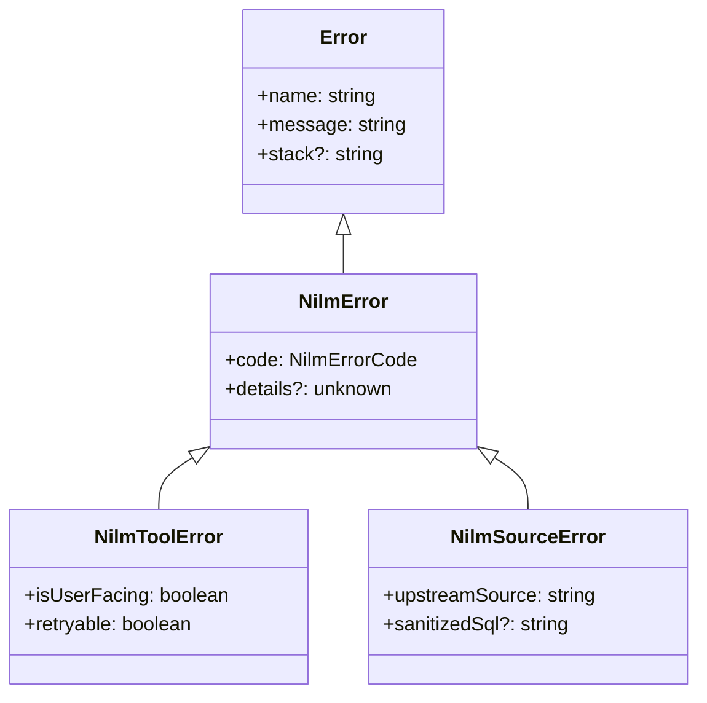

# NILM 工厂端 AI Agent 详细设计说明书（阶段 0：基础设施、数据源适配与生产沙箱）

## 0. 模块导读与设计基线

- **业务需求基线**：[docs/nilm-ai-agent-requirements.md](file:///home/picohood/projects/opensource/deepseek-harness/docs/nilm-ai-agent-requirements.md)
- **系统架构方案**：[docs/nilm-ai-agent-architecture.md](file:///home/picohood/projects/opensource/deepseek-harness/docs/nilm-ai-agent-architecture.md)
- **概要设计规范**：[docs/nilm-ai-agent-high-level-design.md](file:///home/picohood/projects/opensource/deepseek-harness/docs/nilm-ai-agent-high-level-design.md)
- **开发任务书**：[docs/nilm-ai-agent-development-plan.md](file:///home/picohood/projects/opensource/deepseek-harness/docs/nilm-ai-agent-development-plan.md) §2 阶段 0
- **涵盖代码包**：
  - `packages/nilm/core/`（领域类型基座、品牌 ID、错误体系与质量规范）
  - `packages/nilm/context/`（调用方上下文绑定服务与内存生命周期）
  - `packages/nilm/source/`（本地 MySQL 17 张表 DDL、上游只读仓储与白名单拦截器）
  - `packages/bundle/nilm-app/`（生产专用沙箱 Bundle、`cordis.patch.yml` 与启动门禁）

本文档详细阐述阶段 0 的类设计、数据结构、SQL 物理实现、只读防护策略与沙箱验证机制，为后续领域服务提供稳定安全的基础设施。

---

## 1. 领域类型基座与实体设计（`packages/nilm/core`）

### 1.1 品牌化不透明标识符（Branded IDs）

为了防止裸 `string` 导致的跨边界参数错传（例如将 `terminalId` 误传为 `channelId`），系统在 `src/ids.ts` 中基于 TypeScript 标称类型（Nominal Typing）定义了不可伪造的品牌 ID：

```ts
// packages/nilm/core/src/ids.ts
declare const BrandSymbol: unique symbol

export type Branded<T, B extends string> = T & { readonly [BrandSymbol]: B }

export type TenantId = Branded<string, 'TenantId'>
export type WorkshopId = Branded<string, 'WorkshopId'>
export type TerminalId = Branded<string, 'TerminalId'>
export type ChannelId = Branded<string, 'ChannelId'>
export type ApplianceId = Branded<string, 'ApplianceId'>
export type ConversationId = Branded<string, 'ConversationId'>
export type SessionId = Branded<string, 'SessionId'>
export type TurnId = Branded<string, 'TurnId'>

export function asTenantId(value: string): TenantId {
  if (!value || typeof value !== 'string') throw new Error('Invalid TenantId')
  return value as TenantId
}
```

### 1.2 统一结构化错误体系（Errors）

错误系统在 `src/errors.ts` 中实现层次化继承结构，严禁直接向模型或前端抛出未受控的底层堆栈：



核心错误码枚举（`NilmErrorCode`）：
- `TENANT_CONTEXT_UNAVAILABLE`：会话缺少调用方上下文绑定；
- `SCOPE_FORBIDDEN`：请求范围超出调用方权限上限；
- `UNAUTHORIZED_SQL_OPERATION`：尝试执行非 SELECT 或非白名单表操作；
- `UPSTREAM_TIMEOUT`：上游数据源响应超时（热库 >3s、冷代理 >5s）；
- `DATA_UNAVAILABLE`：指定时间窗口内无有效采集数据。

### 1.3 核心数据结构与契约

```ts
// packages/nilm/core/src/types.ts
export type ScopeLevel = 'factory' | 'workshop' | 'terminal' | 'channel' | 'appliance'

export interface ScopeTarget {
  level: ScopeLevel
  id?: string
  name?: string
  path?: string
}

export interface TimeRangeSpec {
  start: string        // ISO 8601 带时区
  end: string          // 左闭右开
  timeZone: 'Asia/Shanghai'
  granularity: 'second' | 'minute' | '15min' | 'hour' | 'day' | 'month'
}

export interface NilmDataQuality {
  coverage: number     // 采样完整率 0.0 ~ 1.0
  lastSampleAt?: string
  provisional: boolean // 数据是否暂定未稳定
  gaps: Array<{ start: string; end: string; reason: string }>
  source: 'preaggregated' | 'raw' | 'cold' | 'mixed'
  warnings: string[]
}
```

---

## 2. 上下文绑定服务设计（`packages/nilm/context`）

### 2.1 内存生命周期管理

`NilmContextService` 负责在 BFF 与 Agent 执行期间管理租户安全上下文。`CallContext` 包含租户标识与授权范围，绝不进入 Tool 参数，模型无法读取和篡改：

```ts
// packages/nilm/core/src/types.ts
export interface CallContext {
  readonly tenantId: TenantId
  readonly userRef: string
  readonly allowedScope?: readonly ScopeTarget[]
  readonly requestId: string
  readonly sessionId: SessionId
}
```

### 2.2 服务接口与线程安全实现

```ts
// packages/nilm/context/src/index.ts
import { Service, Context } from '@deepseek-ai/cordis'
import { NilmToolError, type CallContext } from '@deepseek-ai/dsh-nilm-core'

export class NilmContextService extends Service {
  private readonly store = new Map<string, CallContext>()

  constructor(ctx: Context) {
    super(ctx, 'nilmContext', true)
  }

  public bind(agentId: string, callContext: CallContext): () => void {
    this.store.set(agentId, Object.freeze({ ...callContext }))
    return () => this.revoke(agentId)
  }

  public require(agentId: string): CallContext {
    const ctx = this.store.get(agentId)
    if (!ctx) throw new NilmToolError('TENANT_CONTEXT_UNAVAILABLE', '调用上下文已失效或未绑定')
    return ctx
  }

  public revoke(agentId: string): void {
    this.store.delete(agentId)
  }
}
```

---

## 3. 本地持久化与上游只读仓储设计（`packages/nilm/source`）

### 3.1 本地 MySQL `nilm_system` 数据库物理架构

系统通过独立的 SQL 脚本 `sql/init-nilm-system.sql` 维护 17 张本地业务与审计表。关键表设计原则如下：
1. **主键与唯一索引强制包含 `tenant_id`**，确保多租户数据逻辑硬隔离；
2. **敏感字段落盘加密**：用户原始提问与接收者手机号/OpenID 采用 `VARBINARY` 存储 AES-GCM 密文；
3. **前缀长度防御**：所有参与唯一索引的动态键（如 `dedupe_key`）限制为 `VARCHAR(191)`，完美规避 utf8mb4 下 767 字节的前缀限制。

```sql
-- 租户运行配置表
CREATE TABLE `nilm_tenant_config` (
  `tenant_id` VARCHAR(64) NOT NULL,
  `tenant_name` VARCHAR(128) NOT NULL,
  `status` TINYINT NOT NULL DEFAULT 1,
  `work_calendar_type` VARCHAR(32) NOT NULL DEFAULT 'standard_industrial',
  `work_hours_json` JSON NOT NULL,
  `non_work_baseline_kw` DECIMAL(10, 2) NOT NULL DEFAULT 0.00,
  `config_version` INT UNSIGNED NOT NULL DEFAULT 1,
  PRIMARY KEY (`tenant_id`)
) ENGINE=InnoDB DEFAULT CHARSET=utf8mb4;

-- 轮次审计表 (提问加密存储)
CREATE TABLE `nilm_turn_log` (
  `id` BIGINT UNSIGNED NOT NULL AUTO_INCREMENT,
  `turn_id` VARCHAR(64) NOT NULL,
  `conversation_id` VARCHAR(64) NOT NULL,
  `tenant_id` VARCHAR(64) NOT NULL,
  `user_ref` VARCHAR(64) NOT NULL,
  `client_message_id` VARCHAR(64) NOT NULL,
  `user_query_ciphertext` VARBINARY(4096) DEFAULT NULL,
  `user_query_digest` CHAR(64) DEFAULT NULL,
  PRIMARY KEY (`id`),
  UNIQUE KEY `uk_client_msg` (`tenant_id`, `user_ref`, `client_message_id`)
) ENGINE=InnoDB DEFAULT CHARSET=utf8mb4;
```

### 3.2 SQL 安全防御引擎（`SqlGuard`）

为防止代码漏洞或模型注入导致写穿上游数据库，`packages/nilm/source/src/sql-guard.ts` 实现了 AST 级与正则双重校验机制：
1. **语句类型限制**：只允许 `SELECT` 语句；任何包含 `INSERT`, `UPDATE`, `DELETE`, `DROP`, `ALTER`, `TRUNCATE` 或多语句拼接（分号 `;`）的查询一律就地拒绝；
2. **表白名单校验**：只能读取明确授权的上游表（如 `nilmd_basic_info`, `nilmd_channel_basic_info`, `nilm_unsafe_record`, `appliance_category`）；
3. **强制参数化**：所有动态条件必须走预编译参数（`?` 占位符），严禁拼接字符串。

```ts
// packages/nilm/source/src/sql-guard.ts
export class SqlGuard {
  private static readonly ALLOWED_TABLES = new Set([
    'sys_tenant_info', 'nilmd_basic_info', 'nilmd_channel_basic_info',
    'nilm_unsafe_record', 'appliance_category'
  ])

  public static assertSafeSelect(sql: string, params: unknown[]): void {
    const normalized = sql.trim().toUpperCase()
    if (!normalized.startsWith('SELECT')) {
      throw new NilmSourceError('UNAUTHORIZED_SQL_OPERATION', '只允许执行只读 SELECT 查询')
    }
    if (sql.includes(';')) {
      throw new NilmSourceError('UNAUTHORIZED_SQL_OPERATION', '禁止多语句拼接')
    }
    // 表名白名单检查...
  }
}
```

### 3.3 数据源仓储多实例解耦

在 `packages/nilm/source/src/` 中，系统对不同特性的数据源建立了物理隔离的客户端仓储：
1. **上游 MySQL 仓储（`MysqlRepository`）**：封装针对只读用户（`readonly_user`）的连接池，参数通过 `NILM_UPSTREAM_MYSQL_*` 环境变量注入；
2. **上游 TDengine 热库仓储（`TdengineHotRepository`）**：独立连接串 `NILM_UPSTREAM_TDENGINE_HOT_URL`，专用于提取秒级/分钟级原始遥测超表；
3. **上游 TDengine 预聚合库仓储（`TdengineStatsRepository`）**：独立连接串 `NILM_UPSTREAM_TDENGINE_STATS_URL`，专用于查询日/小时统计超表（`consum_energy_day_statistics_info`），绝不与热库混用；
4. **冷代理受控客户端（`ColdProxyClient`）**：通过 `NILM_COLD_PROXY_URL` 请求内网受控代理，强制设置 5 秒超时保护。

---

## 4. 生产沙箱 Bundle 组装与门禁（`packages/bundle/nilm-app`）

### 4.1 `cordis.patch.yml` 逐项剥离裁剪

基于 `sdk-minimal` 的完整配置树，系统生成了仅包含 NILM 必要组件的生产 Patch 清单。完全剔除了与工业能耗问答无关或存在安全逃逸风险的插件：

```yaml
# packages/bundle/nilm-app/cordis.patch.yml
# 显式禁止加载的宿主公共插件:
- id: cordis/shell
  disabled: true
- id: cordis/filesystem
  disabled: true
- id: cordis/mcp-client
  disabled: true
- id: cordis/web-tools
  disabled: true
- id: cordis/subagent
  disabled: true
- id: deepseek-llm-api-extensions
  disabled: true
- id: session-log-deepseek
  disabled: true
- id: plugin-package-inventory-deepseek
  disabled: true

# 启用的业务领域服务:
- id: nilm/core
- id: nilm/context
- id: nilm/source
- id: nilm/assets
- id: nilm/timeseries
- id: nilm/analytics
- id: nilm/tariff
- id: nilm/safety
- id: nilm/tools
- id: nilm/prompt
- id: nilm/service
```

### 4.2 启动断言与工具清单门禁

在 `packages/bundle/nilm-app/tests/guard.spec.ts` 中，通过在测试环境下加载 Bundle，反射扫描运行时环境的工具列表，强制断言：
1. 绝对不存在 `bash`, `read_file`, `write_file`, `edit_file`, `web_search`, `subagent`, `mcp` 等高危工具；
2. 运行时仅暴露经过审核的 `nilm_*` 业务工具集；
3. 容器能够接收 `SIGTERM` 信号并在 3 秒内干净退出。

---

## 5. 阶段 0 成果验证与客观证据门

阶段 0 的验收必须通过以下 4 项确定性测试，产出运行证据：

| 证据门编号 | 验收项 | 测试文件与自动化命令 | 通过判定标准 |
| :---: | :--- | :--- | :--- |
| **G0-1** | 真实数据源连通性 | `pnpm --filter @deepseek-ai/dsh-nilm-source test:connectivity` | 成功连接 MySQL 读取到租户，成功连接 TDengine 读取到核心超表；冷代理探活通过；总耗时 < 1000ms |
| **G0-2** | 只读安全拦截防护 | `packages/nilm/source/tests/sql-guard.spec.ts` | 构造 INSERT、UPDATE、DROP 及非法表查询，被 `SqlGuard` 100% 拦截抛出异常 |
| **G0-3** | 生产沙箱工具白名单 | `packages/bundle/nilm-app/tests/guard.spec.ts` | 运行时扫描发现的危险工具数为 0；非白名单插件数为 0 |
| **G0-4** | 假模型无损启动冒烟 | `pnpm dsh --profile nilm`（Dummy LLM 配置） | 进程顺利完成 Context 注入，响应最小 SDK 请求，SIGTERM 正常退出（exit code 0） |
