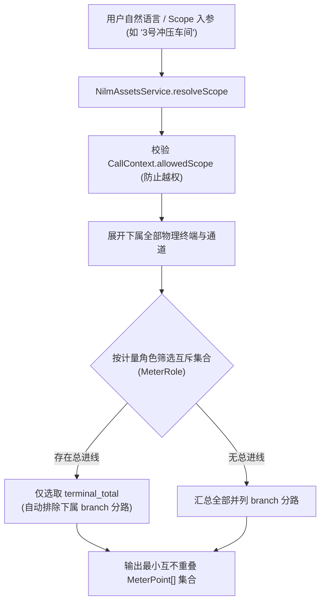
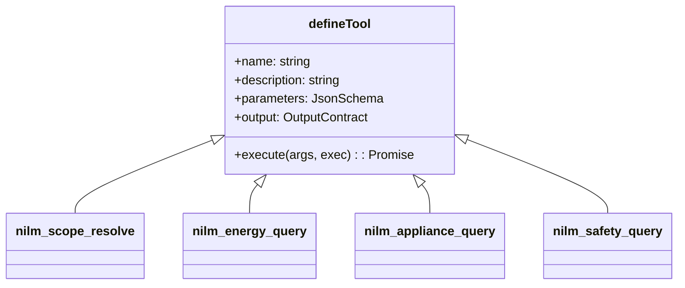
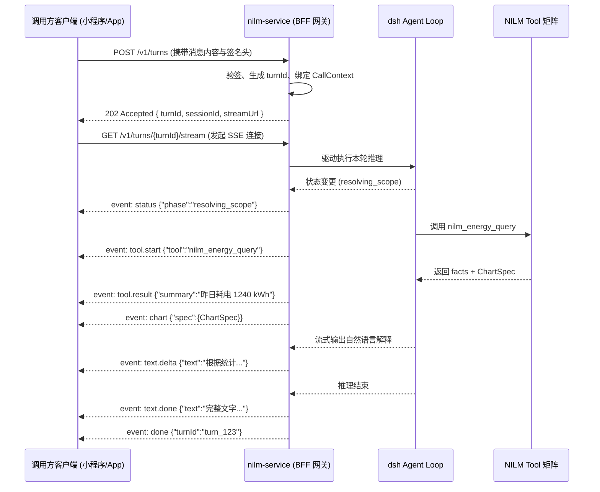

# NILM 工厂端 AI Agent 详细设计说明书（阶段 1：问答核心链路、拓扑展开与确定性计算）

## 0. 模块导读与设计基线

- **业务需求基线**：[docs/nilm-ai-agent-requirements.md](./nilm-ai-agent-requirements.md) §FR-1, §FR-2, §FR-3
- **系统架构方案**：[docs/nilm-ai-agent-architecture.md](./nilm-ai-agent-architecture.md) §4.3, §5.4, §6
- **概要设计规范**：[docs/nilm-ai-agent-high-level-design.md](./nilm-ai-agent-high-level-design.md) §3, §4, §5, §6
- **开发任务书**：[docs/nilm-ai-agent-development-plan.md](./nilm-ai-agent-development-plan.md) §3 阶段 1
- **涵盖代码包**：
  - `packages/nilm/assets/`（五级资产拓扑展开、计量点角色与互斥防重聚合）
  - `packages/nilm/timeseries/`（热库/统计库/冷代理三级路由、降采样与质量元数据）
  - `packages/nilm/tariff/` & `packages/nilm/analytics/`（分时电价纯函数、设备运行时长去抖、同比环比）
  - `packages/nilm/safety/`（电气安全记录检索与详情投影）
  - `packages/nilm/tools/`（4 个基础 defineTool 业务工具矩阵）
  - `packages/nilm/prompt/`（跨租户通用稳定基座提示词）
  - `packages/nilm/service/`（BFF REST API、HMAC-SHA256 签名验签与两阶段 SSE 协议）

本文档详细阐述被动问答（Pull 模式）端到端主链路的算法设计、纯函数计算逻辑、Tool 矩阵交互规范以及前后端流式传输协议。

---

## 1. 五级拓扑展开与计量点互斥防重聚合设计（`packages/nilm/assets`）

### 1.1 资产拓扑树解析与授权校验

`NilmAssetsService` 基于本地 `nilm_asset_snapshot` 快照表，屏蔽多终端物理接线复杂性，将工厂、车间、终端、通道与细分用电设备统一解析为领域实体：



### 1.2 计量点角色定义与防重复聚合算法

```ts
// packages/nilm/core/src/types.ts
export type MeterRole = 'terminal_total' | 'branch' | 'appliance' | 'reference'

export interface MeterPoint {
  terminalId: TerminalId
  channelId: ChannelId
  role: MeterRole
  parentChannelId?: ChannelId
}
```

**算法核心逻辑（`resolveMeterSet`）**：
1. **父子互斥合并**：如果一个车间内包含监测总进线的终端通道（`role === 'terminal_total'`），系统**仅选取该总进线通道**，严格剔除挂载在其下属的全部支路（`branch`），彻底杜绝单点双算；
2. **缺失总线聚合**：当车间无总进线时，自动汇总所有并列的 `branch` 支路；
3. **器具与参考点隔离**：`appliance`（细分电器）仅用于设备工况分析，严禁混入电量电费汇总；`reference`（参考点）仅用于数据质量交叉校验；
4. **父子计量偏差预警**：当同时采集总线与各支路时，计算 $\delta = \left| P_{\text{total}} - \sum P_{\text{branch}} \right| / P_{\text{total}}$。若 $\delta > \text{threshold}$（从 `nilm_tenant_config` 读取，默认 1%），在 `NilmDataQuality.warnings` 中注入 `aggregationWarning`，绝不静默相加。

---

## 2. 时序数据路由、降采样与质量评估（`packages/nilm/timeseries`）

### 2.1 三级存储查询路由策略

`NilmTimeseriesService` 根据时间跨度与粒度自动执行路由，上层业务层无需感知数据物理存储位置：

| 查询粒度与时段 | 目标数据源 | 查询特征与约束 | 失败策略 |
| :--- | :--- | :--- | :--- |
| **秒级 / 分钟级瞬时点** (≤90 天) | TDengine 热库 (`nilmdc_realtime_data`) | 点数上限 2,000 点；超时 3 秒 | 超出自动在服务层降采样；超时抛 `UPSTREAM_TIMEOUT` |
| **日 / 周 / 月聚合电量** (≤90 天) | TDengine 统计库 (`consum_energy_day_statistics_info`) | 优先读取预聚合表，避开原始表全扫描；超时 2 秒 | 降级查小时表重算 |
| **长周期历史数据** (>90 天) | 内网冷库只读代理 (`NILM_COLD_PROXY_URL`) | 仅允许受控聚合模板；单次最多 13 个月；超时 5 秒 | 标注 `source: 'cold'`；失败返回 `COLD_LINK_UNAVAILABLE` |

### 2.2 降采样算法与图表契约控制

为了保护客户端浏览器与微信小程序的渲染性能，后端建立两级点数安全门禁：
1. **服务层原始拉取上限**：单次从时序数据库最多提取 2,000 个原始点；
2. **图表交付上限（LTTB 降采样）**：交付给前端 ECharts 渲染的数据序列严格控制在 **500 点以内**。采用最大三角形三月算法（Largest-Triangle-Three-Buckets, LTTB）在保留波形极值特征的同时平滑压缩点数；
3. **缺口断档标注**：当采样缺失超过采样间隔的 3 倍时，在时序数组中填入 `null`，客户端渲染为断线，严禁补零。

---

## 3. 分时电价与纯函数计算引擎（`packages/nilm/analytics` & `tariff`）

系统坚持“所有数值由 TypeScript 纯函数确定性计算，模型零算术介入”的红线。

### 3.1 分时电价切片纯函数（`calculateEnergyCosts`）

纯函数接收结构化的能耗时间桶数组（`EnergyBucket[]`）与电价时段切片（`TariffSlice[]`），根据日历与时段执行精确匹配计算：

```ts
// packages/nilm/analytics/src/index.ts
export interface TariffSlice {
  startHour: number
  startMinute: number
  endHour: number
  endMinute: number
  periodType: 'sharp' | 'peak' | 'flat' | 'valley'
  pricePerKwh: number
}

export function calculateEnergyCosts(
  buckets: readonly EnergyBucket[],
  slices: readonly TariffSlice[]
): CostBreakdown {
  let sharpKwh = 0, peakKwh = 0, flatKwh = 0, valleyKwh = 0
  let sharpCost = 0, peakCost = 0, flatCost = 0, valleyCost = 0

  for (const bucket of buckets) {
    const slice = findMatchingSlice(bucket.timestamp, slices)
    const kwh = Math.max(0, bucket.activeKwh) // 负增量按 0 处理
    switch (slice.periodType) {
      case 'sharp': sharpKwh += kwh; sharpCost += kwh * slice.pricePerKwh; break
      case 'peak':  peakKwh += kwh;  peakCost += kwh * slice.pricePerKwh; break
      case 'flat':  flatKwh += kwh;  flatCost += kwh * slice.pricePerKwh; break
      case 'valley': valleyKwh += kwh; valleyCost += kwh * slice.pricePerKwh; break
    }
  }
  return {
    totalKwh: sharpKwh + peakKwh + flatKwh + valleyKwh,
    totalCost: sharpCost + peakCost + flatCost + valleyCost,
    breakdown: {
      sharp: { kwh: sharpKwh, cost: sharpCost },
      peak:  { kwh: peakKwh,  cost: peakCost },
      flat:  { kwh: flatKwh,  cost: flatCost },
      valley:{ kwh: valleyKwh,cost: valleyCost },
    }
  }
}
```

### 3.2 设备运行与空载时长去抖算法（`calculateRunningAndIdleTime`）

由于现场存在设备接触器抖动和短时采样中断，算法引入双重保护机制：
1. **最小状态驻留过滤（`minDwellMs`）**：短于 30 秒的状态翻转视为噪声并自动合并；
2. **采样断档扣除**：若采样间隔中断超过阈值（`gapThresholdMs = 15m`），该中断区间一律归类为“离线/断档”，严禁推断为持续运行；
3. **空载浪费电费估算**：$C_{\text{idle}} = P_{\text{idle\_kw}} \times \frac{T_{\text{idle\_min}}}{60} \times \text{Price}_{\text{period}}$。

---

## 4. 业务 Tool 矩阵设计与执行规格（`packages/nilm/tools`）

Tool 是大模型与领域服务交互的唯一通道。阶段 1 交付 4 个核心 Tool：



### 4.1 Tool 规格表

| Tool 名称 | 入参 Schema 关键属性 | 核心后端调用 | 返回模型事实 (facts) | 挂载前端呈现 (presentationMeta) |
| :--- | :--- | :--- | :--- | :--- |
| `nilm_scope_resolve` | `query: string`, `level?: enum` | `assets.resolveScope` | 候选清单、歧义标记、完整路径 | 无 |
| `nilm_energy_query` | `scope: obj`, `timeRange: obj`, `compare?: enum` | `analytics.queryEnergy` | 总电量、峰平谷电量电费、对比百分比 | 柱状/折线趋势 `ChartSpec`、`DataQuality` |
| `nilm_appliance_query`| `scope: obj`, `timeRange: obj`, `category?: str` | `analytics.queryAppliances` | 设备运行时长、空载时长、浪费金额 | 设备运行甘特图 `ChartSpec` |
| `nilm_safety_query` | `scope: obj`, `timeRange: obj`, `severity?: str` | `safety.queryUnsafe` | 隐患事件列表、越限点位、发生时间 | 告警卡片 `AlertCard` 列表 |

### 4.2 严格防幻觉与输出体积收敛
- **Schema 封闭性**：所有参数和输出对象强制声明 `additionalProperties: false`；
- **体积限制**：交付给模型的 `facts` 经精炼压缩，严格控制在 **20 KB 以内**，原始长时序坐标绝不灌入 LLM 上下文；
- **只读并发安全**：所有 Tool 声明 `isConcurrencySafe: () => true`，支持同一轮并发调度。

---

## 5. BFF 网关、认证验签与两阶段 SSE 协议（`packages/nilm/service`）

### 5.1 HMAC-SHA256 规范化验签协议

为保证调用方的不可否认性与防篡改，BFF 在收到非 mTLS 请求时，必须严格执行规范化签名校验：

```text
canonical_string =
  HTTP_METHOD + "\n" +
  PATH + "\n" +
  HEX(SHA256(REQUEST_BODY)) + "\n" +
  X-Nilm-Tenant-Id + "\n" +
  X-Nilm-User-Ref + "\n" +
  X-Nilm-Allowed-Scope (缺省填空串) + "\n" +
  X-Nilm-Request-Id + "\n" +
  X-Nilm-Timestamp + "\n" +
  X-Nilm-Nonce
```

**校验与绑定流程**：
1. 校验 `|当前时间 - Timestamp| ≤ 300s`，防止过期重放；
2. 校验 Redis 中是否存在该 `Nonce`；若不存在，以 10 分钟 TTL 写入；若已存在，立即拒绝（`401 Unauthorized`）；
3. 计算 HMAC-SHA256 签名，比对 Header `X-Nilm-Signature`；
4. 验签成功后，在内存中创建不可变 `CallContext` 并绑定至会话。**请求体中携带的 `tenant_id` 一律忽略**，记录安全审计。

### 5.2 两阶段异步交互与 SSE 事件时序



---

## 6. 阶段 1 成果验证与客观证据门

阶段 1 必须通过以下 4 项确定性测试，产出运行证据：

| 证据门编号 | 验收项 | 自动化测试命令与文件 | 通过判定标准 |
| :---: | :--- | :--- | :--- |
| **G1-1** | 纯函数计算 100% 覆盖 | `pnpm --filter @deepseek-ai/dsh-nilm-analytics test` | `analytics/src/*.ts` 单测覆盖率达到 **100%**；边界切片、负增量、断档去抖用例全绿 |
| **G1-2** | 拓扑展开与防重聚合 | `packages/nilm/assets/tests/assets.spec.ts` | 输入实际车间，下属通道展开无遗漏；总进线与分路互斥，无双算；父子偏差 >1% 正确报警 |
| **G1-3** | 双租户越权与签名闭环 | `packages/nilm/service/tests/auth.spec.ts` | 伪造 Token、篡改 Header、重放 Nonce、请求跨租户资产 100% 被拦截，返回 401/403 |
| **G1-4** | 黄金问答集 Session 回放 | `pnpm test:snapshot -t nilm-golden-qa-p1` | 问答输出数据 100% 吻合 Tool 事实；无数据时不补零；图表符合 `ChartSpec v1` 格式 |
