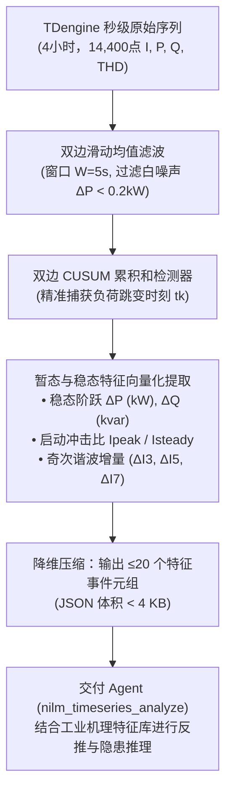

# NILM 工厂端 AI Agent 详细设计说明书（阶段 2：电能质量、CUSUM 秒级时序特征工程与算法协同）

## 0. 模块导读与设计基线

- **业务需求基线**：[docs/nilm-ai-agent-requirements.md](file:///home/picohood/projects/opensource/deepseek-harness/docs/nilm-ai-agent-requirements.md) §FR-2.4, §FR-3.4, §FR-4
- **系统架构方案**：[docs/nilm-ai-agent-architecture.md](file:///home/picohood/projects/opensource/deepseek-harness/docs/nilm-ai-agent-architecture.md) §1.2 (AD-12), §5.4, §6.8
- **概要设计规范**：[docs/nilm-ai-agent-high-level-design.md](file:///home/picohood/projects/opensource/deepseek-harness/docs/nilm-ai-agent-high-level-design.md) §3.3, §4.3, §5.2
- **开发任务书**：[docs/nilm-ai-agent-development-plan.md](file:///home/picohood/projects/opensource/deepseek-harness/docs/nilm-ai-agent-development-plan.md) §4 阶段 2
- **涵盖代码包**：
  - `packages/nilm/analytics/src/cusum.ts`（CUSUM 边沿检测纯函数算法与特征向量提取）
  - `packages/nilm/analytics/src/power-quality.ts`（能量加权功率因数测算与谐波含有率分析）
  - `packages/nilm/timeseries/`（秒级原始时序抽取与多通道对齐）
  - `packages/nilm/tools/src/`（`nilm_power_quality_query` 与 `nilm_timeseries_analyze` 工具）

本文档详细阐述秒级高频时序数据的特征提取算法数学模型、AI Agent 模式识别推理流水线以及微观电气隐患诊断机理。

---

## 1. 电能质量与力调测算引擎设计（`power-quality.ts`）

### 1.1 能量加权功率因数（Energy-Weighted PF）纯函数

国家电网力调电费考核采用基于有功与无功累计电量的加权功率因数，而非简单的瞬时平均值：

$$\text{PF}_{\text{weighted}} = \frac{E_p}{\sqrt{E_p^2 + E_q^2}}$$

```ts
// packages/nilm/analytics/src/power-quality.ts
export function calculateEnergyWeightedPF(activeKwh: number, reactiveKvarh: number): number | undefined {
  if (activeKwh <= 0) return undefined
  const apparentKvah = Math.sqrt(activeKwh * activeKwh + reactiveKvarh * reactiveKvarh)
  return apparentKvah > 0 ? Number((activeKwh / apparentKvah).toFixed(4)) : undefined
}
```

### 1.2 2~7 次谐波含有率与畸变分析

根据上游 TDengine 实际可得的谐波字段（`ih1`, `ih2`, `ih3`, `ih5`, `ih7`），系统建立严格的逐阶次可用性模型：
1. **基波与谐波分离**：各次谐波含有率 $\text{HR}_h = \frac{I_h}{I_1} \times 100\%$；
2. **总谐波畸变率估算**：$\text{THD-I}_{\text{approx}} = \frac{\sqrt{\sum_{h=2}^7 I_h^2}}{I_1}$；
3. **缺失阶次说明**：若上游暂缺 4/6 次偶次谐波，接口显式返回 `null` 并说明“该通道未提供4/6次分量”，绝不虚构完整 THD。

---

## 2. CUSUM 边沿突变检测与时序特征工程算法（`cusum.ts`）

### 2.1 算法架构与两阶段协同模型（AD-12）

针对单通道 1 小时 3,600 点、4 小时超 40,000 个浮点数的密集矩阵，系统坚持两阶段计算协同：



### 2.2 双边 CUSUM 边沿突变检测数学模型

设输入功率序列为 $P_t$，滑动窗口滤波后为 $\bar{P}_t$。构造累积和统计量 $S_t^+$（上升台阶）与 $S_t^-$（下降台阶）：

$$S_t^+ = \max\left(0, S_{t-1}^+ + (\bar{P}_t - \bar{P}_{t-1}) - \delta\right)$$
$$S_t^- = \max\left(0, S_{t-1}^- - (\bar{P}_t - \bar{P}_{t-1}) - \delta\right)$$

- 其中 $\delta$ 为漂移容忍阈值（设为 $0.2\,\text{kW}$，滤除小幅工业抖动）；
- 当 $S_t^+ \ge h$（决策门限，如 $0.8\,\text{kW}$）时，触发启机上升沿事件，记录触发点 $t_k$，并将统计量归零；
- 当 $S_t^- \ge h$ 时，触发停机下降沿事件。

### 2.3 特征元组数据结构

```ts
// packages/nilm/core/src/types.ts
export interface TimeSeriesEdgeEvent {
  timestamp: string
  deltaActivePowerKw: number     // 有功阶跃量 ΔP
  deltaReactivePowerKvar: number // 无功阶跃量 ΔQ
  inrushCurrentRatio: number     // 暂态启动冲击比 Ipeak / Isteady
  steadyDurationSec: number      // 稳态持续时长
  phaseOffset: 'A' | 'B' | 'C' | 'three_phase_balanced'
  harmonicDelta: {
    thdCurrent: number           // ΔTHD-I
    harmonics: Array<{ order: HarmonicOrder; deltaRatio: number }>
  }
}
```

---

## 3. AI Agent 算法协同推理与微观隐患研判（`nilm_timeseries_analyze`）

### 3.1 电器逆向反推（Disaggregation）

Agent 通过调用 `nilm_timeseries_analyze` 获取紧凑事件特征集后，与 MySQL `appliance_category` 只读视图及工业特征库对齐：

1. **启停成对因果匹配**：
   - 若 $t_1$ 发生 $\Delta P_1 \approx +15.2\,\text{kW}$，在持续运行 42 分钟后（$t_2$）发生 $\Delta P_2 \approx -15.1\,\text{kW}$，判定为同一个设备的工作循环；
2. **电气特征向量对齐**：
   - 启动冲击比 $I_{\text{peak}} / I_{\text{steady}} \approx 6.2$ 倍 ➔ 判定为三相异步电机直启；
   - 冲击比 $\approx 1.05$ 倍且无功阶跃 $\Delta Q \approx 0$ ➔ 判定为纯阻性加热元件；
   - 伴随 $\Delta I_3, \Delta I_5$ 明显增量 ➔ 判定为晶闸管整流器或变频驱动负载；
3. **输出候选格式**：包含 `candidate`、`confidence`（高/中/低）、`evidence`（引用具体的 $\Delta P$、冲击倍数、谐波值）与 `residualRatio`。

### 3.2 四类微观电气隐患诊断机理

| 隐患类型 | 识别规则与判定门槛 | 物理成因与现场风险 | 处置建议 |
| :--- | :--- | :--- | :--- |
| **高频启停冲击** | 同一负荷在 10 分钟内启停次数 $\ge 5$ 次 | 温控开关触点打火粘连、气压开关滞环过窄、水泵频繁打压；导致绕组绝缘热过载烧毁 | 检查压力开关/温控器设定死区，检查继电器触点 |
| **重载憋死 / 启动迟滞** | 电机启动冲击电流持续时间 $> 8$ 秒未回落至稳态 | 传动皮带过紧、机械轴承抱死、带载带压启动；启动转矩不足导致堵转跳闸 | 停机检查电机转子机械卡阻，检查软启旁路 |
| **动态三相严重不平衡** | 负荷阶跃投入后，三相不平衡度跃升至 $> 15\%$ | 乱接大功率 220V 单相焊机/电热管，或三相接触器单相接触不良缺相 | 均衡调整相间单相负载，紧固接触器接线端子 |
| **谐波骤增与谐振隐患** | 负荷投入后 5/7 次谐波骤增，伴随功率因数剧烈震荡 | 大功率变频设备投入导致电网阻抗并联谐振，电容器组局部过电流击穿 | 检查无功补偿电容支路串联电抗率，加装滤波器 |

---

## 4. ECharts 秒级波形标注受控协议（`ChartSpec v1 annotations`）

为了在直观展示高频波形的同时避免将底层图表配置泄露给模型，系统规定了受控的 `ChartSpec v1` 格式：

```ts
// packages/nilm/core/src/types.ts
export interface ChartSpec {
  version: 1
  type: 'line'
  title: string
  unit: 'kW' | 'A'
  series: Array<{
    name: string
    data: Array<number | null> // 经 LTTB 降采样后不超过 500 点
  }>
  annotations?: Array<{
    at: string | number        // 触发事件的 X 轴坐标/时间戳
    label: string              // 如 "15kW 空压机启动"
    severity?: 'info' | 'warning' | 'critical'
  }>
}
```

客户端接收到 `annotations` 后，由调用方客户端自行映射为 ECharts 的 `markLine` 或 `markPoint` 渲染，前后端协议高度解耦。

---

## 5. 阶段 2 成果验证与客观证据门

阶段 2 必须通过以下 4 项确定性测试，产出运行证据：

| 证据门编号 | 验收项 | 自动化测试命令与文件 | 通过判定标准 |
| :---: | :--- | :--- | :--- |
| **G2-1** | 边沿突变算法精度验证 | `pnpm --filter @deepseek-ai/dsh-nilm-analytics test:cusum` | 在含有白噪声的仿真波形上，启停边沿召回率 $\ge 98\%$，精确率 $\ge 95\%$；冲击比误差 $< 2\%$ |
| **G2-2** | 4小时时序查询与降维耗时 | `pnpm test:perf:timeseries` | 从 TDengine 抽取 14,400 秒点，特征提取与降维总耗时 **p95 < 2.5 秒**；输出体积严格 **< 4 KB** |
| **G2-3** | 四类微观隐患模式识别 | `packages/nilm/analytics/tests/cusum.spec.ts` | 4 组微观隐患用例全部被准确命中，成因推断必须引用至少 2 个来自 Tool 的结构化事实证据 |
| **G2-4** | 波形渲染协议格式校验 | `packages/nilm/tools/tests/tools.spec.ts` | 输出的 `presentationMeta.chart` 符合 `ChartSpec v1`，数据点 $\le 500$，事件标线位于 `annotations` |
