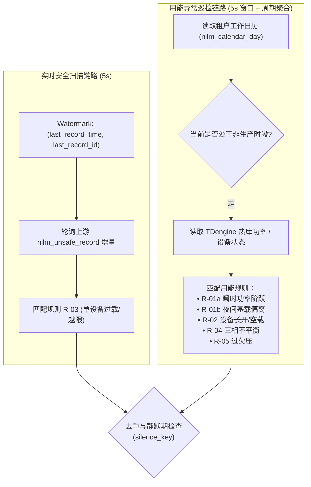
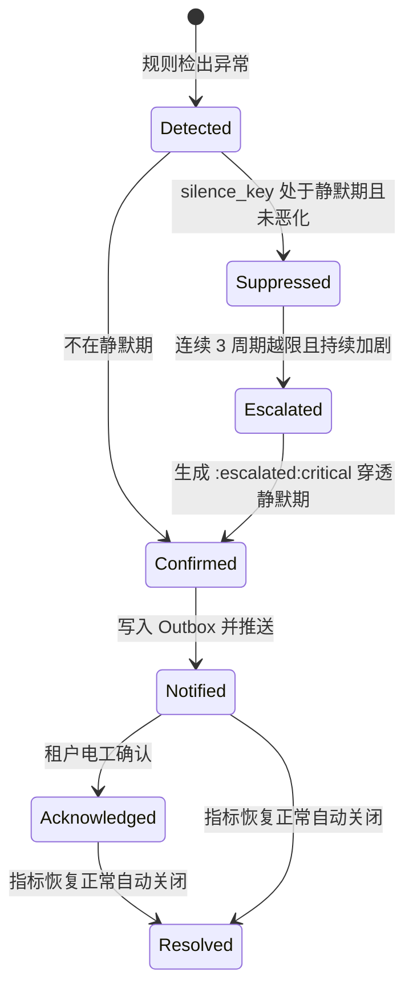
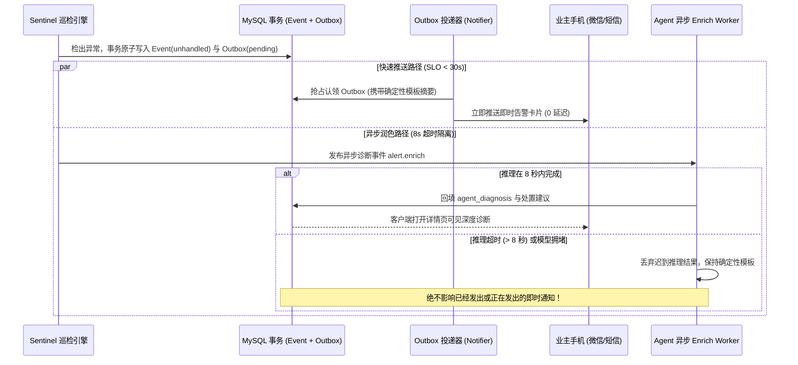

# NILM 工厂端 AI Agent 详细设计说明书（阶段 3：主动巡检引擎、Sentinel 规则与 Outbox 可靠通知）

## 0. 模块导读与设计基线

- **业务需求基线**：[docs/nilm-ai-agent-requirements.md](file:///home/picohood/projects/opensource/deepseek-harness/docs/nilm-ai-agent-requirements.md) §FR-5
- **系统架构方案**：[docs/nilm-ai-agent-architecture.md](file:///home/picohood/projects/opensource/deepseek-harness/docs/nilm-ai-agent-architecture.md) §4.4, §8
- **概要设计规范**：[docs/nilm-ai-agent-high-level-design.md](file:///home/picohood/projects/opensource/deepseek-harness/docs/nilm-ai-agent-high-level-design.md) §2.4, §7
- **开发任务书**：[docs/nilm-ai-agent-development-plan.md](file:///home/picohood/projects/opensource/deepseek-harness/docs/nilm-ai-agent-development-plan.md) §5 阶段 3
- **涵盖代码包**：
  - `packages/nilm/sentinel/`（5秒增量安全扫描、日历基线、R-01~R-05 规则引擎、抑制升级状态机）
  - `packages/nilm/notify/`（Outbox 并发调度器、四渠道适配、分级指数退避、Agent 异步研判）
  - `packages/nilm/source/src/transaction.ts`（告警事件与 Outbox 原子事务管理器）
  - `packages/nilm/service/`（告警查询与用户确认确认端点）

本文档详细阐述主动巡检（Push 模式）全链路的检测机理、抑制状态机流转、Outbox 抢占调度算法以及端到端 30 秒告警触达 SLO 保障设计。

---

## 1. Sentinel 巡检引擎与规则匹配设计（`packages/nilm/sentinel`）

### 1.1 双检测链路与 5 秒增量水位线扫描

巡检服务划分为两条高低搭配的检测链路，二者均以确定性规则常驻执行，不依赖大模型判定：



### 1.2 规则目录与触发条件

| 规则编码 | 监测指标与数据源 | 触发条件（租户可配置） | 严重级别 | 抑制周期与升级策略 |
| :--- | :--- | :--- | :---: | :--- |
| **R-01a** | 车间总功率（TDengine 秒级点） | 非工作时段，连续 2 个 5 秒采样超过基载基准，且增量 $\Delta P > \text{step\_kw}$ | Warning | 10 分钟抑制；摘要给出小时级损失估算 |
| **R-01b** | 车间总功率（分时聚合点） | 非工作时段，功率超过历史 4 周同星期中位数 $+20\%$ 且持续 10 分钟 | Warning | 30 分钟抑制；连续 3 周期越限升级为 Critical |
| **R-02** | 设备运行状态与空载时长 | 非生产时段检测到大功率设备启动，或空载运行持续 $> 30$ 分钟 | Warning | 首次启动即刻提示；持续项 2 小时抑制 |
| **R-03** | 越限值（上游 `nilm_unsafe_record`）| 功率/电流超过额定安全阈值，或隐患类型标记为过载/漏电 | Critical | 10 分钟去重；**Critical 告警绝不受免打扰限制** |
| **R-04** | 三相电流（TDengine 遥测点） | 三相电流不平衡度 $> 15\%$，持续超过 5 分钟 | Warning | 30 分钟抑制 |
| **R-05** | 三相电压（TDengine 遥测点） | 电压偏差超过标称值 $\pm 10\%$（可配），持续 2 分钟 | Warning | 15 分钟抑制 |

---

## 2. 告警状态机、去重抑制与穿透升级设计

### 2.1 静默键与去重键深度解耦

为解决工业现场“告警风暴”与“告警漏报”的平衡难题，系统将跨窗口抑制与事件持久化完全解耦：

- **跨窗口静默抑制键（`silence_key`）**：
  $$\text{silence\_key} = \text{tenant\_id} + \text{rule\_id} + \text{scope\_id} + \text{metric}$$
  在静默期内（如 30 分钟），只要该键已被激活，后续脉冲一律抑制，不重复发通知打扰客户；
- **事件可溯源持久化键（`dedupe_key`）**：
  $$\text{dedupe\_key} = \text{silence\_key} + \text{bucket\_start}$$
  每次检测记录仍带上时间桶写入 `nilm_alert_event`，保证审计可查、趋势可溯。

### 2.2 告警升级穿透抑制机制



- **穿透逻辑**：当一个处于 Warning 抑制中的隐患连续 3 个周期越限幅度超过阈值 1.5 倍时，系统自动生成 `:escalated:critical` 后缀，强制打穿原有的静默抑制期，立即入队 Outbox 触发高危紧急推送。

---

## 3. Outbox 可靠投递调度器与渠道适配（`packages/nilm/notify`）

### 3.1 强一致性事务原子写入（`transaction.ts`）

当规则引擎触发告警时，必须确保**告警事件**与**待投递任务**在同一个数据库事务内提交，严防“产生告警但丢失通知”：

```ts
// packages/nilm/source/src/transaction.ts
export async function withTransaction<T>(
  pool: mysql.Pool,
  action: (conn: mysql.PoolConnection) => Promise<T>
): Promise<T> {
  const conn = await pool.getConnection()
  try {
    await conn.beginTransaction()
    const result = await action(conn)
    await conn.commit()
    return result
  } catch (err) {
    await conn.rollback()
    throw err
  } finally {
    conn.release()
  }
}
```

### 3.2 并发抢占调度算法（`SKIP LOCKED` 租约机制）

通知投递器（`nilm-notifier`）支持多节点水平扩展。为了避免多 Worker 争抢同一条通知任务引发重复推送，SQL 调度采用行级悲观锁与跳过锁机制：

```sql
SELECT * FROM nilm_notification_outbox
WHERE status IN ('pending', 'failed')
  AND next_retry_at <= NOW()
  AND (lease_expires_at IS NULL OR lease_expires_at < NOW())
ORDER BY id ASC
LIMIT 10
FOR UPDATE SKIP LOCKED;
```

- 成功认领任务的 Worker 立即将 `status` 置为 `sending`，设置 `lease_expires_at = NOW() + INTERVAL 60 SECOND`；
- 投递完成后将状态置为 `sent`，记录 `delivered_at`，并将结果归档至 `nilm_notification_record`（保留 180 天）；
- 投递语义为 **at-least-once（至少一次投递）**，各渠道载荷携带不可变的 `notification_id`，客户端据此幂等去重。

### 3.3 四渠道适配器设计

```ts
// packages/nilm/notify/src/channels.ts
export type NotificationChannel = 'wx_subscribe' | 'wx_template' | 'wecom_webhook' | 'sms'

export interface ChannelAdapter {
  readonly channel: NotificationChannel
  send(payload: NotificationPayload): Promise<ChannelSendResult>
}
```

1. **微信小程序订阅消息（`wx_subscribe`）**：调用微信服务接口，使用工厂端订阅模版；
2. **微信公众号/服务号模板（`wx_template`）**：用于跨时段的主动告警卡片推拉；
3. **企业微信机器人（`wecom_webhook`）**：向车间运维群发送 Markdown 格式的富文本告警卡片；
4. **短信推送（`sms`）**：针对 Critical 高危事件，向电工值班手机发送紧急短讯（供应商由 D-12 决策注入，支持阿里云等沙箱驱动）。

### 3.4 显式分级退避重试机

针对网络抖动与第三方平台限流，重试器采用显式梯度退避策略：
- **退避阶梯**：第 1 次重试间隔 1 分钟，第 2 次 5 分钟，第 3 次 15 分钟，第 4 次 1 小时；
- 达到 `max_attempts`（默认 5 次）仍失败的任务，状态正式翻转为 `dead`（死信），触发内部运维告警，不再无休止重试。

---

## 4. Agent 异步成因诊断隔离设计（Enrich Worker）

为了满足 **30 秒内告警必须触达业主** 的极速 SLO，系统严禁让大模型推理阻塞在通知发送的主路径上：



---

## 5. 阶段 3 成果验证与客观证据门

阶段 3 必须通过以下 5 项确定性测试，产出运行证据：

| 证据门编号 | 验收项 | 自动化测试命令与文件 | 通过判定标准 |
| :---: | :--- | :--- | :--- |
| **G3-1** | 告警 30 秒触达 SLO 演练 | `pnpm test:slo:alert` | 向数据库注入高危记录，从落库到 Sentinel 检出、写 Outbox、调用发送接口，端到端耗时 **p95 < 30 秒** |
| **G3-2** | 告警抑制与穿透升级验证 | `packages/nilm/sentinel/tests/suppression.spec.ts` | 连续脉冲在静默期内仅推 1 次；连续 3 周期恶化成功穿透静默期生成升级通知 |
| **G3-3** | Outbox 并发抢占安全断言 | `packages/nilm/notify/tests/dispatcher.spec.ts` | 5 个并发 Notifier 消费 100 条任务，依托 `SKIP LOCKED` 租约，**无重复领取、无丢失、无死锁** |
| **G3-4** | 分级退避与死信流转测试 | `packages/nilm/notify/tests/retry.spec.ts` | 注入网络异常，下次重试时间严格按 `[1m, 5m, 15m, 1h]` 递增；5 次失败后准确标记为 `dead` |
| **G3-5** | 异步诊断 8s 超时隔离 | `packages/nilm/notify/tests/enrich.spec.ts` | 注入大模型 10 秒延迟，即时告警仍在 30 秒内发出；8 秒超时后诊断结果安全降级，不发生线程阻塞 |
