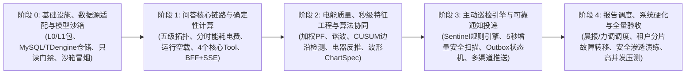

# 非侵入式负荷监测（NILM）工厂端 AI Agent 系统开发计划任务书

## 0. 任务书导读与工程总则

- **业务需求基线**：[docs/nilm-ai-agent-requirements.md](file:///home/picohood/projects/opensource/deepseek-harness/docs/nilm-ai-agent-requirements.md)
- **系统架构方案**：[docs/nilm-ai-agent-architecture.md](file:///home/picohood/projects/opensource/deepseek-harness/docs/nilm-ai-agent-architecture.md)
- **概要设计规范**：[docs/nilm-ai-agent-high-level-design.md](file:///home/picohood/projects/opensource/deepseek-harness/docs/nilm-ai-agent-high-level-design.md)
- **宿主环境**：`deepseek-harness`（Cordis 微内核 + TypeScript Node.js ESM + pnpm Monorepo）
- **开发目标**：依据前序需求、架构与概要设计，明确本系统从**阶段 0（基础设施与沙箱初始化）**到**阶段 4（报告调度、安全硬化与全量验收）**的详细实施路径、工作任务拆解（WBS）、交付产物定义以及每个阶段客观确定性的验证证据门。

### 0.1 核心实施纪律

1. **零破坏与宿主隔离**：所有新业务代码严格限定在 `packages/nilm/` 与 `packages/bundle/nilm-app/`，禁止直接修改 dsh 既有公共包的核心逻辑；
2. **确定性证据门禁**：每个阶段必须出示真实可复现的客观测试证据（自动化测试用例输出、真实环境连通性日志、压测指标报告），严禁未经测试声称交付；
3. **计算与模型严格解耦**：所有电量、电费、功率因数、谐波、时长计算必须在 TypeScript 领域服务中以纯函数实现并通过 100% 覆盖单测，严禁大模型参与任何数值计算；
4. **安全底线不可突破**：多租户隔离与权限过滤必须在代码和数据库层闭环（`CallContext` 强绑定），严禁依赖提示词防越权。

---

## 1. 阶段划分与总体路线图

系统开发划分为 5 个连续演进的阶段：



| 阶段 | 周期建议 | 核心目标 | 关键交付物 | 准出依据 |
| :---: | :---: | :--- | :--- | :--- |
| **阶段 0** | 3 天 | 建立代码骨架、打通真实数据源只读访问、锁死生产沙箱环境 | `nilm-core`, `nilm-source`, `nilm-context`, `nilm-app` bundle | 真实数据库探活成功、无 Key 假模型启动冒烟通过、危险工具白名单清零 |
| **阶段 1** | 5 天 | 打通被动问答（Pull）基础主链路，实现能耗/电费/设备工况分析 | `nilm-assets`, `nilm-timeseries`, `nilm-analytics`, 4个Tool, `nilm-service` (BFF) | 纯函数单测覆盖率 100%、双租户越权拦截率 100%、黄金问答集测试通过 |
| **阶段 2** | 4 天 | 引入电能质量监测与秒级时序边沿突变算法，实现电器反推与微观隐患研判 | 算法引擎（CUSUM）、`nilm_power_quality_query`, `nilm_timeseries_analyze`, ECharts 协议 | 边沿检测基准波形集检验通过、短窗口秒级查询 p95 < 3s、四类微观隐患模式识别生效 |
| **阶段 3** | 4 天 | 建设主动巡检（Push）链路，实现 5 秒增量安全报警与 Outbox 可靠投递 | `nilm-sentinel`, `nilm-notify`, 告警表 DDL, 渠道适配器 (微信/企微/短信) | 30 秒安全告警触达 SLO 演练达标、Outbox `SKIP LOCKED` 防重抢占、指数退避重试生效 |
| **阶段 4** | 4 天 | 定时报告调度、多租户分片高可用硬化、全链路集成验收与压测 | `nilm-scheduler`, 晨报/力调任务, K8s 分片配置, 性能压测套件 | 晨报 08:35 前送达率 > 99%、并发压测达标、渗透演练零越权、全链路审计无明文泄露 |

---

## 2. 阶段 0：基础设施、数据源适配与模型沙箱初始化

### 2.1 主要功能与工作任务（WBS）

1. **代码包骨架与类型基座构建（L0 包）**：
   - 创建 `packages/nilm/core/`：
     - 定义品牌标识类型：`TenantId`, `TerminalId`, `ChannelId`, `ConversationId`, `SessionId`, `TurnId`；
     - 定义基础结构：`ScopeTarget`, `MeterPoint`, `MeterRole`, `TimeRangeSpec`, `NilmDataQuality`, `ChartSpec`, `AlertCard`；
     - 定义统一错误体系：`NilmError`, `NilmToolError`, `NilmSourceError` 与稳定错误码枚举。
2. **上下文绑定服务（L1 包）**：
   - 创建 `packages/nilm/context/`：
     - 实现 `NilmContextService`（`bind(agentId, callContext)`, `require(agentId)`, `revoke(agentId)`）；
     - 确保上下文仅驻留在进程内存映射表中，严禁通过 Tool 参数或 Session JSONL 传递。
3. **本地持久化库与上游只读适配器（L1 包）**：
   - 初始化本地 MySQL `nilm_system` 数据库，执行 DDL 脚本创建 15 张核心业务与审计表；
   - 创建 `packages/nilm/source/`：
     - **上游 MySQL 仓储**：基于 `mysql2/promise` 封装只读连接池（连接到 `121.41.8.7:30446`，账号 `readonly_user`），实现 SELECT 白名单检查与强制参数化查询；
     - **上游 TDengine 仓储**：基于 REST/WebSocket 封装客户端（连接到 `192.168.1.67:6030/6041`，库 `tpim_system`），实现超表（`nilmdc_realtime_data`, `nilmdc_energy_data` 等）的时序数据提取；
     - **冷库只读代理客户端**：定义针对内网冷库代理的受控 HTTP 请求客户端接口（预留参数化模板，超时 5 秒）。
4. **自定义生产 Bundle 与沙箱门禁组装**：
   - 创建 `packages/bundle/nilm-app/`：
     - 编写 `cordis.patch.yml`，以 `sdk-minimal` 为基线，删除所有开发与危险扩展；
     - 声明 Context 类型合并（`Context declaration merging`）；
     - 组装 `dsh --profile nilm` 启动 profile。

### 2.2 交付成果物清单

- `packages/nilm/core/` 源码与导出类型声明；
- `packages/nilm/context/` 源码与单元测试；
- `packages/nilm/source/` 源码、MySQL 与 TDengine 适配器；
- 本地 MySQL `nilm_system` 全量建表 SQL 脚本（`packages/nilm/source/sql/init-nilm-system.sql`）；
- `packages/bundle/nilm-app/` 组合包及其 `cordis.patch.yml`。

### 2.3 成果验证方法与证据门（Evidence Gates）

本阶段完成时，必须通过以下 4 项自动化验证，并出示运行证据：

| 验证项 | 验证方法与执行命令 | 预期通过标准（证据门） |
| :--- | :--- | :--- |
| **G0-1: 真实数据库连通性验证** | 执行独立探测脚本 `pnpm --filter @deepseek-ai/dsh-nilm-source test:connectivity` | 成功连接 MySQL `tpim_system` 读取到租户数；成功连接 TDengine `tpim_system` 查询到 23 张超表元数据；耗时 < 1000ms |
| **G0-2: 只读权限安全防护验证** | 执行单元测试针对 `NilmSourceService` 尝试执行 `INSERT`、`UPDATE`、`DROP` 或非白名单表查询 | 驱动层或拦截层抛出 `NilmSourceError('UNAUTHORIZED_SQL_OPERATION')`，写操作执行率为 0% |
| **G0-3: 生产沙箱工具白名单验证** | 执行工具清单断言测试：启动容器，反射枚举 `ctx.tools.getTools()` | 运行环境中绝对禁止出现 `bash`, `read_file`, `write_file`, `edit_file`, `web_search`, `subagent`, `mcp` 等危险工具；仅允许 `nilm_*` |
| **G0-4: 假模型进程无损启动冒烟** | 配置虚拟 Dummy LLM Provider，执行 `pnpm dsh --profile nilm --test-boot` | 服务依赖注入全部成功，无未满足的 Context 依赖，健康检查 `/healthz` 返回 200，进程可干净终止（exit code 0） |

---

## 3. 阶段 1：被动问答核心链路与确定性计算

### 3.1 主要功能与工作任务（WBS）

1. **五级资产拓扑解析服务（L2 包）**：
   - 创建 `packages/nilm/assets/`：
     - 实现 `NilmAssetsService`：基于 `nilm_asset_snapshot` 快照表，实现自然语言到五级资产实体（工厂/车间/终端/通道/设备）的精准与模糊匹配；
     - 实现 `resolveMeterSet`：解析多通道聚合关系，按 `MeterRole` 规则（`terminal_total` vs `branch`）选择互不重叠的叶子节点，防重复相加；
     - 强制注入 `allowed_scope` 权限过滤，跨范围查询抛出 `SCOPE_FORBIDDEN`。
2. **时序数据查询与冷热路由（L2 包）**：
   - 创建 `packages/nilm/timeseries/`：
     - 实现 `NilmTimeseriesService`：支持按时间区间查询分时电量与瞬时测量点；
     - 实现冷热路由：90 天以内查 TDengine 热库；超过 90 天路由至冷代理；单次查询点数超过 500 点执行降采样，并输出 `NilmDataQuality`（覆盖率、缺口区间）。
3. **分时电价与纯函数计算引擎（L2 包）**：
   - 创建 `packages/nilm/tariff/`：
     - 实现 `NilmTariffService`：读取工商业分时电价方案（尖峰平谷时段、季节性尖峰、工作日历）；
   - 创建 `packages/nilm/analytics/`：
     - 实现纯函数计算模块：
       - `calculateEnergyCosts`：按电价时段精确切片计算峰平谷电度电费；
       - `calculateRunningAndIdleTime`：基于状态跳变事件，去抖并扣除采样断档后计算设备运行时长与空载时长；
       - `calculateCompareTrends`：日环比、周环比、月同比对齐计算（两期覆盖率差 >2% 时降级为参考）。
4. **电气安全检索服务（L2 包）**：
   - 创建 `packages/nilm/safety/`：
     - 实现 `NilmSafetyService`：检索上游 `nilm_unsafe_record`，完成点位、相别、越限值、持续时间与严重级别的结构化投影。
5. **基础 Tool 矩阵封装（L3 包）**：
   - 创建 `packages/nilm/tools/`：
     - 实现 `nilm_scope_resolve`、`nilm_energy_query`、`nilm_appliance_query`、`nilm_safety_query`；
     - 严格约束输出：模型事实 ≤20 KB，图表数据挂载于 `presentationMeta.chart`（`ChartSpec`），质量元数据挂载于 `presentationMeta.dataQuality`；
     - 所有输入/输出 Schema 显式设置 `additionalProperties: false`。
6. **BFF 网关与基座提示词装配（L4/L5 包）**：
   - 创建 `packages/nilm/prompt/`：装配跨租户通用的稳定基座提示词（严禁伪造数据、无数据不补零、口径标注说明）；
   - 创建 `packages/nilm/service/`：
     - 实现 `POST /v1/turns`（HMAC-SHA256 验签、创建/恢复会话、返回 `202 Accepted` + `streamUrl`）；
     - 实现 `GET /v1/turns/{id}/stream`（SSE 流式推送 `status`, `text.delta`, `chart`, `done`, `error`）。

### 3.2 交付成果物清单

- `packages/nilm/assets/` 源码与拓扑解析集成测试；
- `packages/nilm/timeseries/` 源码与冷热路由降采样测试；
- `packages/nilm/tariff/` 与 `packages/nilm/analytics/` 纯函数计算库；
- `packages/nilm/safety/` 源码；
- `packages/nilm/tools/` 4 个基础 Tool 实现；
- `packages/nilm/prompt/` 基座提示词；
- `packages/nilm/service/` BFF REST/SSE 网关；
- 阶段 1 黄金问答集录制文件（`tests/snapshots/golden-qa-p1.json`）。

### 3.3 成果验证方法与证据门（Evidence Gates）

| 验证项 | 验证方法与执行命令 | 预期通过标准（证据门） |
| :--- | :--- | :--- |
| **G1-1: 纯函数计算引擎 100% 单测** | 执行 `pnpm --filter @deepseek-ai/dsh-nilm-analytics test:coverage` | `analytics/src/*.ts` 单测覆盖率达到 **100%**（分支、行、函数全覆盖）；分时切片、跨日断档、负增量清零等边界用例全部断言通过 |
| **G1-2: 多通道拓扑展开与防重聚合** | 执行拓扑展开测试 `pnpm --filter @deepseek-ai/dsh-nilm-assets test` | 输入指定车间 ID，正确展开全部监测终端与通道；总进线（`terminal_total`）与下属分路（`branch`）互斥，严禁单点双算；父子偏差 >5% 时输出 warning |
| **G1-3: 双租户跨权限越权拦截测试** | 启动集成测试，模拟 A 租户合法签名 Token 请求查询 B 租户车间资产或数据 | BFF 或领域服务层直接阻断，返回 `403 Forbidden` (`SCOPE_FORBIDDEN`)；数据库未执行任何涉及 B 租户的 SQL |
| **G1-4: 黄金问答集 Session 回放** | 执行无 Key 回放测试 `pnpm test:snapshot -t nilm-p1` | 问答输出严格符合事实：回答中的所有电量、金额完全等同于 Tool 返回事实；无数据时明确说无数据，绝对无模型估算或补零；图表输出为合法 `ChartSpec` |

---

## 4. 阶段 2：电能质量、秒级时序特征工程与算法协同

### 4.1 主要功能与工作任务（WBS）

1. **电能质量与力调测算引擎增强**：
   - 在 `nilm-analytics` 中实现能量加权功率因数测算：$PF = \frac{E_p}{\sqrt{E_p^2 + E_q^2}}$；
   - 实现 2~7 次谐波含有率与畸变率分析，针对越限和畸变偏高生成特征提示；
   - 实现 `nilm_power_quality_query` Tool。
2. **秒级时序信号处理算法（CUSUM 边沿检测）**：
   - 在 `nilm-analytics` 中实现 `detectTimeSeriesFeatures` 纯函数算法引擎：
     - **去噪滤波**：双边滑动均值滤波过滤微小白噪声（$\Delta P < 0.2\,\text{kW}$）；
     - **CUSUM 边沿突变检测**：精准捕获有功功率跳变时刻 $t_k$；
     - **特征向量化提取**：提取有功阶跃 $\Delta P$、无功阶跃 $\Delta Q$、暂态冲击比 $I_{\text{peak}} / I_{\text{steady}}$、三相偏置平衡度、奇次谐波增量（$\Delta I_3, \Delta I_5, \Delta I_7$）；
     - **数据降维**：将 4 小时内超 40,000 个浮点数压缩为不超过 20 个特征事件元组（体积 < 4 KB）。
3. **AI Agent 算法协同推理与微观隐患研判**：
   - 实现 `nilm_timeseries_analyze` Tool；
   - **电器逆向反推（Disaggregation）**：将提取的事件特征向量与 MySQL `appliance_category` 及工业机理特征图谱对齐，利用“启停对称因果性”反推电器类别与容量；
   - **微观电气隐患诊断**：
     - 高频启停冲击隐患（10分钟内启停 >5 次）；
     - 启动加速迟滞憋死隐患（启动电流冲击时长 >8s 未降至稳态）；
     - 动态三相严重不平衡（不平衡度跃升至 >15%）；
     - 谐波突跃与无功补偿谐振隐患（5/7次谐波骤升伴随功率因数震荡）。
4. **ECharts 秒级波形标注图表协议（ChartSpec 增强）**：
   - 实现将秒级时序降采样曲线与台阶事件标注点（markLine / markPoint）组装为受控 `ChartSpec`，通过 `presentationMeta.chart` 交付前端原生渲染。

### 4.2 交付成果物清单

- `packages/nilm/analytics/src/cusum.ts` 纯函数边沿检测与特征提取源码；
- `packages/nilm/analytics/src/power-factor.ts` 功率因数测算源码；
- `packages/nilm/tools/src/definitions/power-quality-query.ts`；
- `packages/nilm/tools/src/definitions/timeseries-analyze.ts`；
- 边沿检测基准波形测试集（包含电机启动、加热管投入、工频风机跳变、采样断档等基准波形）。

### 4.3 成果验证方法与证据门（Evidence Gates）

| 验证项 | 验证方法与执行命令 | 预期通过标准（证据门） |
| :--- | :--- | :--- |
| **G2-1: 边沿检测与特征算法精度验证** | 运行离线基准数据集回放测试 `pnpm --filter @deepseek-ai/dsh-nilm-analytics test:cusum` | 在含有工业白噪声的仿真波形上，启停边沿检出率（Recall）≥ 98%，误检率（Precision）≥ 95%；冲击比计算误差 < 2% |
| **G2-2: 秒级查询与降维性能压测** | 针对真实 TDengine 连续抽取 4 小时（14,400 秒点）执行特征分析 `pnpm test:perf:timeseries` | 端到端取数 + CUSUM 边沿提取 + 降维耗时 **p95 < 2.5 秒**；输出给大模型的事件列表体积严格 **< 4 KB** |
| **G2-3: 四类微观用电隐患诊断验证** | 构造 4 组包含典型隐患的时序特征测试用例进行 Agent 问答评测 | Agent 准确识别出“高频启停冲击”、“电机重载带压启动/机械卡阻”、“三相严重偏载”及“谐波谐振隐患”，成因分析逻辑严密，并提出正确的现场排查建议 |
| **G2-4: 秒级波形 ChartSpec 渲染协议合规** | 检查 `nilm_timeseries_analyze` 输出的 `presentationMeta.chart` 结构 | 图表协议符合 `ChartSpec v1` 规范，序列点数经降采样严格控制在 500 点以内，包含准确的事件标线（markLines），无语法畸变 |

---

## 5. 阶段 3：主动巡检引擎与可靠通知投递链路

### 5.1 主要功能与工作任务（WBS）

1. **巡检规则引擎（`nilm-sentinel` 包）**：
   - 创建 `packages/nilm/sentinel/`：
     - 实现 5 秒增量安全扫描器：使用水位线 `(record_time, record_id)` 轮询上游 `nilm_unsafe_record`；
     - 实现非工作时段用能偏离检测器（规则 R-01a 瞬时阶跃、R-01b 夜间基载偏离、R-02 设备长开/空载）；
     - 实现电气越限规则（R-03 单设备过载、R-04 三相不平衡、R-05 过欠压）；
     - 实现告警三级抑制策略与状态流转机（`detected → confirmed → notified → acknowledged → resolved`）。
2. **告警升级穿透抑制机制**：
   - 同一 `dedupe_key`（`tenant_id + rule_id + scope_id + metric + bucket_start`）在静默期内自动抑制；
   - 当连续 3 个采样窗口持续越限且金额/幅值扩大时，自动从 Warning 升级为 Critical，生成 `:escalated:critical` 穿透静默期，强制入队。
3. **Outbox 可靠投递器与渠道适配（`nilm-notify` 包）**：
   - 创建 `packages/nilm/notify/`：
     - 告警事件与 Outbox 记录在同一个 MySQL 事务中强一致性落库；
     - 实现 Outbox 轮询调度器：采用 `SELECT ... FOR UPDATE SKIP LOCKED` 并发领取任务，设置 60 秒锁租约；
     - 实现多渠道适配器：微信小程序订阅消息（`wx_subscribe`）、公众号模板消息（`wx_template`）、企业微信机器人（`wecom_webhook`）、阿里云短信（`sms`）；
     - 实现指数退避重试机：$T_{\text{retry}} = 2^{\text{attempt}} \times 5\,\text{s}$（1m, 5m, 15m, 1h），最大重试 5 次后标记为 `dead`；
     - 投递日志写入 `nilm_notification_record`，保留 180 天。
4. **Agent 异步成因诊断（Enrich Worker）**：
   - 告警入队后异步唤起 `nilm-agent` 执行深度成因分析；设置硬超时 8 秒；
   - 超时或模型故障时保留确定性模板摘要，绝不阻塞通知向业主手机的即时投递；
   - 诊断完成后回填 `nilm_alert_event.agent_diagnosis`。

### 5.2 交付成果物清单

- `packages/nilm/sentinel/` 规则引擎源码；
- `packages/nilm/notify/` Outbox 轮询器与渠道适配器源码；
- 告警状态流转机与抑制测试套件；
- 微信/短信 Mock 桩与真实发送沙箱套件。

### 5.3 成果验证方法与证据门（Evidence Gates）

| 验证项 | 验证方法与执行命令 | 预期通过标准（证据门） |
| :--- | :--- | :--- |
| **G3-1: 告警触达 30 秒 SLO 演练** | 向测试库插入一条高危 `nilm_unsafe_record`，启动全链路计时监控 `pnpm test:slo:alert` | 从记录落库到 Sentinel 检出、事务写 Outbox、Notifier 成功调用推送渠道，端到端耗时 **p95 < 30 秒** |
| **G3-2: 告警抑制与穿透升级验证** | 模拟同一设备在 10 分钟内持续产生超限脉冲 | 同一去重键在静默期内仅产生 1 条通知；当连续 3 个周期越限加剧时，成功触发 Critical 升级穿透，产生第 2 条升级警报 |
| **G3-3: Outbox 并发抢占安全断言** | 启动 5 个并行 Notifier 进程同时并发消费 100 条待投递记录 | 依托 `SKIP LOCKED` 租约，**无任何一条通知被重复投递**（投递成功数恰好为 100，各进程无死锁） |
| **G3-4: 网络故障与指数退避重试** | 注入网络断网异常，观察 Outbox 任务状态流转 | 状态正确翻转为 `failed`，下次重试时间严格按指数退避递增；重试 5 次失败后准确标记为 `dead` 并写入审计 |
| **G3-5: 异步诊断非阻塞验证** | 人为将 Agent 响应时延注入为 10 秒（模拟大模型拥堵） | 即时告警通知仍然在 30 秒内发出（携带初始确定性模板），随后在 10 秒后静默回填 `agent_diagnosis`，未发生阻断 |

---

## 6. 阶段 4：定时调度报告、系统硬化与全量验收

### 6.1 主要功能与工作任务（WBS）

1. **定时报告调度服务（`nilm-scheduler` 包）**：
   - 创建 `packages/nilm/scheduler/`：
     - **08:30 每日晨报流水线**：`nilm-analytics` 汇总昨日能耗、电费、峰平谷占比与安全风险，调用 Agent 报表接口生成摘要，入库 `nilm_report` 并交 Outbox 投递；
     - **月度力调电费预测流水线**：每月 20、25 日触发，外推全月有功/无功电量，预测功率因数与力调电费考核风险；
     - **数据质量巡检（R-08）**：每日低峰期核对采集覆盖率与父子计量偏差，异常写运维审计。
2. **多租户分片与 StatefulSet 故障转移硬化**：
   - 编写 Kubernetes `StatefulSet` 部署清单与 PVC 挂载；
   - 实现租户一致性哈希路由（`tenant_id -> shard_id`）；
   - 编写 Pod 异常崩溃后 Session JSONL 自动恢复与双写防护测试。
3. **安全渗透演练与数据脱敏硬化**：
   - 验证 AES-GCM 密文存储，排查生产日志，确保无用户原始提问、无手机号/OpenID 明文；
   - 执行提示词注入攻击测试（尝试诱导 Agent 跨租户查数、输出内部 SQL 或执行系统命令）。
4. **端到端综合性能与容量压测**：
   - 模拟 100 家工厂同时在线巡检、多用户高并发提问；
   - 调优 Redis 缓存与 MySQL/TDengine 连接池参数，验证全局信号量限流。

### 6.2 交付成果物清单

- `packages/nilm/scheduler/` 源码与定时任务配置；
- K8s 部署配置清单（`deploy/k8s/`：StatefulSet, Service, Ingress, NetworkPolicy）；
- 端到端集成验收测试报告；
- 综合性能压测与安全审计报告。

### 6.3 成果验证方法与证据门（Evidence Gates）

| 验证项 | 验证方法与执行命令 | 预期通过标准（证据门） |
| :--- | :--- | :--- |
| **G4-1: 每日晨报准时送达率演练** | 模拟触发全量租户晨报生成流水线 `pnpm test:scheduler:morning-report` | 结构化数据重算耗时 < 500ms；晨报幂等键有效，重复触发不重复计算；08:35 送达完成率 **> 99%** |
| **G4-2: StatefulSet 崩溃恢复验证** | 模拟 `nilm-agent` Pod 在对话生成中途被 SIGKILL 终止并重新拉起 | 新 Pod 成功从 PVC 重新加载 Session JSONL，旧会话历史完好无损，用户发起下一轮消息可正常继续交互 |
| **G4-3: 百家工厂并发性能达标** | 使用压测工具发起并发负载 `pnpm test:perf:load` | 首流事件响应时间 **p95 < 300 ms**；无 Tool 简单问答首字 **p95 < 1.5 s**；含 Tool 复杂分析端到端 **p95 < 8 s**；系统无 5xx 错误 |
| **G4-4: 安全渗透与越权红蓝对抗** | 执行安全攻击测试套件（伪造 Header、SQL 注入载荷、提示词越权攻击） | 攻击拦截率 **100%**；模型明确拒绝透露非授权车间数据；日志与数据库中绝无明文敏感信息 |

---

## 7. 任务分解 WBS 与实施进度甘特矩阵

```text
阶段 0: 基础设施、数据源适配与模型沙箱 (Day 1 - Day 3)
  ├── 0.1 初始化 packages/nilm/{core,context,source} 包骨架与 TypeScript 接口
  ├── 0.2 执行本地 MySQL nilm_system 数据库 DDL 部署 (15张表)
  ├── 0.3 实现 MySQL 与 TDengine 只读仓储及白名单拦截器 (验证 G0-1, G0-2)
  └── 0.4 配置 dsh-nilm-app bundle 并完成启动门禁与工具清单断言 (验证 G0-3, G0-4)

阶段 1: 问答核心链路与确定性计算 (Day 4 - Day 8)
  ├── 1.1 实现 nilm-assets 拓扑展开与计量点父子防重聚合算法 (验证 G1-2)
  ├── 1.2 实现 nilm-timeseries 冷热查询路由与降采样
  ├── 1.3 实现 nilm-tariff 与 nilm-analytics 分时电量费用纯函数 (验证 G1-1)
  ├── 1.4 实现 nilm-safety 隐患检索与详情投影
  ├── 1.5 封装 4 个核心业务 Tool (定义严格 Schema)
  ├── 1.6 实现 nilm-service (BFF) 网关与 SSE 流协议
  └── 1.7 双租户越权集成测试与黄金问答集 Session 回放校验 (验证 G1-3, G1-4)

阶段 2: 电能质量、秒级特征工程与算法协同 (Day 9 - Day 12)
  ├── 2.1 实现能量加权功率因数测算与 2~7 次谐波含有率分析
  ├── 2.2 实现 CUSUM 双边滑动均值边沿突变检测纯函数算法 (验证 G2-1)
  ├── 2.3 实现瞬态冲击比、稳态台阶、奇次谐波指纹特征降维提取 (验证 G2-2)
  ├── 2.4 实现 nilm_timeseries_analyze Tool 并集成电器反推与微观隐患研判 (验证 G2-3)
  └── 2.5 组装秒级波形标注 ChartSpec 协议交付前端 (验证 G2-4)

阶段 3: 主动巡检引擎与可靠通知投递链路 (Day 13 - Day 16)
  ├── 3.1 实现 nilm-sentinel 5 秒增量安全扫描与 R-01~R-05 巡检规则
  ├── 3.2 实现告警去重抑制与穿透升级状态机 (验证 G3-2)
  ├── 3.3 实现 nilm-notify Outbox 投递调度器 (SKIP LOCKED 抢占) (验证 G3-3)
  ├── 3.4 集成微信订阅消息、服务号模板、企微与短信适配器 (验证 G3-4)
  └── 3.5 实现 Agent 8s 异步 enrich 机制并执行 30s SLO 演练 (验证 G3-1, G3-5)

阶段 4: 定时调度报告、系统硬化与全量验收 (Day 17 - Day 20)
  ├── 4.1 实现 nilm-scheduler 08:30 晨报与 20/25 日力调预测流水线 (验证 G4-1)
  ├── 4.2 部署 StatefulSet 租户分片与 PVC 会话恢复演练 (验证 G4-2)
  ├── 4.3 执行百家工厂高并发性能与吞吐量压测 (验证 G4-3)
  └── 4.4 执行全链路安全渗透演练、数据脱敏审计与全量验收 (验证 G4-4)
```

---

## 8. 阶段流转准入与准出控制门（Exit & Entry Gates）

为杜绝“边开发边埋坑”和技术债务后延，各阶段遵循严格的阶段流转门禁。前序阶段准出条件未全部达成（出现任意未修复缺陷）时，严禁强行进入下一阶段：

| 流转节点 | 硬性准入/准出条件（Gate Checklist） | 责任人判定依据 |
| :---: | :--- | :--- |
| **阶段 0 ➔ 阶段 1** | 1. `G0-1` 真实环境数据库连接测试 100% 通过；<br/>2. `G0-2` 任何写 SQL 操作被物理/驱动级彻底拦截；<br/>3. `G0-3` 生产 Profile 中绝对无 `bash` 等危险工具；<br/>4. `G0-4` 假模型进程顺利启动并通过健康检查。 | 架构师与系统工程师核验日志与测试代码 |
| **阶段 1 ➔ 阶段 2** | 1. `G1-1` 纯函数计算单测覆盖率达到 100%；<br/>2. `G1-2` 真实资产树展开无双算、无漏算；<br/>3. `G1-3` 双租户越权渗透测试 100% 拦截；<br/>4. `G1-4` 黄金问答集回放完全吻合事实，零数据幻觉。 | 研发负责人与测试负责人签署单测与快照报告 |
| **阶段 2 ➔ 阶段 3** | 1. `G2-1` CUSUM 边沿检测在基准波形集上召回率 ≥98%；<br/>2. `G2-2` 4 小时秒级取数与特征提取耗时 p95 < 2.5 秒，事实体积 < 4KB；<br/>3. `G2-3` 四类微观用电隐患能够被准确推理并给出合理排查建议；<br/>4. `G2-4` ECharts 降采样波形协议通过前端校验。 | 算法工程师与能效专家联合验收 |
| **阶段 3 ➔ 阶段 4** | 1. `G3-1` 30 秒安全告警全链路 SLO 演练达标；<br/>2. `G3-2` 告警升级穿透抑制逻辑通过状态机验证；<br/>3. `G3-3` 多进程并发 Outbox 投递零重复、零漏发；<br/>4. `G3-5` 大模型超时降级不影响即时告警触达。 | 安全工程师与运维工程师签署 SLO 演练报告 |
| **阶段 4 ➔ 正式上线** | 1. `G4-1` 每日晨报 08:35 送达率 > 99%；<br/>2. `G4-2` StatefulSet Pod 故障漂移后 Session 恢复率 100%；<br/>3. `G4-3` 百家工厂并发压测 p95 延时全部达标；<br/>4. `G4-4` 安全渗透攻击零漏洞，数据库与日志零明文泄露。 | 项目总负责人、业务方与客户代表联合交付验收 |
