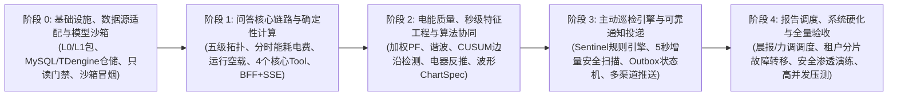

# 非侵入式负荷监测（NILM）工厂端 AI Agent 系统开发计划任务书

## 0. 任务书导读与工程总则

- **业务需求基线**：[docs/nilm-ai-agent-requirements.md](nilm-ai-agent-requirements.md)
- **系统架构方案**：[docs/nilm-ai-agent-architecture.md](nilm-ai-agent-architecture.md)
- **概要设计规范**：[docs/nilm-ai-agent-high-level-design.md](nilm-ai-agent-high-level-design.md)
- **宿主环境**：`deepseek-harness`（Cordis 微内核 + TypeScript Node.js ESM + pnpm Monorepo）
- **开发目标**：依据前序需求、架构与概要设计，明确本系统从**阶段 0（基础设施与沙箱初始化）**到**阶段 4（报告调度、安全硬化与全量验收）**的详细实施路径、工作任务拆解（WBS）、交付产物定义以及每个阶段客观确定性的验证证据门。
- **开工前决策**：D-13（调用方 mTLS 或签名令牌）须在阶段 0 开工前定稿；D-02（电价导入方式）在阶段 1 前、D-12（短信供应商）在阶段 3 前定稿。任务书给出的默认实现不替代决策记录。

### 0.1 核心实施纪律

1. **零破坏与宿主隔离**：所有新业务代码严格限定在 `packages/nilm/` 与 `packages/bundle/nilm-app/`，禁止直接修改 dsh 既有公共包的核心逻辑；测试夹具按仓库规范放在 `snapshots/session/`，部署清单放在 `deploy/k8s/`，二者不属于业务包；
2. **确定性证据门禁**：每个阶段必须出示真实可复现的客观测试证据（自动化测试用例输出、真实环境连通性日志、压测指标报告），严禁未经测试声称交付；
3. **计算与模型严格解耦**：所有电量、电费、功率因数、谐波、时长计算必须在 TypeScript 领域服务中以纯函数实现并通过 100% 覆盖单测，严禁大模型参与任何数值计算；
4. **安全底线不可突破**：多租户隔离与权限过滤必须在代码和数据库层闭环（`CallContext` 强绑定），严禁依赖提示词防越权。
5. **新增脚本显式交付**：本任务书引用的 `test:connectivity`、`test:cusum`、`test:perf:timeseries`、`test:slo:alert`、`test:scheduler:morning-report`、`test:perf:load` 等均为本任务新增脚本，必须在对应包或根 `package.json` 中声明并纳入交付清单；不得假设宿主已有同名命令。

---

## 1. 阶段划分与总体路线图

系统开发划分为 5 个连续演进的阶段：



| 阶段 | 周期建议 | 核心目标 | 关键交付物 | 准出依据 |
| :---: | :---: | :--- | :--- | :--- |
| **阶段 0** | 5 天 | 建立代码骨架、打通真实数据源只读访问、锁死生产沙箱环境 | `nilm-core`, `nilm-source`, `nilm-context`, `nilm-app` bundle | 真实数据库探活成功、无 Key 假模型启动冒烟通过、危险工具白名单清零 |
| **阶段 1** | 8 天 | 打通被动问答（Pull）基础主链路，实现能耗/电费/设备工况分析 | `nilm-assets`, `nilm-timeseries`, `nilm-analytics`, 4个Tool, `nilm-service` (BFF) | 纯函数单测覆盖率 100%、双租户越权拦截率 100%、黄金问答集测试通过 |
| **阶段 2** | 6 天 | 引入电能质量监测与秒级时序边沿突变算法，实现电器反推与微观隐患研判 | 算法引擎（CUSUM）、`nilm_power_quality_query`, `nilm_timeseries_analyze`, ECharts 协议 | 边沿检测基准波形集检验通过、短窗口秒级查询 p95 < 3s、四类微观隐患模式识别生效 |
| **阶段 3** | 5 天 | 建设主动巡检（Push）链路，实现 5 秒增量安全报警与 Outbox 可靠投递 | `nilm-sentinel`, `nilm-notify`, 告警表 DDL, 渠道适配器 (微信/企微/短信) | 30 秒安全告警触达 SLO 演练达标、Outbox `SKIP LOCKED` 防重抢占、at-least-once 投递与退避重试生效 |
| **阶段 4** | 5 天 | 定时报告调度、多租户分片高可用硬化、全链路集成验收与压测 | `nilm-scheduler`, 晨报/力调任务, K8s 分片配置, 性能压测套件 | 晨报 08:35 前送达率 > 99%、并发压测达标、渗透演练无 Critical/High、全链路审计无已知明文泄露 |

合计约 29 个工作日。该周期按单人串行、含联调与返工余量估算，不含客户侧数据开通、渠道审核与网络变更等待；实际排期按关键路径重排，不得以本表压缩阶段门禁。

---

## 2. 阶段 0：基础设施、数据源适配与模型沙箱初始化

### 2.1 主要功能与工作任务（WBS）

1. **代码包骨架与类型基座构建（L0 包）**：
   - 创建 `packages/nilm/core/`：
     - 定义品牌标识类型：`TenantId`, `TerminalId`, `ChannelId`, `ConversationId`, `SessionId`, `TurnId`；
     - 定义基础结构：`ScopeTarget`, `MeterPoint`, `MeterRole`, `TimeRangeSpec`, `NilmDataQuality`, `ChartSpec`, `AlertCard`；
     - 定义统一错误体系：`NilmError`, `NilmToolError`, `NilmSourceError` 与稳定错误码枚举。
2. **上下文绑定服务（L1 包）**：
   - 创建 `packages/nilm/context/`：
     - 实现 `NilmContextService`（`bind(agentId, callContext)`, `require(agentId)`, `revoke(agentId)`）；
     - 确保上下文仅驻留在进程内存映射表中，严禁通过 Tool 参数或 Session JSONL 传递。
3. **本地持久化库与上游只读适配器（L1 包）**：
   - 初始化本地 MySQL `nilm_system` 数据库，执行 DDL 脚本创建 **18 张**核心业务与审计表，与概要设计 §2 一致：`nilm_tenant_config`、`nilm_asset_snapshot`、`nilm_measurement_binding`、`nilm_conversation`、`nilm_turn_log`、`nilm_security_audit`、`nilm_alert_rule`、`nilm_alert_event`、`nilm_alert_transition`、`nilm_notification_outbox`、`nilm_notification_record`、`nilm_sentinel_watermark`、`nilm_job_run`、`nilm_report`、`nilm_tariff_plan`、`nilm_tariff_period`、`nilm_calendar_day`、`nilm_pf_policy`；
   - 创建 `packages/nilm/source/`：
     - **上游 MySQL 仓储**：基于 `mysql2/promise` 封装只读连接池；主机、端口、库名、账号与密码全部由 `NILM_UPSTREAM_MYSQL_*` 环境变量或 K8s Secret 注入，仓库与文档不保存固定值；实现 SELECT 白名单检查、强制参数化查询，并要求上游账号本身为只读权限；
     - **上游 TDengine 热库仓储**：基于 REST/WebSocket 封装客户端，连接串由 `NILM_UPSTREAM_TDENGINE_HOT_URL` 注入，库名 `tpim_system`；实现秒级/分钟级核心超表（`nilmdc_realtime_data`、`nilmdc_energy_data`、`nilmdc_appliance_identification` 等）的时序数据提取；
     - **上游 TDengine 日统计库仓储**：独立连接串由 `NILM_UPSTREAM_TDENGINE_STATS_URL` 注入，仅用于 `consum_energy_day_statistics_info` 等日/小时预聚合表；不得与热库连接混用，避免把日统计查询误发到实时库；
     - **冷库只读代理客户端**：冷库地址由 `NILM_COLD_PROXY_URL` 独立注入（现场冷库为内网服务器，不得与热库连接混用），仅接受参数化模板，超时 5 秒。
4. **自定义生产 Bundle 与沙箱门禁组装**：
   - 创建 `packages/bundle/nilm-app/`：
     - 编写 `cordis.patch.yml`，以 `sdk-minimal` 完整树为基线，逐项删除开发与危险扩展；至少删除 `deepseek-llm-api-extensions`、`session-log-deepseek`、`plugin-package-inventory-deepseek`（架构 §5.1 明确禁止加回），以及 shell、文件系统读写工具、MCP、Web、subagent、GUI 等无关行；最终行集合以概要设计 §5.1 的允许清单为准，不保留未说明理由的插件；
     - 增加启动断言：上述三个包与危险工具均不在最终 Cordis 树与 `ctx.tools.schemas()` 清单中；
     - 声明 Context 类型合并（`Context declaration merging`）；
     - 组装 `dsh --profile nilm` 启动 profile。

### 2.2 交付成果物清单

- `packages/nilm/core/` 源码与导出类型声明；
- `packages/nilm/context/` 源码与单元测试；
- `packages/nilm/source/` 源码、上游 MySQL 适配器、TDengine 热库/统计库适配器与冷代理客户端；
- 本地 MySQL `nilm_system` 全量建表 SQL 脚本（`packages/nilm/source/sql/init-nilm-system.sql`）；
- `packages/bundle/nilm-app/` 组合包及其 `cordis.patch.yml`。

### 2.3 成果验证方法与证据门（Evidence Gates）

本阶段完成时，必须通过以下 4 项自动化验证，并出示运行证据：

| 验证项 | 验证方法与执行命令 | 预期通过标准（证据门） |
| :--- | :--- | :--- |
| **G0-1: 真实数据库连通性验证** | 执行本阶段新增的探测脚本 `pnpm --filter @deepseek-ai/dsh-nilm-source test:connectivity`（脚本列入交付物） | 用环境变量注入的连接串成功连接上游 MySQL；连接本地 `nilm_system` 并断言 18 张表存在；用热库连接断言 `nilmdc_realtime_data`、`nilmdc_energy_data`、`nilmdc_appliance_identification` 存在且可读；用统计库连接断言 `consum_energy_day_statistics_info` 存在且可读；冷代理 `NILM_COLD_PROXY_URL` 的受控模板探活通过；**不校验固定超表总数**；耗时 < 1000ms |
| **G0-2: 只读权限安全防护验证** | 执行单元测试，针对 `NilmSourceService` 尝试执行 `INSERT`、`UPDATE`、`DROP`、非白名单表查询与多语句拼接 | 应用层 SELECT-only 白名单拦截，抛出 `NilmSourceError('UNAUTHORIZED_SQL_OPERATION')`；同时用上游只读账号复验写操作被数据库拒绝；两条链路均通过，写操作成功数为 0 |
| **G0-3: 生产沙箱工具白名单验证** | 启动容器后调用 `ctx.tools.schemas()` 枚举最终工具清单，并读取最终 Cordis 树断言禁止包不存在 | 不得出现 `bash`、`read_file`、`write_file`、`edit_file`、`web_search`、`subagent`、`mcp` 等危险工具；`deepseek-llm-api-extensions`、`session-log-deepseek`、`plugin-package-inventory-deepseek` 不在树中；默认只允许 `nilm_*`，基线运行必需的内部工具须逐项列入白名单并说明理由；断言结果写入测试日志 |
| **G0-4: 假模型进程无损启动冒烟** | 配置虚拟 Dummy LLM Provider，执行 `pnpm dsh --profile nilm`（使用现有 CLI，不引入自定义启动参数）；阶段 0 尚未交付 BFF，不检查 `/healthz` | 所有硬注入满足、无未满足的 Context 依赖；进程能启动并响应一次最小 SDK 调用；收到 SIGTERM 后干净退出（exit code 0）；BFF 健康检查在阶段 1 交付 BFF 后补充 |

---

## 3. 阶段 1：被动问答核心链路与确定性计算

### 3.1 主要功能与工作任务（WBS）

1. **五级资产拓扑解析服务（L2 包）**：
   - 创建 `packages/nilm/assets/`：
     - 实现 `NilmAssetsService`：基于 `nilm_asset_snapshot` 快照表，实现自然语言到五级资产实体（工厂/车间/终端/通道/设备）的精准与模糊匹配；
     - 实现 `resolveMeterSet`：优先从上游通道数据推导计量角色；上游无法表达 `terminal_total`/`branch` 父子关系时，回退读 `nilm_measurement_binding`；按 `MeterRole` 规则选择互不重叠的叶子节点，防重复相加；
     - 强制注入 `allowed_scope` 权限过滤，跨范围查询抛出 `SCOPE_FORBIDDEN`。
2. **时序数据查询与热库/统计库/冷代理路由（L2 包）**：
   - 创建 `packages/nilm/timeseries/`：
     - 实现 `NilmTimeseriesService`：支持按时间区间查询分时电量与瞬时测量点；
     - 实现数据路由：秒级/分钟级原始测量走 TDengine 热库；日/周/月聚合优先走 `consum_energy_day_statistics_info` 统计库；超过 90 天且统计库无法覆盖时路由至冷代理；单次原始查询点数上限 **2,000 点**，超出时在服务层降采样；交付给图表的数据序列上限 **500 点**；同时输出 `NilmDataQuality`（覆盖率、缺口区间）。
3. **分时电价与纯函数计算引擎（L2 包）**：
   - 创建 `packages/nilm/tariff/`：
     - 实现 `NilmTariffService`：读取工商业分时电价方案（尖峰平谷时段、季节性尖峰、工作日历）；
   - 创建 `packages/nilm/analytics/`：
     - 实现纯函数计算模块：
       - `calculateEnergyCosts`：按电价时段精确切片计算峰平谷电度电费；
       - `calculateRunningAndIdleTime`：基于状态跳变事件，去抖并扣除采样断档后计算设备运行时长与空载时长；
       - `calculateCompareTrends`：日环比、周环比、月同比对齐计算；任一期 `coverage < 95%` 时不得输出精确电费，只给基于已覆盖数据的估算与缺口说明；两期覆盖率差 >2% 时额外标注“可比性下降”。
4. **电气安全检索服务（L2 包）**：
   - 创建 `packages/nilm/safety/`：
     - 实现 `NilmSafetyService`：检索上游 `nilm_unsafe_record`，完成点位、相别、越限值、持续时间与严重级别的结构化投影。
5. **基础 Tool 矩阵封装（L3 包）**：
   - 创建 `packages/nilm/tools/`：
     - 实现 `nilm_scope_resolve`、`nilm_energy_query`、`nilm_appliance_query`、`nilm_safety_query`；
     - 严格约束输出：模型事实 ≤20 KB，图表数据挂载于 `presentationMeta.chart`（`ChartSpec`），质量元数据挂载于 `presentationMeta.dataQuality`；
     - 所有输入/输出 Schema 显式设置 `additionalProperties: false`。
6. **BFF 网关与基座提示词装配（L4/L5 包）**：
   - 创建 `packages/nilm/prompt/`：装配跨租户通用的稳定基座提示词（严禁伪造数据、无数据不补零、口径标注说明）；
   - 创建 `packages/nilm/service/`：
     - 实现 `POST /v1/turns`：生产优先 mTLS；非 mTLS 场景校验 `X-Nilm-Tenant-Id`、`X-Nilm-User-Ref`、`X-Nilm-Request-Id`、`X-Nilm-Timestamp`、`X-Nilm-Nonce`、`X-Nilm-Allowed-Scope` 与 `X-Nilm-Signature`；签名覆盖 method、path、body 摘要与上述 Header；阶段 1 端点不使用 query，带 query 的请求直接拒绝；Timestamp 允许 ±300 秒，Nonce 默认保存 10 分钟防重放，阶段 1 代码使用进程内缓存，多副本上线前替换为 Redis；验签密钥或 CA 由 K8s Secret 注入并按调用方轮换；`Allowed-Scope` 缺省视为租户级并审计；验签后由 BFF 绑定不可变 `CallContext`，请求体中的 `tenant_id` 一律忽略并记录安全事件；返回 `202 Accepted` + `{ turnId, sessionId, streamUrl }`；
     - 实现 `GET /v1/turns/{turnId}/stream`：SSE 推送 `status`、`text.delta`、`text.done`、`tool.start`、`tool.result`、`chart`、`alert`、`clarify`、`error`、`done`、`ping`；每个事件带 turn 内单调 `id`，支持 `Last-Event-ID` 断线重放；`done` 后关闭连接；
     - 实现 `POST /v1/turns/{turnId}/cancel`、`POST /v1/conversations`、`GET /v1/conversations`、`GET /v1/conversations/{id}/messages`、`GET /v1/alerts`、`POST /v1/alerts/{id}/ack`；告警端点阶段 1 先交付只读骨架，阶段 3 接入 Sentinel 数据；
     - 阶段 1 交付 BFF 后补充 `/healthz` 与就绪检查。

### 3.2 交付成果物清单

- `packages/nilm/assets/` 源码与拓扑解析集成测试；
- `packages/nilm/timeseries/` 源码与数据路由、降采样测试；
- `packages/nilm/tariff/` 与 `packages/nilm/analytics/` 纯函数计算库；
- `packages/nilm/safety/` 源码；
- `packages/nilm/tools/` 4 个基础 Tool 实现；
- `packages/nilm/prompt/` 基座提示词；
- `packages/nilm/service/` BFF REST/SSE 网关；
- 阶段 1 黄金问答集录制场景（`snapshots/session/nilm-golden-qa-p1/`，含 `snapshot.yml`、Session JSONL 与期望输出）。

### 3.3 成果验证方法与证据门（Evidence Gates）

| 验证项 | 验证方法与执行命令 | 预期通过标准（证据门） |
| :--- | :--- | :--- |
| **G1-1: 纯函数计算引擎 100% 单测** | 执行 `pnpm --filter @deepseek-ai/dsh-nilm-analytics test`，并用根仓 `pnpm run test:coverage` 的 per-file 100% 门禁校验 `packages/nilm/analytics/src` | `analytics/src/*.ts` 单测覆盖率达到 **100%**（分支、行、函数全覆盖）；分时切片、跨日断档、负增量清零等边界用例全部断言通过 |
| **G1-2: 多通道拓扑展开与防重聚合** | 执行拓扑展开测试 `pnpm --filter @deepseek-ai/dsh-nilm-assets test` | 输入指定车间 ID，正确展开全部监测终端与通道；总进线（`terminal_total`）与下属分路（`branch`）互斥，严禁单点双算；父子偏差超过租户配置阈值（默认 1%）时输出 `aggregationWarning`，不静默相加；阈值从 `nilm_tenant_config` 读取，不在代码中写死 |
| **G1-3: 双租户越权与签名闭环测试** | 启动集成测试，覆盖：A 租户合法签名查询 B 租户资产；过期 Timestamp；重复 Nonce；缺失/错误 Signature；请求体伪造 `tenant_id` | 跨租户返回 `403 Forbidden` (`SCOPE_FORBIDDEN`)；过期、重放、验签失败返回 `401` 且不创建 turn；请求体 `tenant_id` 被忽略，以 Header 绑定租户为准；每次拒绝写安全审计（阶段 1 先写结构化日志，`nilm_security_audit` 随审计存储集成交付）；数据库未执行任何涉及 B 租户的 SQL |
| **G1-4: 黄金问答集 Session 回放** | 执行无 Key 回放测试 `pnpm test:snapshot -t nilm-golden-qa-p1` | 黄金问答集范围内，回答中的所有电量、金额与 Tool 返回事实一致；无数据时明确说无数据，无模型估算或补零；图表为合法 `ChartSpec v1`；新增问题需扩充 `snapshots/session/nilm-golden-qa-p1/` 后再验收 |

### 3.4 阶段 1 实现状态与部署前置

已完成：五级拓扑与互不重叠计量点选择、热/统计/冷路由与降采样、分时电价与电费、设备运行/停止时长与估算电量、安全隐患投影、4 个 `nilm_*` Tool、稳定基座提示词、BFF REST/SSE、HMAC 验签、时间戳/nonce 校验、`allowed_scope`、会话三元组归属、`clientMessageId` 幂等、`Last-Event-ID` 重放、取消与健康检查。

以下为明确的部署前置，不伪装成已交付：mTLS 仅完成协议设计，代码只接受 HMAC；nonce、幂等映射与本轮缓冲是进程内状态，多副本前需 Redis 与共享幂等记录；会话元数据在配置 `NILM_SESSIONS_ROOT` 后落 PVC，MySQL `nilm_conversation` 尚未接入；`nilm_security_audit` 尚写日志；告警端点为空骨架；黄金问答 Session 快照需在具备真实数据源与模型录制的环境生成。阶段 1 `nilm_appliance_query` 只返回上游稳定的运行/停止状态与估算电量，不推断空载或浪费金额。

---

## 4. 阶段 2：电能质量、秒级时序特征工程与算法协同

### 4.1 主要功能与工作任务（WBS）

1. **电能质量与力调测算引擎增强**：
   - 在 `nilm-analytics` 中实现能量加权功率因数测算：$PF = \frac{E_p}{\sqrt{E_p^2 + E_q^2}}$；
   - 实现谐波含有率分析，阶次以上游 DDL 实际字段为准（当前确证 `ih1/2/3/5/7`，4/6 次是否可得需在阶段 0 冻结）；对外口径称“2~7 次谐波监测”，但逐阶次返回可用性，缺失阶次返回 `null` 并说明，不冒充完整 THD；
   - 实现 `nilm_power_quality_query` Tool。
2. **秒级时序信号处理算法（CUSUM 边沿检测）**：
   - 在 `nilm-analytics` 中实现 `detectTimeSeriesFeatures` 纯函数算法引擎：
     - **去噪滤波**：双边滑动均值滤波过滤微小白噪声（$\Delta P < 0.2\,\text{kW}$）；
     - **CUSUM 边沿突变检测**：精准捕获有功功率跳变时刻 $t_k$；
     - **特征向量化提取**：提取有功阶跃 $\Delta P$、无功阶跃 $\Delta Q$、暂态冲击比 $I_{\text{peak}} / I_{\text{steady}}$、三相偏置平衡度；谐波指纹默认使用区分度更高的奇次增量（$\Delta I_3, \Delta I_5, \Delta I_7$），但电能质量查询仍按上游可用阶次返回完整谐波集合；二者口径分开，不互相替代；
     - **数据降维**：将 4 小时内超 40,000 个浮点数压缩为不超过 20 个特征事件元组（体积 < 4 KB）。
3. **AI Agent 算法协同推理与微观隐患研判**：
   - 实现 `nilm_timeseries_analyze` Tool；
   - **电器逆向反推（Disaggregation）**：将提取的事件特征向量与 `nilm-source` 暴露的设备品类只读视图（上游 `appliance_category` 的受控投影）及工业机理特征图谱对齐，利用“启停对称因果性”反推电器类别与容量；算法层不得直接持有 MySQL 连接；
   - **微观电气隐患诊断**：
     - 高频启停冲击隐患（10分钟内启停 >5 次）；
     - 启动加速迟滞憋死隐患（启动电流冲击时长 >8s 未降至稳态）；
     - 动态三相严重不平衡（不平衡度跃升至 >15%）；
     - 谐波突跃与无功补偿谐振隐患（5/7次谐波骤升伴随功率因数震荡）。
4. **ECharts 秒级波形标注图表协议（ChartSpec 增强）**：
   - 实现将秒级时序降采样曲线与台阶事件标注组装为受控 `ChartSpec v1`：事件标注使用 `annotations: Array<{ at, label, severity }>`，不使用 `markLine`/`markPoint`；通过 `presentationMeta.chart` 交付客户端；

### 4.2 交付成果物清单

- `packages/nilm/analytics/src/power-quality.ts`：能量加权功率因数、逐阶谐波含有率、电压偏差与不平衡度纯函数；
- `packages/nilm/analytics/src/cusum.ts`：CUSUM 边沿检测、过渡期去重、循环配对、特征向量与四类隐患规则；
- `packages/nilm/timeseries/src/index.ts` 的 `queryAnalysisSamples`：原始实时行取数，`analysisPointLimit` 作为单次总预算按计量点均分；
- `packages/nilm/tools/src/index.ts` 中的 `nilm_power_quality_query` 与 `nilm_timeseries_analyze`；
- `packages/nilm/analytics/tests/power-quality.spec.ts`、`cusum.spec.ts` 基准波形与算法测试；
- `packages/nilm/timeseries/tests/timeseries.spec.ts`、`packages/nilm/tools/tests/tools.spec.ts` 的查询与工具契约测试。

### 4.3 成果验证方法与证据门（Evidence Gates）

| 验证项 | 验证方法与执行命令 | 预期通过标准（证据门） |
| :--- | :--- | :--- |
| **G2-1: 边沿检测与特征算法精度验证** | 运行离线基准数据集回放测试 `pnpm --filter @deepseek-ai/dsh-nilm-analytics test:cusum` | 在含有工业白噪声的仿真波形上，启停边沿检出率（Recall）≥ 98%，精确率（Precision）≥ 95%；冲击比计算误差 < 2% |
| **G2-2: 秒级查询与降维性能压测** | 离线算法基线与降维体积用 `pnpm test:perf:timeseries`；具备真实 TDengine 只读凭证后，对同一 4 小时（14,400 秒点）执行端到端回放 | 离线算法 + 降维 p95 **< 2.5 秒**、事件 JSON **< 4 KB**；端到端取数整体 p95 **< 2.5 秒**（部署环境证据，离线结果不可替代） |
| **G2-3: 四类微观用电隐患诊断验证** | 构造 4 组包含典型隐患的时序特征测试用例进行 Agent 问答评测 | 4 组用例全部命中预期隐患类型；每组至少引用 2 个来自 Tool 事实的证据字段（ΔP/ΔQ、谐波增量、不平衡度、持续时间）；排查建议包含可执行动作；不得出现 fixture 之外的数字 |
| **G2-4: 秒级波形 ChartSpec 渲染协议合规** | 检查 `nilm_timeseries_analyze` 输出的 `presentationMeta.chart` 结构 | 图表协议符合 `ChartSpec v1` 规范：序列点数 ≤ 500，事件标注位于 `annotations` 且字段为 `{ at, label, severity }`；不含 `markLine`/`markPoint`；客户端按 v1 渲染通过 |

### 4.4 阶段 2 实现状态与部署前置

已完成：能量加权功率因数与风险分级、2/3/5/7 次逐阶谐波含有率、电压偏差、CUSUM 边沿检测与同向过渡去重、启停循环配对、冲击比/三相不平衡/谐波指纹特征、四类微观隐患规则、`nilm_power_quality_query` 与 `nilm_timeseries_analyze` 两个 Tool、秒级波形 `ChartSpec v1` 的 `annotations` 降采样图表，以及原始实时行取数与逐计量点上限。离线基准波形测试覆盖电机启动、加热管投入、工频风机跳变、相位不平衡、谐波谐振、启动迟滞、频繁启停与采样断档；4 小时 14,400 点的算法耗时与事件 JSON 体积在离线回放中满足 `< 2.5 s` 与 `< 4 KB`。

以下为明确的部署前置，不伪装成已交付：

- `G2-2` 的**端到端** p95 必须在具备 TDengine 只读凭证的环境中实测，离线回放只证明纯算法与降维部分；
- 月度力调所需的整月 P/Q 预聚合尚未接入；阶段 2 的 PF 只对原始点预算内窗口有效，短窗口结果不能外推为月度达标结论；
- `nilmdc_realtime_data` 当前投影没有分相电流列，三相不平衡返回 `null` 并告警，不能由 `line_current` 或 `irms` 推算；
- 完整 THD 不在契约内，谐波只按上游实际提供的阶次返回；
- `G2-3` 的 Agent 问答评测与 `G2-4` 的客户端 ECharts 渲染验收需要真实模型与客户端参与，本仓库只验证 Tool 事实、图表结构与 `annotations` 字段合规。

---

## 5. 阶段 3：主动巡检引擎与可靠通知投递链路

### 5.1 主要功能与工作任务（WBS）

1. **巡检规则引擎（`nilm-sentinel` 包）**：
   - 创建 `packages/nilm/sentinel/`：
     - 实现 5 秒增量安全扫描器：使用水位线 `(record_time, record_id)` 轮询上游 `nilm_unsafe_record`；
     - 实现非工作时段用能偏离检测器（规则 R-01a 瞬时阶跃、R-01b 夜间基载偏离、R-02 设备长开/空载）；
     - 实现电气越限规则（R-03 单设备过载、R-04 三相不平衡、R-05 过欠压）；
     - 实现告警三级抑制策略与状态流转机（`detected → confirmed → notified → acknowledged → resolved`）。
2. **告警升级穿透抑制机制**：
   - 静默键 `silence_key`（`tenant_id + rule_id + scope_id + metric`）在静默期内自动抑制；事件仍以 `dedupe_key`（追加 `bucket_start`）记录，保证可追溯，但不能用含 `bucket_start` 的键做跨窗口抑制；
   - 当连续 3 个采样窗口持续越限且金额/幅值扩大时，自动从 Warning 升级为 Critical，生成 `:escalated:critical` 穿透静默期，强制入队。
3. **Outbox 可靠投递器与渠道适配（`nilm-notify` 包）**：
   - 创建 `packages/nilm/notify/`：
     - 告警事件与 Outbox 记录在同一个 MySQL 事务中强一致性落库；
     - 实现 Outbox 轮询调度器：采用 `SELECT ... FOR UPDATE SKIP LOCKED` 并发领取任务，设置 60 秒锁租约；
     - 实现渠道适配器接口与四个渠道枚举：微信小程序订阅消息（`wx_subscribe`）、公众号模板消息（`wx_template`）、企业微信机器人（`wecom_webhook`）、短信（`sms`）；具体短信供应商由 D-12 决策后注入，本任务书不锁定供应商；
     - 实现重试调度：按显式退避表 `[1m, 5m, 15m, 1h]` 分级重试，达到 `max_attempts`（默认 5）后标记为 `dead`；退避值允许按渠道配置覆盖，不使用与枚举不一致的幂次公式；
     - 投递日志写入 `nilm_notification_record`，保留 180 天。
4. **Agent 异步成因诊断（Enrich Worker）**：
   - 告警入队后异步唤起 `nilm-agent` 执行深度成因分析；设置硬超时 8 秒；
   - 超时或模型故障时保留确定性模板摘要，绝不阻塞通知向业主手机的即时投递；
   - 诊断完成后回填 `nilm_alert_event.agent_diagnosis`。

### 5.2 交付成果物清单

- `packages/nilm/sentinel/` 规则引擎源码；
- `packages/nilm/notify/` Outbox 轮询器与渠道适配器源码；
- 告警状态流转机与抑制测试套件；
- 微信/短信 Mock 桩与供应商沙箱/联调套件（按 D-12 决策开通，未开通时只跑 Mock）。

### 5.3 成果验证方法与证据门（Evidence Gates）

| 验证项 | 验证方法与执行命令 | 预期通过标准（证据门） |
| :--- | :--- | :--- |
| **G3-1: 告警触达 30 秒 SLO 演练** | 向测试库插入一条高危 `nilm_unsafe_record`，启动全链路计时监控 `pnpm test:slo:alert` | 从记录落库到 Sentinel 检出、事务写 Outbox、Notifier 成功调用推送渠道，端到端耗时 **p95 < 30 秒** |
| **G3-2: 告警抑制与穿透升级验证** | 模拟同一设备在 10 分钟内持续产生超限脉冲 | 同一 `silence_key` 在静默期内仅产生 1 条通知；当连续 3 个周期越限加剧时，成功触发 Critical 升级穿透，产生第 2 条升级警报；事件表仍保留每个 `bucket_start` 的 `dedupe_key` 记录 |
| **G3-3: Outbox 并发抢占安全断言** | 启动 5 个并行 Notifier 进程同时并发消费 100 条待投递记录，渠道使用可记录调用的 Mock | 依托 `SKIP LOCKED` 租约，**同一条 Outbox 记录不会被两个进程同时领取**；100 条记录全部至少被处理一次，无丢失、无死锁；投递语义为 **at-least-once**，允许极端故障下重复，客户端按 `notification_id` 去重 |
| **G3-4: 网络故障与分级退避重试** | 注入网络断网异常，观察 Outbox 任务状态流转 | 状态正确翻转为 `failed`，下次重试时间严格按 `[1m, 5m, 15m, 1h]` 分级退避递增；达到 `max_attempts` 后准确标记为 `dead` 并写入审计 |
| **G3-5: 异步诊断非阻塞验证** | 人为将 Agent 响应时延注入为 10 秒（模拟大模型拥堵），enrich 硬超时仍为 8 秒 | 即时告警通知在 30 秒内发出（携带初始确定性模板）；8 秒超时后告警保持模板文案，`agent_diagnosis` 保持空值；10 秒后的迟到结果被丢弃，不得覆盖已确认告警，也不得阻塞通知 |

### 5.4 当前实现状态

本阶段代码已落地，离线验证证据如下；真实数据库与渠道联调仍按证据门单独签署。

| 项目 | 状态 | 离线证据 | 仍需现场验证 |
| :--- | :--- | :--- | :--- |
| `nilm-sentinel` 增量安全扫描、R-01a/R-01b/R-02/R-03/R-04/R-05、状态机、抑制与升级 | 部分实现 | `packages/nilm/sentinel/tests` 的状态机、规则、抑制与扫描器用例 | 上游真实水位线索引、真实热库信号、30 秒 SLO |
| 规则边界 | R-01b 使用租户配置基线；R-03 仅走上游隐患分类；R-04 因缺分相电流停用 | 缺失信号只记录一次告警日志，不估算 | 自适应 4 周基线、实时过载与分相电流列 |
| Sentinel 事务写告警与 Outbox、`silence_key`、`nilm_sentinel_watermark` | 已实现 | DDL 18 表断言；内存存储事务用例 | MySQL 隔离级别与并发去重实测 |
| `nilm-notify` Outbox 领取、60 秒租约、`[1m,5m,15m,1h]` 退避、死信、投递记录保留 | 已实现 | 调度器 5 worker 并发、租约回收、永久失败与退避用例 | 真实 MySQL `SKIP LOCKED` 多进程抢占 |
| 四个渠道网关适配与加密接收方载荷 | 已实现网关契约 | HTTP 200/429/5xx/4xx、载荷不含明文接收方用例 | 微信/企微/短信供应商沙箱，D-12 短信选型 |
| Agent 8 秒异步富化、条件回填、迟到结果丢弃 | 已实现 | 10 秒延迟注入、超时、已确认告警不覆盖用例 | 真实模型时延与限流 |
| BFF `/v1/alerts` 列表与确认 | 已接入 Sentinel | HTTP 端点用例，未挂载时保留 `available:false` 降级 | 端到端小程序联调 |
| G3-1 30 秒 SLO、G3-3 多进程并发、G3-4 网络故障演练 | 未完成 | — | 需真实测试库与渠道 Mock/沙箱，由安全与运维签署演练报告 |

---

## 6. 阶段 4：定时调度报告、系统硬化与全量验收

### 6.1 主要功能与工作任务（WBS）

1. **定时报告调度服务（`nilm-scheduler` 包）**：
   - 创建 `packages/nilm/scheduler/`：
     - **08:30 每日晨报流水线**：`nilm-analytics` 汇总昨日能耗、电费、峰平谷占比与安全风险，调用 Agent 报表接口生成摘要，入库 `nilm_report`，写 `nilm_job_run` 幂等记录后交 Outbox 投递；
     - **月度力调电费预测流水线**：每月 20、25 日触发，外推全月有功/无功电量，预测功率因数与力调电费考核风险；每次执行写 `nilm_job_run`，同一租户同一业务日只执行一次；
     - **数据质量巡检（R-08）**：每日低峰期核对采集覆盖率与父子计量偏差，异常写运维审计与 `nilm_job_run`；不向客户发送告警。
2. **多租户分片与 StatefulSet 故障转移硬化**：
   - 编写 Kubernetes `StatefulSet` 部署清单与 PVC 挂载；
   - 实现租户一致性哈希路由（`tenant_id -> shard_id`）；
   - 编写**同分片** Pod 异常重启或排空迁移后的 Session JSONL 恢复测试与双写防护测试；不承诺任意跨分片“故障漂移”恢复，旧 Pod 必须终止后才允许新 Pod 接管。
3. **安全渗透演练与数据脱敏硬化**：
   - 验证 AES-GCM 密文存储与 KMS/Secret 密钥注入，排查生产日志，确保无用户原始提问、无手机号/OpenID 明文；
   - 执行提示词注入攻击测试（尝试诱导 Agent 跨租户查数、输出内部 SQL 或执行系统命令）。
4. **端到端综合性能与容量压测**：
   - 按 100 租户、每租户 5 个并发会话、持续 30 分钟的负载模型组织压测，覆盖无 Tool 问答、单 Tool 查询与多 Tool 分析三类场景；
   - 记录 QPS、p50/p95/p99、5xx 错误率与租户间串扰；据此调优 Redis 缓存与 MySQL/TDengine 连接池参数，验证全局信号量限流。

### 6.2 交付成果物清单

- `packages/nilm/scheduler/` 源码与定时任务配置；
- K8s 部署配置清单（`deploy/k8s/`：StatefulSet, Service, Ingress, NetworkPolicy）；
- 端到端集成验收测试报告；
- 综合性能压测与安全审计报告。

### 6.3 成果验证方法与证据门（Evidence Gates）

| 验证项 | 验证方法与执行命令 | 预期通过标准（证据门） |
| :--- | :--- | :--- |
| **G4-1: 每日晨报准时送达率演练** | 用 20 个租户、每租户 30 天日数据与 5 个计量点触发晨报流水线 `pnpm test:scheduler:morning-report`（脚本列入交付物） | 单租户结构化数据重算 p95 < 500ms；`nilm_job_run` 幂等键有效，重复触发不重复计算、不重复投递；08:35 送达完成率 > 99%（以 Mock 渠道回执计时） |
| **G4-2: StatefulSet 同分片恢复验证** | 模拟 `nilm-agent` Pod 在对话生成中途被 SIGKILL 终止，由 StatefulSet 在同分片、同 PVC 重新拉起 | 新 Pod 从 PVC 重新加载 Session JSONL；尾部半写行被安全截断/忽略，已完成事件不丢失；旧 Pod 已终止后才接管，无在线双写；用户可继续下一轮；不测试跨分片“漂移恢复” |
| **G4-3: 百家工厂并发性能达标** | 使用 `pnpm test:perf:load`（harness 已交付，现场未执行）发起 100 租户、每租户 5 个并发会话，持续 30 分钟；数据集为 90 天分钟级 + 7 天秒级，记录 QPS、p50/p95/p99 与错误率 | 首流事件 p95 < 300ms；无 Tool 简单问答首字 p95 < 1.5s；含 Tool 复杂分析端到端 p95 < 8s、p99 < 12s；5xx 与轮次错误率 < 0.5%；传输失败为 0；无租户间串扰 |
| **G4-4: 安全渗透与越权红蓝对抗** | 执行版本化的安全攻击套件（伪造 Header、重放、SQL 注入载荷、越权 Scope、提示词注入） | 套件内攻击用例 **100%** 被 Tool/SQL/`CallContext` 拦截并写审计；不把模型拒答当作安全证据；无 Critical/High 遗留；日志、Session 与数据库中无已知明文手机号/OpenID/原始提问 |

### 6.4 当前实现状态

阶段 4 的定时任务、分片部署清单与压测 harness 已落地；系统硬化与全量验收仍需独立环境执行，离线用例不能替代证据门。

| 项目 | 状态 | 离线证据 | 仍需现场验证 |
| :--- | :--- | :--- | :--- |
| `nilm-scheduler` 上海业务时区、08:30 晨报、20/25 日力调、03:30 R-08、到期扫描 | 已实现 | `packages/nilm/scheduler/tests` 的时间、任务编排与 20 租户 G4-1 演练 | 真实部署时钟、进程重启后的到期补偿 |
| `nilm_job_run` `(job_type, tenant_id, business_date)` 幂等、租约重领与失败重试 | 已实现 | 内存仓储任务状态用例；MySQL 仓储使用唯一键与事务领取 | 真实 MySQL 并发领取、隔离级别与死锁观察 |
| R-07 晨报结构化载荷、小时能耗图、告警计数、力调风险、Outbox 入队与 `delivered_at` 回填 | 已实现 | `report.spec.ts`、`scheduler.spec.ts` 晨报用例；Notify 报告投递回填用例 | BFF 对话查询晨报 Tool 尚未实现；真实渠道送达与回执 |
| R-06 能量加权月度 PF 预测 | 已实现确定性算法 | `pf.spec.ts` 同星期中位数、缺失星期回退与风险分级 | 默认部署无月度 `E_p`/`E_q` 预聚合时以 `DATA_UNAVAILABLE` 失败；奖惩金额未计算 |
| R-08 覆盖率与父子计量偏差巡检 | 已实现；冷热一致性停用 | `quality.spec.ts`、调度器运维审计用例 | 配置冷电量路由后补冷热一致性；真实表数据质量 |
| 模型摘要边界 | 已实现 | 超时、空白摘要和失败回退模板用例 | 真实模型时延与限流；默认不创建 Session |
| G4-1 晨报演练脚本 | 离线部分通过 | `pnpm test:scheduler:morning-report` 验证 20 租户重算、幂等与延迟预算 | 08:35 前送达完成率 > 99% 需在线渠道回执 |
| G4-2 租户分片路由、PVC 会话索引、同分片恢复 | 离线部分完成 | `packages/nilm/sharding` 固定向量与分布用例；`packages/nilm/service/tests` 覆盖租户目录、分片拒绝、跨实例会话重载；`packages/nilm/service/tests/recovery.spec.ts` 用真实 JSONL 后端验证撕裂尾部读取，并在原生租约可用时验证写互斥与继任续写 | 需真实 K8s 环境执行 SIGKILL、PVC 重挂与边缘路由演练；`deploy/k8s/` 清单已交付，但 `nilm-edge` 由平台边缘网关实现 |
| G4-3 百家工厂压测 harness | 已交付，现场未执行 | `packages/nilm/service/tests/perf-load.spec.ts` 覆盖最近秩百分位、门禁判定、manifest 预检、签名信封、SSE 分块解析、注入 transport 调度与隔离探测；loopback 自检在可绑定回环端口的主机运行 | 需真实目标环境、100 租户签名密钥与 90 天分钟级 / 7 天秒级数据集；必须先完成 G4-2 演练；保存 100 x 5 x 30 分钟报告、manifest、租户清单与命令 |
| G4-4 安全渗透演练 | 未开始 | — | 需安全测试环境与版本化攻击套件 |

---

## 7. 任务分解 WBS 与实施进度甘特矩阵

```text
阶段 0: 基础设施、数据源适配与模型沙箱 (Day 1 - Day 5)
  ├── 0.1 初始化 packages/nilm/{core,context,source} 包骨架与 TypeScript 接口
  ├── 0.2 执行本地 MySQL nilm_system 数据库 DDL 部署 (18 张表)
  ├── 0.3 实现 MySQL/TDengine 只读仓储、冷代理接口及白名单拦截器，交付 test:connectivity 脚本 (验证 G0-1, G0-2)
  └── 0.4 配置 dsh-nilm-app bundle 并完成启动门禁与工具清单断言 (验证 G0-3, G0-4)

阶段 1: 问答核心链路与确定性计算 (Day 6 - Day 13)
  ├── 1.1 实现 nilm-assets 拓扑展开与计量点父子防重聚合算法 (验证 G1-2)
  ├── 1.2 实现 nilm-timeseries 热库/统计库/冷代理路由、2,000 点原始上限与 500 点图表降采样
  ├── 1.3 实现 nilm-tariff 与 nilm-analytics 分时电量费用纯函数 (验证 G1-1)
  ├── 1.4 实现 nilm-safety 隐患检索与详情投影
  ├── 1.5 封装 4 个核心业务 Tool (定义严格 Schema)
  ├── 1.6 实现 nilm-service (BFF) 验签、会话/告警端点、SSE 11 类事件与 Last-Event-ID 重放
  └── 1.7 双租户越权与签名闭环集成测试、黄金问答集 Session 回放校验 (验证 G1-3, G1-4)

阶段 2: 电能质量、秒级特征工程与算法协同 (Day 14 - Day 19)
  ├── 2.1 实现能量加权功率因数测算与 2~7 次谐波含有率分析 (按上游可用阶次返回)
  ├── 2.2 实现 CUSUM 双边滑动均值边沿突变检测纯函数算法，交付 test:cusum 脚本 (验证 G2-1)
  ├── 2.3 实现瞬态冲击比、稳态台阶、奇次谐波指纹特征降维提取，交付 test:perf:timeseries 脚本 (验证 G2-2)
  ├── 2.4 实现 nilm_timeseries_analyze Tool 并集成电器反推与微观隐患研判 (验证 G2-3)
  └── 2.5 组装秒级波形 ChartSpec v1 annotations 协议交付客户端 (验证 G2-4)

阶段 3: 主动巡检引擎与可靠通知投递链路 (Day 20 - Day 24)
  ├── 3.1 实现 nilm-sentinel 5 秒增量安全扫描与 R-01~R-05 巡检规则
  ├── 3.2 实现告警去重抑制与穿透升级状态机 (验证 G3-2)
  ├── 3.3 实现 nilm-notify Outbox 投递调度器 (SKIP LOCKED 抢占) (验证 G3-3)
  ├── 3.4 集成微信订阅消息、服务号模板、企微与短信适配器 (验证 G3-4)
  └── 3.5 实现 Agent 8s 异步 enrich 机制，交付 test:slo:alert 脚本并执行 30s SLO 演练 (验证 G3-1, G3-5)

阶段 4: 定时调度报告、系统硬化与全量验收 (Day 25 - Day 29)
  ├── 4.1 实现 nilm-scheduler 08:30 晨报、20/25 日力调预测与 R-08 数据质量巡检，交付 test:scheduler:morning-report 脚本 (验证 G4-1)
  ├── 4.2 部署 StatefulSet 租户分片与 PVC 会话恢复演练 (验证 G4-2)
  ├── 4.3 执行百家工厂高并发性能与吞吐量压测，交付 test:perf:load 脚本 (验证 G4-3)
  └── 4.4 执行全链路安全渗透演练、数据脱敏审计与全量验收 (验证 G4-4)
```

---

## 8. 阶段流转准入与准出控制门（Exit & Entry Gates）

为杜绝“边开发边埋坑”和技术债务后延，各阶段遵循严格的阶段流转门禁。前序阶段准出条件未全部达成（出现任意未修复缺陷）时，严禁强行进入下一阶段：

| 流转节点 | 硬性准入/准出条件（Gate Checklist） | 责任人判定依据 |
| :---: | :--- | :--- |
| **阶段 0 ➔ 阶段 1** | 1. `G0-1` 真实环境数据库连接与核心超表可读性测试 100% 通过；<br/>2. `G0-2` 应用层 SELECT-only 白名单与上游只读账号双重约束下，写操作成功数为 0；<br/>3. `G0-3` 生产 Profile 中无 `bash` 等危险工具，且三个 DeepSeek 会话/插件清单包已移除；<br/>4. `G0-4` 假模型进程启动、最小调用与 SIGTERM 干净退出通过。 | 架构师与系统工程师核验日志与测试代码 |
| **阶段 1 ➔ 阶段 2** | 1. `G1-1` 纯函数计算单测覆盖率达到 100%；<br/>2. `G1-2` 真实资产树展开无双算、无漏算；<br/>3. `G1-3` 双租户越权渗透测试 100% 拦截；<br/>4. `G1-4` 黄金问答集回放与事实完全吻合，用例范围内无数值幻觉。 | 研发负责人与测试负责人签署单测与快照报告 |
| **阶段 2 ➔ 阶段 3** | 1. `G2-1` CUSUM 边沿检测在基准波形集上召回率 ≥98%；<br/>2. `G2-2` 4 小时秒级取数与特征提取耗时 p95 < 2.5 秒，事实体积 < 4KB；<br/>3. `G2-3` 四类微观用电隐患能够被准确推理并给出合理排查建议；<br/>4. `G2-4` ChartSpec v1 降采样波形协议通过客户端契约校验。 | 算法工程师与能效专家联合验收 |
| **阶段 3 ➔ 阶段 4** | 1. `G3-1` 30 秒安全告警全链路 SLO 演练达标；<br/>2. `G3-2` 告警升级穿透抑制逻辑通过状态机验证；<br/>3. `G3-3` 多进程并发 Outbox 无同一记录重复领取、无丢失；at-least-once 语义与 `notification_id` 去重验证通过；<br/>4. `G3-4` 网络故障下分级退避与 `dead` 状态验证通过；<br/>5. `G3-5` 大模型 8 秒超时降级不影响即时告警触达。 | 安全工程师与运维工程师签署 SLO 演练报告 |
| **阶段 4 ➔ 正式上线** | 1. `G4-1` 每日晨报 08:35 送达率 > 99%；<br/>2. `G4-2` 同分片重启/排空迁移后 Session 恢复率 100%，无在线双写；<br/>3. `G4-3` 百家工厂并发压测 p95/p99 与错误率达标；<br/>4. `G4-4` 攻击套件 100% 拦截，无 Critical/High 遗留，无已知明文泄露。 | 项目总负责人、业务方与客户代表联合交付验收 |
