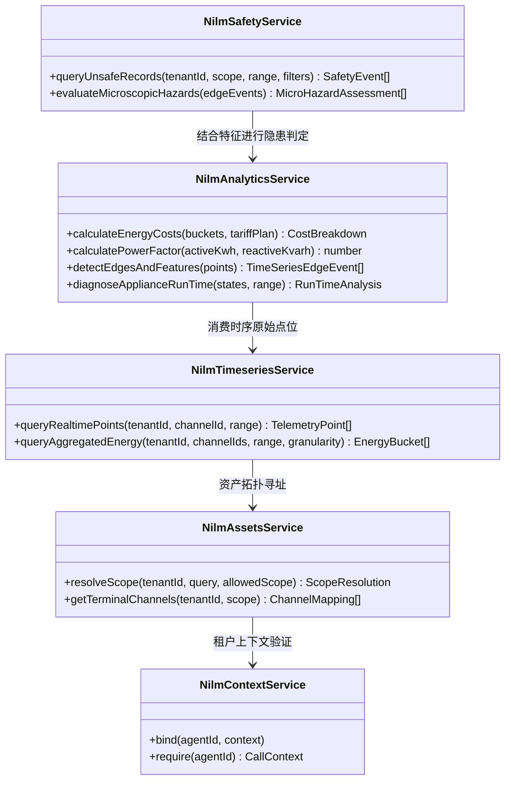
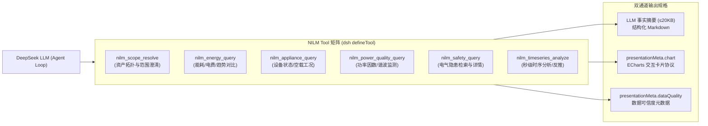
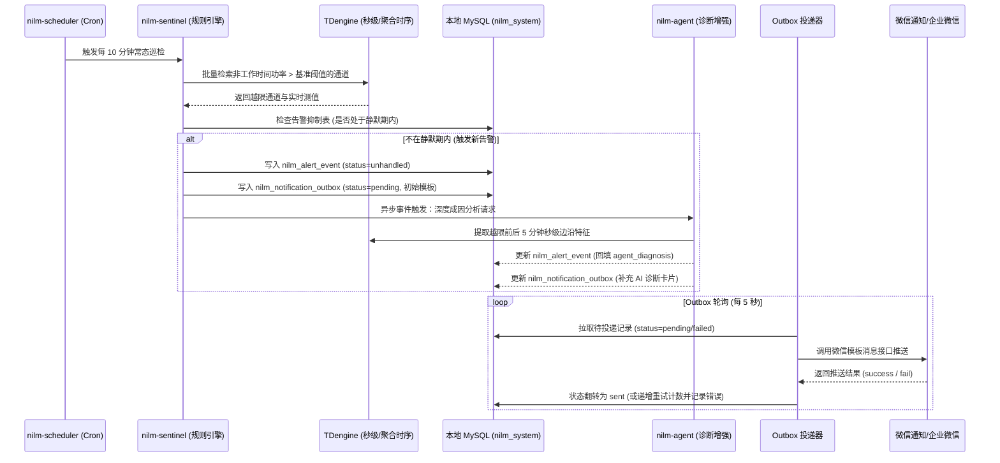

# 非侵入式负荷监测（NILM）工厂端 AI Agent 系统概要设计说明书

## 0. 文档导读与设计基线

- **业务需求基线**：[docs/nilm-ai-agent-requirements.md](file:///home/picohood/projects/opensource/deepseek-harness/docs/nilm-ai-agent-requirements.md)
- **系统架构方案**：[docs/nilm-ai-agent-architecture.md](file:///home/picohood/projects/opensource/deepseek-harness/docs/nilm-ai-agent-architecture.md)
- **底层宿主环境**：`deepseek-harness` (Cordis 微内核插件体系 + TypeScript Node.js ESM)
- **文档目的**：本文档为非侵入式负荷监测（NILM）工厂端 AI Agent 系统的**概要设计说明书（High-Level Design, HLD）**。作为架构方案与详细代码实现之间的桥梁，本文档将系统功能与架构决策映射为具体的软件模块结构、Cordis 插件拓扑、本地持久化 DDL、领域服务接口契约、Tool 矩阵规格以及前后端交互协议。

---

## 1. 系统总体结构与模块划分

### 1.1 包结构设计（Monorepo Layout）

系统作为 `deepseek-harness` 仓库下的业务扩展，遵循 Monorepo 规范，以独立 package 形式组织在 `packages/nilm/` 命名空间下，并由 `packages/bundle/nilm-app/` 组装为可运行的 profile bundle：

```
packages/
  nilm/
    core/             # L0: 领域基础实体、值对象、强类型 Branded ID、错误码定义
    source/           # L1: 上游 MySQL/TDengine/冷库代理数据源适配层 (只读仓储 Repository)
    assets/           # L2: 五级拓扑（租户-车间-终端-通道-设备）投影与缓存解析服务
    timeseries/       # L2: 秒级/分时时序数据查询、冷热路由与降采样服务
    analytics/        # L2: 纯函数计算引擎（能耗/电费/PF/时长/CUSUM边沿突变与特征工程）
    tariff/           # L2: 分时电价、功率因数考核与力调电费测算服务
    safety/           # L2: 电气安全隐患检索、分类与严重级别归一化服务
    charts/           # L2: ECharts 规范 (ChartSpec) 确定性生成与校验服务
    sentinel/         # L2: 主动巡检规则匹配、非工作时间基线偏离检测与去重过滤
    tools/            # L3: dsh defineTool 矩阵（6个业务 Tool 与参数校验）
    agent/            # L4: Agent 编排、系统提示词装配、模型路由与多轮会话管理
    bff/              # L5: 外部 HTTP REST API、SSE 响应流、调用方上下文验签
    notify/           # L5: 异步告警投递器 (Outbox Processor) 与多渠道通知推送
  bundle/
    nilm-app/         # 运行时组合打包（cordis.yml 配置、依赖注入与长驻启动入口）
```

### 1.2 Cordis 运行时上下文扩展（Context Declaration Merging）

系统基于 Cordis 的服务注入机制运作。各领域服务作为独立 Service 挂载至全局上下文 `Context`，各层通过类型安全的方式消费依赖：

```ts
// packages/nilm/core/src/context.ts
import { Context } from '@deepseek-ai/cordis'
import type { NilmSourceService } from '@deepseek-ai/dsh-nilm-source'
import type { NilmAssetsService } from '@deepseek-ai/dsh-nilm-assets'
import type { NilmTimeseriesService } from '@deepseek-ai/dsh-nilm-timeseries'
import type { NilmAnalyticsService } from '@deepseek-ai/dsh-nilm-analytics'
import type { NilmTariffService } from '@deepseek-ai/dsh-nilm-tariff'
import type { NilmSafetyService } from '@deepseek-ai/dsh-nilm-safety'
import type { NilmChartsService } from '@deepseek-ai/dsh-nilm-charts'
import type { NilmSentinelService } from '@deepseek-ai/dsh-nilm-sentinel'
import type { NilmContextService } from './tenant-context.js'

declare module '@deepseek-ai/cordis' {
  interface Context {
    nilmContext: NilmContextService
    nilmSource: NilmSourceService
    nilmAssets: NilmAssetsService
    nilmTimeseries: NilmTimeseriesService
    nilmAnalytics: NilmAnalyticsService
    nilmTariff: NilmTariffService
    nilmSafety: NilmSafetyService
    nilmCharts: NilmChartsService
    nilmSentinel: NilmSentinelService
  }
}
```

### 1.3 进程模型与部署拓扑

生产环境遵循**计算服务与调度服务分离**的部署模型：

1. **`nilm-agent` 生产长驻进程（Deployment）**：
   - 挂载 `nilm-bff`（承载外部 HTTP / SSE 请求）、`nilm-agent`（dsh Agent Loop）、各领域服务及 Tool 矩阵；
   - 支持多副本水平扩展，节点间无状态，通过 Redis 协调限流与分布式缓存；
   - 承载被动问答（Pull 模式）的全部生命周期。
2. **`nilm-scheduler` 独立任务与检测进程（Deployment）**：
   - 专用于承载定时巡检（非工作时间能耗基线检测、力调电费预测、每日晨报触发）；
   - 基于数据库租约（MySQL 悲观锁或 Redis 分布式锁）保证多副本单点执行；
   - 检测到异常后，直接将事件写入 `nilm_alert_event` 与 `nilm_notification_outbox`，异步唤起 Agent 接口进行深度诊断文案润色；
   - 独立运行 `nilm-notify` 轮询投递器，执行至少一次的通知推送。

---

## 2. 本地持久化数据表设计（MySQL `nilm_system`）

本项目不侵入修改上游业务数据库（`tpim_system`），自建独立的存储库 `nilm_system`，用于存储系统本地的租户接入配置、资产快照、会话索引、告警规则、通知出件箱（Outbox）及审计日志。

### 2.1 租户与资产配置表 (`nilm_tenant_config`)

维护已接入本系统的租户专属运行策略与日历基线：

```sql
CREATE TABLE `nilm_tenant_config` (
  `id` BIGINT UNSIGNED NOT NULL AUTO_INCREMENT COMMENT '自增主键',
  `tenant_id` VARCHAR(64) NOT NULL COMMENT '租户唯一标识，对应上游 sys_tenant_info.tenant_id',
  `tenant_name` VARCHAR(128) NOT NULL COMMENT '工厂企业名称',
  `status` TINYINT NOT NULL DEFAULT 1 COMMENT '状态: 0=禁用, 1=正常',
  `work_calendar_type` VARCHAR(32) NOT NULL DEFAULT 'standard_industrial' COMMENT '工作日历类型',
  `work_hours_json` JSON NOT NULL COMMENT '工作时段配置，如 {"ranges": [["08:00", "12:00"], ["13:00", "17:00"]]}',
  `non_work_baseline_kw` DECIMAL(10, 2) NOT NULL DEFAULT 0.00 COMMENT '非工作时间基载功率阈值(kW)',
  `non_work_alert_minutes` INT NOT NULL DEFAULT 30 COMMENT '基载超限持续报警判定分钟数',
  `power_factor_target` DECIMAL(4, 2) NOT NULL DEFAULT 0.90 COMMENT '功率因数考核目标(如0.90)',
  `tariff_plan_id` VARCHAR(64) NOT NULL DEFAULT 'default' COMMENT '绑定的电价方案ID',
  `created_at` DATETIME NOT NULL DEFAULT CURRENT_TIMESTAMP,
  `updated_at` DATETIME NOT NULL DEFAULT CURRENT_TIMESTAMP ON UPDATE CURRENT_TIMESTAMP,
  PRIMARY KEY (`id`),
  UNIQUE KEY `uk_tenant_id` (`tenant_id`)
) ENGINE=InnoDB DEFAULT CHARSET=utf8mb4 COMMENT='NILM租户运行策略与基线配置表';
```

### 2.2 资产结构缓存快照表 (`nilm_asset_snapshot`)

缓存自上游 MySQL 周期性同步的五级资产拓扑，加速模型 Scope 模糊匹配与层级聚合运算：

```sql
CREATE TABLE `nilm_asset_snapshot` (
  `id` BIGINT UNSIGNED NOT NULL AUTO_INCREMENT,
  `tenant_id` VARCHAR(64) NOT NULL COMMENT '租户ID',
  `level` ENUM('factory', 'workshop', 'terminal', 'channel', 'appliance') NOT NULL COMMENT '拓扑层级',
  `node_id` VARCHAR(64) NOT NULL COMMENT '节点ID (如终端ID/通道ID/分类ID)',
  `parent_id` VARCHAR(64) DEFAULT NULL COMMENT '父节点ID',
  `node_name` VARCHAR(128) NOT NULL COMMENT '节点名称 (如1号冲压车间/进线总柜)',
  `path_name` VARCHAR(512) NOT NULL COMMENT '层级路径全称 (如 XX机械厂/1号冲压车间/进线总柜/通道1)',
  `rated_power_kw` DECIMAL(10, 2) DEFAULT NULL COMMENT '额定功率/变压器容量',
  `channel_type` VARCHAR(32) DEFAULT NULL COMMENT '通道类型: main=总进线, sub=分路',
  `appliance_category_id` INT DEFAULT NULL COMMENT '绑定的用电器具类别ID',
  `is_active` TINYINT NOT NULL DEFAULT 1 COMMENT '是否有效',
  `synced_at` DATETIME NOT NULL COMMENT '快照同步时间',
  PRIMARY KEY (`id`),
  UNIQUE KEY `uk_tenant_level_node` (`tenant_id`, `level`, `node_id`),
  KEY `idx_tenant_parent` (`tenant_id`, `parent_id`),
  KEY `idx_tenant_name` (`tenant_id`, `node_name`)
) ENGINE=InnoDB DEFAULT CHARSET=utf8mb4 COMMENT='五级资产拓扑结构快照缓存表';
```

### 2.3 会话与对话轮次索引表 (`nilm_conversation` / `nilm_turn_log`)

记录多端会话元数据，实际流式事件与长上下文依赖 dsh Session JSONL：

```sql
CREATE TABLE `nilm_conversation` (
  `id` BIGINT UNSIGNED NOT NULL AUTO_INCREMENT,
  `conversation_id` VARCHAR(64) NOT NULL COMMENT '会话外部业务标识',
  `tenant_id` VARCHAR(64) NOT NULL COMMENT '租户ID',
  `user_ref` VARCHAR(64) NOT NULL COMMENT '调用方用户标识 (微信openid/系统userId)',
  `session_id` VARCHAR(128) NOT NULL COMMENT '对应 dsh 内部持久化 Session ID',
  `title` VARCHAR(128) NOT NULL DEFAULT '新对话' COMMENT '会话标题',
  `last_active_at` DATETIME NOT NULL DEFAULT CURRENT_TIMESTAMP COMMENT '最后活跃时间',
  `status` VARCHAR(32) NOT NULL DEFAULT 'active' COMMENT '状态: active/archived/closed',
  `created_at` DATETIME NOT NULL DEFAULT CURRENT_TIMESTAMP,
  PRIMARY KEY (`id`),
  UNIQUE KEY `uk_conv_id` (`conversation_id`),
  KEY `idx_tenant_user` (`tenant_id`, `user_ref`, `last_active_at`)
) ENGINE=InnoDB DEFAULT CHARSET=utf8mb4 COMMENT='AI会话索引表';

CREATE TABLE `nilm_turn_log` (
  `id` BIGINT UNSIGNED NOT NULL AUTO_INCREMENT,
  `turn_id` VARCHAR(64) NOT NULL COMMENT '交互轮次唯一ID',
  `conversation_id` VARCHAR(64) NOT NULL,
  `tenant_id` VARCHAR(64) NOT NULL,
  `user_ref` VARCHAR(64) NOT NULL,
  `client_message_id` VARCHAR(64) NOT NULL COMMENT '客户端消息幂等ID',
  `user_query` TEXT NOT NULL COMMENT '用户原始提问文本',
  `model_name` VARCHAR(64) NOT NULL COMMENT '使用的模型名称 (deepseek-chat/reasoner)',
  `total_tokens` INT UNSIGNED DEFAULT 0 COMMENT '消耗Token总量',
  `tools_called_json` JSON DEFAULT NULL COMMENT '调用的Tool列表与入参记录',
  `latency_ms` INT UNSIGNED NOT NULL COMMENT '端到端响应耗时毫秒数',
  `data_quality_json` JSON DEFAULT NULL COMMENT '本轮涉及的数据质量评级',
  `created_at` DATETIME NOT NULL DEFAULT CURRENT_TIMESTAMP,
  PRIMARY KEY (`id`),
  UNIQUE KEY `uk_turn_id` (`turn_id`),
  UNIQUE KEY `uk_client_msg` (`tenant_id`, `client_message_id`),
  KEY `idx_conv_time` (`conversation_id`, `created_at`)
) ENGINE=InnoDB DEFAULT CHARSET=utf8mb4 COMMENT='会话交互轮次审计表';
```

### 2.4 告警规则与事件表 (`nilm_alert_rule` / `nilm_alert_event`)

支撑主动巡检（Push 通道）的规则判定与事件记录：

```sql
CREATE TABLE `nilm_alert_rule` (
  `id` BIGINT UNSIGNED NOT NULL AUTO_INCREMENT,
  `rule_id` VARCHAR(64) NOT NULL COMMENT '规则唯一编码',
  `tenant_id` VARCHAR(64) NOT NULL,
  `rule_type` VARCHAR(32) NOT NULL COMMENT '规则类型: non_work_energy, power_factor, safety_threshold, harmonic_exceed',
  `scope_level` ENUM('factory', 'workshop', 'terminal', 'channel') NOT NULL,
  `scope_id` VARCHAR(64) NOT NULL COMMENT '适用的资产范围ID',
  `threshold_json` JSON NOT NULL COMMENT '动态阈值参数 (如功率限值、持续分钟数等)',
  `severity` ENUM('info', 'warning', 'critical') NOT NULL DEFAULT 'warning',
  `silent_minutes` INT NOT NULL DEFAULT 60 COMMENT '告警静默抑制周期(分钟)',
  `notify_channels_json` JSON NOT NULL COMMENT '通知渠道: ["wechat", "sms", "app"]',
  `is_enabled` TINYINT NOT NULL DEFAULT 1,
  `created_at` DATETIME NOT NULL DEFAULT CURRENT_TIMESTAMP,
  `updated_at` DATETIME NOT NULL DEFAULT CURRENT_TIMESTAMP ON UPDATE CURRENT_TIMESTAMP,
  PRIMARY KEY (`id`),
  UNIQUE KEY `uk_tenant_rule` (`tenant_id`, `rule_id`),
  KEY `idx_tenant_type` (`tenant_id`, `rule_type`, `is_enabled`)
) ENGINE=InnoDB DEFAULT CHARSET=utf8mb4 COMMENT='主动巡检告警规则配置表';

CREATE TABLE `nilm_alert_event` (
  `id` BIGINT UNSIGNED NOT NULL AUTO_INCREMENT,
  `event_id` VARCHAR(64) NOT NULL COMMENT '告警事件唯一业务ID',
  `tenant_id` VARCHAR(64) NOT NULL,
  `rule_id` VARCHAR(64) NOT NULL,
  `source_type` ENUM('sentinel_rule', 'upstream_unsafe', 'scheduler_check') NOT NULL,
  `scope_level` ENUM('factory', 'workshop', 'terminal', 'channel') NOT NULL,
  `scope_id` VARCHAR(64) NOT NULL,
  `scope_name` VARCHAR(128) NOT NULL,
  `severity` ENUM('info', 'warning', 'critical') NOT NULL,
  `metric_name` VARCHAR(64) NOT NULL COMMENT '越限指标 (如 power, current, power_factor, thd_i)',
  `metric_value` DECIMAL(12, 4) NOT NULL COMMENT '越限发生时的实际值',
  `threshold_value` DECIMAL(12, 4) NOT NULL COMMENT '设定阈值',
  `raw_event_time` DATETIME NOT NULL COMMENT '设备端或采样发生时间',
  `summary_text` VARCHAR(512) NOT NULL COMMENT '确定性模板生成的告警摘要',
  `agent_diagnosis` TEXT DEFAULT NULL COMMENT 'AI Agent 异步增强的深度成因诊断与处置建议',
  `status` ENUM('unhandled', 'notified', 'acknowledged', 'resolved') NOT NULL DEFAULT 'unhandled',
  `created_at` DATETIME NOT NULL DEFAULT CURRENT_TIMESTAMP,
  PRIMARY KEY (`id`),
  UNIQUE KEY `uk_event_id` (`event_id`),
  KEY `idx_tenant_status` (`tenant_id`, `status`, `created_at`)
) ENGINE=InnoDB DEFAULT CHARSET=utf8mb4 COMMENT='主动巡检与电气安全告警事件表';
```

### 2.5 异步通知出件箱表 (`nilm_notification_outbox`)

支撑可靠投递模式（Outbox Pattern），保障弱网络与三方推送服务抖动下的最终一致性：

```sql
CREATE TABLE `nilm_notification_outbox` (
  `id` BIGINT UNSIGNED NOT NULL AUTO_INCREMENT,
  `outbox_id` VARCHAR(64) NOT NULL COMMENT '出件箱流水号',
  `tenant_id` VARCHAR(64) NOT NULL,
  `event_id` VARCHAR(64) NOT NULL COMMENT '关联的告警事件ID',
  `channel` ENUM('wechat_miniprogram', 'wechat_work', 'sms', 'webhook') NOT NULL,
  `recipient` VARCHAR(128) NOT NULL COMMENT '接收者标识 (openid/手机号/webhook URL)',
  `payload_json` JSON NOT NULL COMMENT '投递模板载荷与参数',
  `status` ENUM('pending', 'sending', 'sent', 'failed', 'dead') NOT NULL DEFAULT 'pending',
  `retry_count` INT UNSIGNED NOT NULL DEFAULT 0,
  `max_retries` INT UNSIGNED NOT NULL DEFAULT 5,
  `next_retry_at` DATETIME NOT NULL DEFAULT CURRENT_TIMESTAMP,
  `last_error_message` VARCHAR(512) DEFAULT NULL,
  `delivered_at` DATETIME DEFAULT NULL,
  `created_at` DATETIME NOT NULL DEFAULT CURRENT_TIMESTAMP,
  PRIMARY KEY (`id`),
  UNIQUE KEY `uk_outbox_id` (`outbox_id`),
  KEY `idx_status_next_retry` (`status`, `next_retry_at`),
  KEY `idx_event_id` (`event_id`)
) ENGINE=InnoDB DEFAULT CHARSET=utf8mb4 COMMENT='通知投递出件箱表 (Outbox)';
```

---

## 3. 领域模型与核心数据字典（Domain Schemas）

在 `packages/nilm/core/src/types/` 中定义不可变领域实体与值对象：

```ts
// packages/nilm/core/src/types/domain.ts

/** 强类型品牌标识 */
export type TenantId = string & { readonly __brand: unique symbol }
export type TerminalId = string & { readonly __brand: unique symbol }
export type ChannelId = string & { readonly __brand: unique symbol }
export type ConversationId = string & { readonly __brand: unique symbol }

/** 拓扑作用域级别 */
export type ScopeLevel = 'factory' | 'workshop' | 'terminal' | 'channel'

export interface ScopeTarget {
  level: ScopeLevel
  id?: string
  name?: string
  resolvedPath?: string
  terminalIds?: string[]
  channelIds?: string[]
}

/** 时间区间规格 */
export interface TimeRangeSpec {
  start: Date
  end: Date
  timeZone: string
  granularity: 'second' | 'minute' | '15min' | 'hour' | 'day' | 'month'
}

/** 数据质量评估对象 */
export interface DataQuality {
  coverageRate: number      // 数据完整度 0.0 ~ 1.0
  expectedPoints: number    // 理论点数
  actualPoints: number      // 实测点数
  gapSeconds: number        // 采样中断缺失秒数
  isInterpolated: boolean   // 是否包含插值修复
  confidence: 'high' | 'medium' | 'low' | 'unavailable'
}

/** 统一图表协议结构 (ChartSpec) */
export interface ChartSpec {
  chartType: 'line' | 'bar' | 'pie' | 'scatter' | 'heatmap'
  title: string
  subTitle?: string
  xAxis: {
    type: 'time' | 'category' | 'value'
    data?: string[]
    name?: string
  }
  yAxis: {
    type: 'value'
    unit: string
    min?: number
    max?: number
  }
  series: Array<{
    name: string
    type: string
    data: Array<number | [string, number]>
    color?: string
    stack?: string
    step?: 'start' | 'middle' | 'end'
  }>
  markLines?: Array<{
    name: string
    yValue: number
    color?: string
  }>
}

/** 时序边沿突变检测事件元组 */
export interface TimeSeriesEdgeEvent {
  timestamp: string         // ISO 8601 事件触发时间
  deltaActivePowerKw: number // 有功功率阶跃量 ΔP
  deltaReactivePowerKvar: number // 无功功率阶跃量 ΔQ
  inrushCurrentRatio: number // 暂态冲击比 Ipeak / Isteady
  steadyDurationSec: number  // 稳态持续秒数
  phaseOffset: 'A' | 'B' | 'C' | 'three_phase_balanced'
  harmonicDelta: {
    thdCurrent: number      // ΔTHD-I
    harmonic3rd: number     // 3次谐波增量
    harmonic5th: number     // 5次谐波增量
    harmonic7th: number     // 7次谐波增量
  }
}
```

---

## 4. 领域服务详细设计（Domain Services）

领域服务位于 `packages/nilm/` 各业务包中，严格遵循“纯计算下沉、强无状态、无模型依赖”原则。



### 4.1 资产与范围解析服务 (`NilmAssetsService`)

- **职责**：
  1. 屏蔽底层拓扑差异，实现自然语言到五级资产实体（`factory`, `workshop`, `terminal`, `channel`, `appliance`）的双向解析；
  2. 强制校验调用方的 `allowed_scope`，防止越权；
  3. 将任意车间或总线范围，动态展开为下属全部监测终端（`terminal`）与通道（`channel`）的真实 ID 列表。
- **核心方法签名**：
  ```ts
  interface NilmAssetsService {
    resolveScope(
      tenantId: TenantId,
      rawQuery: { level?: ScopeLevel; name?: string; id?: string },
      allowedScope?: ScopeTarget[]
    ): Promise<ScopeResolutionResult>

    getWorkshopChannels(
      tenantId: TenantId,
      workshopId: string
    ): Promise<Array<{ terminalId: string; channelId: string; channelType: 'main' | 'sub' }>>
  }
  ```

### 4.2 时序特征工程与算法服务 (`NilmAnalyticsService`)

- **职责**：
  1. **能耗与费用纯函数**：按租户分时电价方案计算尖峰平谷切片、能量加权功率因数、空载浪费金额；
  2. **时序信号处理算法（CUSUM 边沿检测）**：从 TDengine 获取秒级瞬时数据后，提取有功/无功台阶、瞬态冲击比（$I_{\text{peak}} / I_{\text{steady}}$）以及谐波畸变指纹；
  3. **微观隐患判定**：对高频启停、启动迟滞憋死、三相动态偏载提供确定性特征指标。
- **核心算法设计规格（纯函数无状态）**：
  ```ts
  interface NilmAnalyticsService {
    /** 边沿跳变检测与特征向量提取 (CUSUM 算法) */
    detectTimeSeriesFeatures(
      points: Array<{ ts: number; currentA: number; activeKw: number; reactiveKvar: number; thdI: number }>,
      options: { powerThresholdKw: number; windowSizeSec: number }
    ): TimeSeriesEdgeEvent[]

    /** 能量加权功率因数测算 */
    calculatePowerFactor(totalActiveKwh: number, totalReactiveKvarh: number): number | undefined

    /** 运行与空载时长分析 (防断档与去抖) */
    calculateRunningAndIdleTime(
      transitions: Array<{ ts: number; isRunning: boolean; isIdle: boolean }>,
      window: { start: number; end: number },
      minDwellMs: number
    ): { runningMinutes: number; idleMinutes: number; validRatio: number }
  }
  ```

### 4.3 计费与电价日历服务 (`NilmTariffService`)

- **职责**：
  1. 解析浙江及华东工商业分时电价规则（尖峰平谷时段、季节性尖峰、日历节假日）；
  2. 执行国家力调电费考核标准测算（0.90 / 0.85 基准，查表法或多项式计算奖惩比例）；
  3. 输出月度电费预测与需量/容量电费优化建议输入事实。

---

## 5. Tool 矩阵与执行规格详细设计

Tool 是大模型（LLM）与底层业务体系交互的唯一通道。每个 Tool 继承自 dsh `defineTool`，遵循以下硬性约束：
1. **入参无数据库敏感信息**：禁止暴露 `tenant_id`、SQL、物理表名；
2. **只读幂等保障**：全部 Tool 声明 `isConcurrencySafe: () => true`；
3. **输出体积受限**：单次 Tool 调用返回给大模型的文本事实不超过 20 KB；详细坐标点位下沉至 `presentationMeta`，供客户端渲染。



### 5.1 Tool 详细规格表

| Tool 名称 | 输入参数 Schema 核心字段 | 执行服务调用 | 输出结构说明 (返回模型 / 挂载前端) |
| :--- | :--- | :--- | :--- |
| `nilm_scope_resolve` | `query: string`, `level?: ScopeLevel` | `ctx.nilmAssets.resolveScope` | 匹配到的作用域候选清单、歧义标记与对应 ID 路径 |
| `nilm_energy_query` | `scope: ScopeSpec`, `timeRange: RangeSpec`, `compare?: enum`, `includeCost?: boolean` | `ctx.nilmAnalytics.queryEnergy` | 周期能耗总量、分时电量费用、环比趋势；挂载柱状/折线图 `ChartSpec` |
| `nilm_appliance_query` | `scope: ScopeSpec`, `timeRange: RangeSpec`, `category?: string`, `idleThresholdKw?: number` | `ctx.nilmAnalytics.queryAppliances` | 各设备运行/空载时长、浪费电量金额；挂载工况甘特/饼图 `ChartSpec` |
| `nilm_power_quality_query` | `scope: ScopeSpec`, `timeRange: RangeSpec`, `metrics?: string[]` | `ctx.nilmAnalytics.queryPowerQuality` | 加权功率因数、谐波含有率、越限风险统计；挂载谐波分布图 `ChartSpec` |
| `nilm_safety_query` | `scope: ScopeSpec`, `timeRange: RangeSpec`, `severity?: string`, `types?: string[]` | `ctx.nilmSafety.queryUnsafeRecords` | 隐患记录清单、发生点位、越限幅值与处置指引事实 |
| `nilm_timeseries_analyze` | `scope: ScopeSpec`, `timeRange: RangeSpec (<=4h)`, `analysisMode: enum` | `ctx.nilmAnalytics.analyzeTimeseries` | 提取的时序边沿特征元组、推测电器候选列表、微观潜在隐患诊断；挂载秒级波形标注图 `ChartSpec` |

### 5.2 核心 Tool 声明示例（`nilm_timeseries_analyze`）

```ts
// packages/nilm/tools/src/timeseries-analyze.ts
import { defineTool } from '@deepseek-ai/dsh-tools'
import { NilmToolError } from '@deepseek-ai/dsh-nilm-core'

export const nilmTimeseriesAnalyzeTool = defineTool({
  name: 'nilm_timeseries_analyze',
  description: '查询并分析指定监测终端或通道在短时间窗口（<=4小时）内的秒级时序电气特征，识别功率阶跃台阶，反推用电设备并研判潜在微观电气隐患。',
  parameters: {
    scope: {
      type: 'object',
      required: true,
      properties: {
        level: { type: 'string', required: true, enum: ['terminal', 'channel'] },
        id: { type: 'string' },
        name: { type: 'string' },
      },
    },
    timeRange: {
      type: 'object',
      required: true,
      properties: {
        start: { type: 'string', required: true },
        end: { type: 'string', required: true },
      },
    },
    analysisMode: {
      type: 'string',
      required: true,
      enum: ['disaggregation_only', 'hazard_diagnosis', 'comprehensive'],
    },
  },
  output: {
    schema: {
      type: 'object',
      required: true,
      properties: {
        summaryText: { type: 'string', required: true },
        detectedEvents: { type: 'array' },
        applianceCandidates: { type: 'array' },
        potentialHazards: { type: 'array' },
        dataQuality: { type: 'object', required: true },
      },
    },
    render: (_args, value) => [{ type: 'text', text: value.summaryText }],
    presentationMeta: (_args, value) => ({
      chart: value.chart,
      dataQuality: value.dataQuality,
    }),
  },
  isConcurrencySafe: () => true,
  async execute(args, exec) {
    const agentId = exec.agent?.id
    if (!agentId) throw new NilmToolError('TENANT_CONTEXT_UNAVAILABLE', '会话上下文缺失')
    const callCtx = ctx.nilmContext.require(agentId)
    return ctx.nilmAnalytics.analyzeTimeseries({
      callContext: callCtx,
      scope: args.scope,
      timeRange: args.timeRange,
      analysisMode: args.analysisMode,
    })
  },
})
```

---

## 6. BFF 接口与客户端交互协议设计

BFF（Backend For Frontend）作为服务的接入网关，承载调用方身份验签、请求分发与 SSE 流式响应。

### 6.1 HTTP REST API 规格

#### 1. 提交对话请求 (`POST /v1/turns`)
- **Headers**：
  - `X-Nilm-Tenant-Id: <tenant_id>` （必填）
  - `X-Nilm-User-Ref: <user_open_id>` （必填）
  - `X-Nilm-Signature: <hmac_sha256_sign>` （网关验签密钥）
- **Request Body**：
  ```json
  {
    "conversationId": "conv_9a8b7c6d",
    "clientMessageId": "msg_1710000000_001",
    "content": "帮我看看昨天3号车间哪个设备空载浪费最严重？",
    "mode": "auto"
  }
  ```
- **Response**：`200 OK`，`Content-Type: text/event-stream`

#### 2. 会话管理接口
- `POST /v1/conversations`：开启新对话（返回 `conversationId`）；
- `GET /v1/conversations`：获取当前用户的历史会话列表；
- `DELETE /v1/conversations/:id`：清空或归档指定会话。

### 6.2 SSE 事件流协议与前端渲染协议

```
event: status
data: {"step": "resolving_scope", "message": "正在解析3号冲压车间监测终端..."}

event: tool_call
data: {"tool": "nilm_appliance_query", "scope": "3号车间", "timeRange": "2026-11-16"}

event: text_chunk
data: {"delta": "昨日（11月16日）3号车间累计空载浪费电量为 "}

event: text_chunk
data: {"delta": "**246.8 kWh**，折合电费约 **212.5 元**。"}

event: chart_card
data: {
  "cardId": "card_chart_001",
  "chartSpec": {
    "chartType": "bar",
    "title": "3号车间主要设备昨日空载损失",
    "xAxis": {"data": ["1号空压机", "2号冲压机", "工频除尘风机"]},
    "yAxis": {"unit": "元"},
    "series": [{"name": "浪费金额", "type": "bar", "data": [128.4, 56.2, 27.9]}]
  }
}

event: done
data: {"turnId": "turn_abc123", "tokensUsed": 842, "latencyMs": 1240}
```

---

## 7. 主动巡检引擎与通知投递机制设计

### 7.1 定时巡检流水线（Push 链路）

主动巡检遵循 **“轻量确定性规则常驻扫描 ➔ 阈值越限生成事件 ➔ 异步唤醒 Agent 深度诊断 ➔ Outbox 保证送达”** 的设计：



### 7.2 告警抑制与状态机流转

为杜绝报警风暴，系统实现三级抑制策略：
1. **持续时间门槛**：异常状态必须持续超过 `non_work_alert_minutes`（默认 30 分钟），过滤短暂试车或偶发脉冲；
2. **静默期冷却**：同一租户、同一设备点位的同类告警，在 `silent_minutes`（默认 60 分钟）内不重复向业主手机推送；
3. **Outbox 状态机流转**：
   - `pending` ➔ `sending` ➔ `sent`（正常流程）；
   - `sending` ➔ 发生网络/三方限流异常 ➔ `failed`（根据指数退避公式 $T_{\text{next}} = 2^{\text{retry}} \times 5\,\text{s}$ 计算下次重试时间）；
   - 超过最大重试次数（`max_retries = 5`） ➔ 标记为 `dead`，触发内部运维告警。

---

## 8. 错误处理与降级码表

系统建立分级错误控制模型，严防系统崩溃或向用户泄露内部敏感堆栈：

| 错误代码 (Error Code) | 触发条件 | HTTP 状态码 | SSE / 用户端展现策略 |
| :--- | :--- | :--- | :--- |
| `UNAUTHORIZED_TENANT` | 缺少有效签名或租户已被禁用 | `401 Unauthorized` | 拦截请求，引导重新授权 |
| `SCOPE_FORBIDDEN` | 用户无权访问该车间或终端 | `403 Forbidden` | 明确说明无权查看该区域数据 |
| `DATA_UNAVAILABLE` | 上游时序库无数据或断档 | `200 OK` (业务降级) | “该时间段内暂无有效采集数据，可能终端处于离线状态” |
| `DATA_PARTIAL` | 采集完整率 < 85% | `200 OK` (带警示) | 正常给出结论，但显著标注“数据覆盖率偏低，结果仅供参考” |
| `MODEL_TIMEOUT` | LLM 深度推理超时 (>15s) | `200 OK` (降级输出) | 降级输出确定性纯文本报表，跳过 AI 润色 |
| `TOOL_EXECUTION_TIMEOUT`| TDengine 查询超时 (>3s) | `200 OK` (局部降级) | 提示“时序检索超时，建议缩短查询时间范围” |

---

## 9. 工程落盘与实施组织

系统代码落地规划于以下源码目录结构：

```
packages/
  nilm/
    core/
      src/
        types/            # 领域类型与接口
        errors.ts         # 统一错误体系
        tenant-context.ts # 租户上下文定义
    source/
      src/
        mysql/            # MySQL 连接池与参数化仓储
        tdengine/         # TDengine 3.0 REST/WebSocket 客户端
    assets/
      src/
        service.ts        # 资产拓扑缓存与解析
    analytics/
      src/
        energy.ts         # 能耗纯函数
        cusum.ts          # CUSUM 时序特征工程算法
        power-factor.ts   # 功率因数测算
    tariff/
      src/
        plans/            # 华东/浙江工商业电价模板
    safety/
      src/
        service.ts        # 隐患检索与微观诊断
    tools/
      src/
        definitions/      # 6个业务 Tool 的 defineTool 实现
    agent/
      src/
        prompts/          # 系统基座提示词
        runner.ts         # Agent 执行编排
    bff/
      src/
        routes/           # REST 路由与 SSE 封装
    sentinel/
      src/
        detector.ts       # 巡检规则执行器
    notify/
      src/
        outbox.ts         # Outbox 轮询与重试
```

---

## 10. 概要设计完备性核对矩阵

| 序号 | 需求与架构条目 | 概要设计落地章节 | 完备性核验结论 |
| :---: | :--- | :--- | :---: |
| 1 | 五级资产拓扑与聚合支持 | 2.2 资产快照表、3 领域模型、4.1 资产服务 | **PASS**（支持工厂/车间/终端/通道全层级展开） |
| 2 | 严禁模型伪造数据与口径漂移 | 4.2 计算服务、5 Tool 矩阵、8 错误码 | **PASS**（全部计算纯函数化，Tool 结果直出事实） |
| 3 | 秒级时序特征工程与算法协同 | 3 边沿特征实体、4.2 CUSUM算法、5.2 Tool | **PASS**（下沉提取紧凑特征向量，防上下文打爆） |
| 4 | 主动巡检与可靠通知投递 | 2.4/2.5 DDL、7 主动巡检与 Outbox 状态机 | **PASS**（规避报警风暴，指数退避重试保证送达） |
| 5 | 多租户强隔离与数据安全 | 2.1 租户表、4.1 鉴权上下文、6.1 BFF 验签 | **PASS**（租户不可篡改，Tool 参数无租户渗透） |
