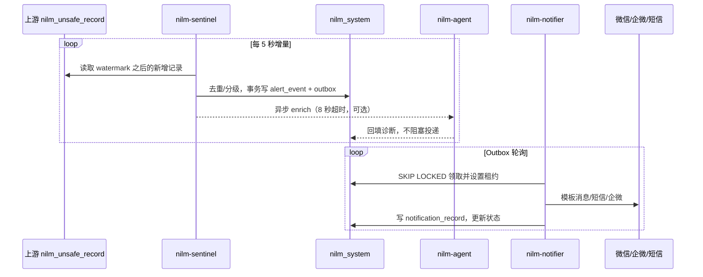

# 非侵入式负荷监测（NILM）工厂端 AI Agent 系统概要设计说明书

## 0. 文档导读与设计边界

- **业务需求基线**：[docs/nilm-ai-agent-requirements.md](file:///home/picohood/projects/opensource/deepseek-harness/docs/nilm-ai-agent-requirements.md)
- **系统架构方案**：[docs/nilm-ai-agent-architecture.md](file:///home/picohood/projects/opensource/deepseek-harness/docs/nilm-ai-agent-architecture.md)
- **底层宿主环境**：`deepseek-harness`（Cordis 插件体系 + TypeScript Node.js ESM）
- **文档定位**：本文档把架构方案映射为可落地的包结构、持久化表、领域服务接口、Tool 规格和调用方接入协议；架构取舍与论证以架构文档为准，本文档不重复展开。

### 0.1 系统边界

本项目是面向微信小程序/App 使用客户的**后端 Agent 服务提供方**，不是客户侧管理平台，也不是前端展示系统。

| 能力 | 归属 | 本项目处理方式 |
| :--- | :--- | :--- |
| 用户登录、角色、菜单、微信绑定、用户可见范围 | 调用方平台 | 不实现；只消费调用方签名后的 `tenant_id`、`user_ref`、`allowed_scope` |
| 小程序/App 页面、图表渲染、语音 ASR、分享导出 | 调用方客户端 | 不实现；只提供 REST/SSE、`ChartSpec` 与告警卡片协议 |
| 租户隔离、调用方验签、范围上限执行 | 本项目 BFF | `nilm-service` 在信任边界验签并绑定不可变 `CallContext` |
| 领域数据查询、Agent 推理、Tool、告警检测、通知投递 | 本项目 | 由 `nilm-*` 包与 `nilm-agent`/`nilm-sentinel`/`nilm-scheduler` 承载 |
| 设备控制、分合闸、远程参数下发 | 现场系统 | 不实现；告警卡片只提供确认、查看详情与联系入口 |

本项目 v1 不写上游 `tpim_system`/TDengine，不复制参考管理平台的账号、权限、菜单与前端实现；不建 `nilm_user`、`nilm_user_tenant`、`nilm_wechat_binding`、角色或菜单表。上游表名只作为候选线索，运行期契约由 `nilm-source` 的白名单与契约版本固定。

### 0.2 关键设计事实

- 多租户隔离由代码与 SQL 兜底，不能依赖提示词。
- 所有业务数字由 Tool/领域服务计算，模型只做解释与建议。
- 会话内容以 dsh Session JSONL 为准，本项目 MySQL 只保存索引、告警、通知与审计。
- 生产 Profile 只挂载问答所需的最小内核与 NILM 插件，不挂载 shell、文件系统、Web、子代理与 MCP 客户端。
- 力调公式、电价导入方式、数据接入模式、调用方签名方式仍是待决策项，未确认前只输出风险等级或明确标注估算。

---

## 1. 系统总体结构与运行模型

### 1.1 包布局与 dsh Bundle 组合

系统作为 `deepseek-harness` 仓库下的业务扩展，放在 `packages/nilm/`，bundle 放在 `packages/bundle/nilm-app/`。包职责与架构文档 5.2 保持一致：

```text
packages/
  nilm/
    core/             # L0: 品牌 ID、Scope、DataQuality、ChartSpec、错误码
    context/          # L1: 调用方上下文绑定与取回
    source/           # L1: MySQL/TDengine/冷代理只读适配；白名单与契约版本
    assets/           # L2: 五级拓扑投影、范围解析、计量点集合
    timeseries/       # L2: 实时/预聚合/冷库查询、降采样、质量元数据
    tariff/           # L2: 电价计划、日历、功率因数考核政策
    analytics/        # L2: 电量/电费/PF/谐波/时长/CUSUM/同比环比
    safety/           # L2: 隐患检索、详情投影、严重度归一化
    charts/           # L2: 结构化结果到受控 ChartSpec
    tools/            # L3: 6 个 defineTool 业务 Tool
    prompt/           # L4: 稳定基座提示词与输出规则
    sentinel/         # L5: 实时安全与用能巡检规则引擎
    scheduler/        # L5: 晨报、力调预测、数据质量任务
    notify/           # L5: Outbox、渠道适配、重试与投递审计
    service/          # L5: BFF HTTP/SSE、会话编排、验签、取消与幂等
  bundle/
    nilm-app/         # @deepseek-ai/dsh-nilm-app；cordis.patch.yml 与组合测试
```

`nilm-service` 是 BFF，不是独立前端服务。`nilm-agent`、`nilm-sentinel`、`nilm-scheduler`、`nilm-notifier`、`nilm-cold-proxy` 是部署单元名称，不是额外 package。Agent Loop、Session、LLM、Tool 注册表来自 dsh 核心包。

生产组合使用自定义 bundle `@deepseek-ai/dsh-nilm-app`，在 `package.json` 声明 `dsh.bundle.patch: ./cordis.patch.yml`，通过 `dsh --profile nilm` 启动。环境相关配置放在 `$DSH_HOME/profiles/nilm/cordis.patch.yml` 或 K8s Secret，不在仓库维护固定 IP 的 `cordis.yml`，也不新增自定义长驻启动入口。

**不继承 `dsh-base` 不会破坏 harness 工程。** `dsh-base` 是静态 patch 层，不是运行时内核；它不挂载服务、不持有状态。项目以 `sdk-minimal` 的完整树为基线，删除与 NILM 无关的行并加入 NILM 行。风险是升级时的行集合漂移，用三道门禁控制：

1. **组合快照**：断言 `cordis.patch.yml` 的 `(id, package, disabled, config)` 列表与黄金快照一致。
2. **启动冒烟**：CI 用无 Key 的假 provider 启动 `dsh --profile nilm`，断言硬注入满足、健康检查通过、进程干净退出。
3. **工具清单断言**：运行时只允许 `nilm_*` 与必要内核 Tool；出现 `bash`、`read`、`write`、`edit`、`web_search`、`web_fetch`、`subagent`、MCP 资源工具即失败。

生产 Profile 不挂载 settings、credentials、plugin-manager、HMR、config-editor、session-telemetry-otel、session-log-deepseek、session-title-llm。模型 Key 由 K8s Secret/环境变量注入；会话标题由 `nilm_conversation.title` 维护。

### 1.2 Cordis 上下文扩展

各领域服务通过 `ctx.effect()` 注册，注册函数返回 disposer；其它插件只通过声明的 `Context` key 消费服务：

```ts
// packages/bundle/nilm-app/src/context.ts
import type { Context } from '@deepseek-ai/cordis'
import type { NilmContextService } from '@deepseek-ai/dsh-nilm-context'
import type { NilmSourceService } from '@deepseek-ai/dsh-nilm-source'
import type { NilmAssetsService } from '@deepseek-ai/dsh-nilm-assets'
import type { NilmTimeseriesService } from '@deepseek-ai/dsh-nilm-timeseries'
import type { NilmAnalyticsService } from '@deepseek-ai/dsh-nilm-analytics'
import type { NilmTariffService } from '@deepseek-ai/dsh-nilm-tariff'
import type { NilmSafetyService } from '@deepseek-ai/dsh-nilm-safety'
import type { NilmChartsService } from '@deepseek-ai/dsh-nilm-charts'
import type { NilmSentinelService } from '@deepseek-ai/dsh-nilm-sentinel'
import type { NilmSchedulerService } from '@deepseek-ai/dsh-nilm-scheduler'
import type { NilmNotificationService } from '@deepseek-ai/dsh-nilm-notify'
import type { NilmService } from '@deepseek-ai/dsh-nilm-service'

declare module '@deepseek-ai/cordis' {
  interface Context {
    nilmContext: NilmContextService
    nilmSource: NilmSourceService
    nilmAssets: NilmAssetsService
    nilmTimeseries: NilmTimeseriesService
    nilmAnalytics: NilmAnalyticsService
    nilmTariff: NilmTariffService
    nilmSafety: NilmSafetyService
    nilmCharts: NilmChartsService
    nilmSentinel: NilmSentinelService
    nilmScheduler: NilmSchedulerService
    nilmNotify: NilmNotificationService
    nilmService: NilmService
  }
}
```

声明合并放在组合包，而不是 `nilm-core`，避免 L0 反向依赖 L1/L2 服务包。`nilm-prompt` 不新增 Context key，它向 dsh `ctx.systemPrompt` 贡献稳定基座提示词。`nilm-tools` 在注册时捕获插件 `ctx`，Tool 的 `execute` 不接收全局上下文对象。

### 1.3 部署单元与会话所有权

| 单元 | 形态 | 副本 | 状态 | 说明 |
| :--- | :--- | :--- | :--- | :--- |
| `nilm-edge` | Deployment/Ingress | 2+ | 无状态 | TLS、WAF、限流、路由；不解析业务身份 |
| `nilm-agent` | StatefulSet（按租户分片） | 每分片 1 主 | PVC（Session JSONL） | dsh runtime、`nilm-service` BFF、Tool、领域服务 |
| `nilm-sentinel` | Deployment | 1 Leader + 备用 | DB/Redis 规则状态 | 5 秒增量巡检、告警去重与入队 |
| `nilm-scheduler` | Deployment | 1+（数据库幂等） | DB 任务状态 | 08:30 晨报、20/25 日力调预测、数据质量巡检 |
| `nilm-notifier` | Deployment | 2+ | 无状态 | 从 Outbox 领取任务，按渠道限流 |
| `nilm-cold-proxy` | 内网 Deployment | 2 | 无状态 | 只读、限查询、mTLS，隔离冷库 |
| Redis | 托管/集群 | 3 | 有状态 | 限流、nonce、租约、短 TTL 缓存 |
| 本项目 MySQL | 托管 | 主备 | 有状态 | 租户配置、告警、Outbox、报告与审计 |

上游 MySQL、TDengine 热库与冷库不是本项目部署单元，只作为只读依赖。Agent 不能做成无状态 Serverless：Session 持久化、模型长连接、工具上下文与租户分片都需要稳定的进程所有权。

`nilm-sentinel` 不挂模型与 Session；需要诊断文案时通过内网专用接口调用 `nilm-agent`。`nilm-scheduler` 默认只使用确定性模板；仅当部署配置 `summaryModel` 时，才通过一次性 Cordis Agent 生成摘要文字，报表数字与投递仍由确定性流水线控制。

dsh Session 采用单写者所有权，横向扩展必须显式处理：

1. 以 `tenant_id` 做一致性哈希，把租户固定到 `nilm-agent` 分片；同一租户的会话只落在该分片。
2. 新会话由当前分片创建，`nilm_conversation` 记录 `session_id -> shard_id`。
3. 网关按 `session_id` 或 `tenant_id` 粘性路由；跨分片请求拒绝并返回可重试的重定向。
4. Pod 重启后从 PVC 的 JSONL 恢复；恢复前确认旧 Pod 已终止，避免双写。
5. 扩容先增加分片，再迁移租户；迁移采用“排空—归档—切换”，不做在线双写。
6. 定时任务与巡检用数据库租约或 Kubernetes Lease 选主；同一任务同一时刻只有一个执行者。

性能目标按架构 Q-03/Q-04 执行：首流事件 p95 < 300 ms；无 Tool 的简单问题首个文本 p95 < 1.5 s；含 Tool 的端到端 p95 < 8 s；热聚合查询 p95 < 300 ms；Critical 告警从入库到触达 p95 < 30 s。容量按“百家工厂同时在线巡检”规划，每租户最多 4 个并发查询，全局信号量按 Pod 配置。

### 1.4 Agent 提示词、会话与模型路由

提示词分为三层，跨租户稳定的内容放最前，动态内容后置：

1. **稳定基座提示词**：数字来源、口径、无数据处理、歧义澄清、租户边界、输出结构、安全措辞、语言。由 `nilm-prompt` 贡献，保持跨租户稳定以复用 KV 缓存。
2. **动态上下文**：租户名、当前时间、业务时区、调用方范围、会话级“上一个范围/时间”。由 `nilm-service` 以可记录的消息注入，不放进基座片段。
3. **Tool 结构化事实**：`summaryText`、`facts`、`dataQuality`、`warnings`、`chart`、`actions`。模型只能引用，不得改数字与单位。

会话生命周期：

- 创建使用 `ctx.agents.create({ sessionId, agentOptions })`，恢复使用 `ctx.agents.resume()`；`sessionId` 为不透明品牌字符串。
- 创建与恢复都在 `setup(agentCtx, agent)` 中调用 `ctx.nilmContext.bind(agent.id, callContext)`；进程重启后必须重新验签调用方请求，不得从 Session 日志恢复 `tenant_id`。
- 用户消息通过 `followup()` 进入下一轮；打断使用 `cancel()`；外部不直接修改 Session 事件。
- 多轮“上一个范围/时间”由 `nilm-service` 维护为结构化状态，并以一条可记录的上下文消息注入；模型可见内容必须能从 Session 日志重建。
- 上下文压缩使用 `dsh-compaction-basic`，保留最近一轮 Tool 结果摘要与数据质量，不保留完整大数组。
- 每轮最多 6 次 Tool 调用，单 Tool 输出不超过 20 KB，单轮总上下文按模型窗口配置；超限返回可解释错误，不静默截断事实。

模型路由：

| 场景 | 模型 | 约束 |
| :--- | :--- | :--- |
| 常规统计、查询、晨报摘要 | `deepseek-chat` | 低延迟，工具调用稳定 |
| 用户显式要求深度诊断、复杂因果分析 | `deepseek-reasoner` | BFF 在 turn 开始前选择，不在同一轮中途切换 |
| Critical 告警模板与即时通知 | 不调用模型 | 保证 30 秒 SLO |
| 异步告警增强 | `deepseek-chat` | 超时 8 秒；失败保留模板文案 |

---

## 2. 本地持久化设计（MySQL `nilm_system`）

本项目不写上游业务库，自建 `nilm_system` 保存租户配置、资产投影、会话索引、告警、通知、报告与审计。Session 正文仍以 PVC 上的 dsh Session JSONL 为准。

### 2.1 表清单

| 表 | 作用 | v1 必要性 |
| :--- | :--- | :--- |
| `nilm_tenant_config` | 租户运行策略、工作日历、基线与通知策略 | 必需 |
| `nilm_asset_snapshot` | 上游五级拓扑的可重建投影 | 必需 |
| `nilm_measurement_binding` | 终端/通道计量角色与父子关系，防重复聚合 | 按需；上游无法表达时启用 |
| `nilm_conversation` | 会话索引、`session_id -> shard_id` | 必需 |
| `nilm_turn_log` | 轮次审计、幂等与延迟 | 必需 |
| `nilm_security_audit` | Tool/SQL/越权/通知审计 | 必需 |
| `nilm_alert_rule` | 规则配置与版本 | 必需 |
| `nilm_alert_event` | 告警事件、跨窗口静默、去重、确认与诊断 | 必需 |
| `nilm_alert_transition` | 告警状态流转审计 | 必需 |
| `nilm_notification_outbox` | 可靠投递队列 | 必需 |
| `nilm_notification_record` | 渠道投递审计（需求中的 `log_notification_record`） | 必需 |
| `nilm_sentinel_watermark` | 上游增量读取水位线 `(source, record_time, record_id)` | 必需 |
| `nilm_job_run` | 定时任务执行与幂等 | 必需 |
| `nilm_report` | 晨报/力调报告的结构化结果 | 必需 |
| `nilm_tariff_plan` / `nilm_tariff_period` | 电价方案与分时时段 | 必需 |
| `nilm_calendar_day` | 工作日、节假日、班次 | 必需 |
| `nilm_pf_policy` | 功率因数考核线与力调规则版本 | 必需 |

### 2.2 核心表 DDL

```sql
CREATE TABLE `nilm_tenant_config` (
  `tenant_id` VARCHAR(64) NOT NULL COMMENT '调用方签名上下文中的租户标识',
  `tenant_name` VARCHAR(128) NOT NULL COMMENT '工厂企业名称',
  `status` TINYINT NOT NULL DEFAULT 1 COMMENT '0=停用, 1=正常',
  `time_zone` VARCHAR(64) NOT NULL DEFAULT 'Asia/Shanghai',
  `work_calendar_type` VARCHAR(32) NOT NULL DEFAULT 'standard_industrial',
  `work_hours_json` JSON NOT NULL COMMENT '工作时段，如 {"ranges":[["08:00","12:00"],["13:00","17:00"]]}',
  `non_work_baseline_kw` DECIMAL(10, 2) NOT NULL DEFAULT 0.00 COMMENT '非工作时段基载阈值(kW)',
  `non_work_alert_minutes` INT NOT NULL DEFAULT 10 COMMENT '用能类告警持续判定分钟数；Critical 安全告警不受此值限制',
  `tariff_plan_id` VARCHAR(64) DEFAULT NULL COMMENT '当前生效电价方案',
  `calendar_id` VARCHAR(64) DEFAULT NULL COMMENT '工作日历',
  `pf_policy_id` VARCHAR(64) DEFAULT NULL COMMENT '功率因数考核政策',
  `notification_policy_json` JSON DEFAULT NULL COMMENT '渠道、免打扰、级别下限；不含联系人明文',
  `config_version` INT UNSIGNED NOT NULL DEFAULT 1 COMMENT '缓存失效版本',
  `created_at` DATETIME NOT NULL DEFAULT CURRENT_TIMESTAMP,
  `updated_at` DATETIME NOT NULL DEFAULT CURRENT_TIMESTAMP ON UPDATE CURRENT_TIMESTAMP,
  PRIMARY KEY (`tenant_id`)
) ENGINE=InnoDB DEFAULT CHARSET=utf8mb4 COMMENT='租户运行策略与基线配置';

CREATE TABLE `nilm_asset_snapshot` (
  `id` BIGINT UNSIGNED NOT NULL AUTO_INCREMENT,
  `tenant_id` VARCHAR(64) NOT NULL,
  `level` ENUM('factory', 'workshop', 'terminal', 'channel', 'appliance') NOT NULL,
  `node_id` VARCHAR(64) NOT NULL COMMENT '上游节点ID',
  `parent_id` VARCHAR(64) DEFAULT NULL,
  `node_name` VARCHAR(128) NOT NULL,
  `path_name` VARCHAR(512) NOT NULL COMMENT '完整路径，用于名称匹配与展示',
  `path_ids_json` JSON DEFAULT NULL COMMENT '从根到当前节点的ID链',
  `rated_power_kw` DECIMAL(10, 2) DEFAULT NULL COMMENT '额定功率/变压器容量',
  `channel_type` VARCHAR(32) DEFAULT NULL COMMENT 'main=总进线, sub=分路',
  `appliance_category_id` INT DEFAULT NULL COMMENT 'NILM 设备品类',
  `is_active` TINYINT NOT NULL DEFAULT 1,
  `source_contract_version` VARCHAR(32) NOT NULL DEFAULT 'v0' COMMENT '上游适配契约版本',
  `source_updated_at` DATETIME DEFAULT NULL COMMENT '上游记录更新时间',
  `synced_at` DATETIME NOT NULL COMMENT '同步时间；超过阈值视为 stale',
  PRIMARY KEY (`id`),
  UNIQUE KEY `uk_tenant_level_node` (`tenant_id`, `level`, `node_id`),
  KEY `idx_tenant_parent` (`tenant_id`, `parent_id`),
  KEY `idx_tenant_name` (`tenant_id`, `node_name`)
) ENGINE=InnoDB DEFAULT CHARSET=utf8mb4 COMMENT='五级资产拓扑投影';

CREATE TABLE `nilm_conversation` (
  `id` BIGINT UNSIGNED NOT NULL AUTO_INCREMENT,
  `conversation_id` VARCHAR(64) NOT NULL COMMENT '服务端签发的不透明ID',
  `tenant_id` VARCHAR(64) NOT NULL,
  `user_ref` VARCHAR(64) NOT NULL COMMENT '调用方用户引用，仅用于审计、限流与通知定位',
  `session_id` VARCHAR(128) NOT NULL COMMENT 'dsh Session ID',
  `shard_id` VARCHAR(32) NOT NULL COMMENT '会话所属 agent 分片',
  `title` VARCHAR(128) NOT NULL DEFAULT '' COMMENT '可由调用方命名；不使用模型生成',
  `last_active_at` DATETIME NOT NULL DEFAULT CURRENT_TIMESTAMP,
  `status` VARCHAR(32) NOT NULL DEFAULT 'active' COMMENT 'active/archived/closed',
  `created_at` DATETIME NOT NULL DEFAULT CURRENT_TIMESTAMP,
  PRIMARY KEY (`id`),
  UNIQUE KEY `uk_tenant_user_conv` (`tenant_id`, `user_ref`, `conversation_id`),
  UNIQUE KEY `uk_session_id` (`session_id`),
  KEY `idx_tenant_user_active` (`tenant_id`, `user_ref`, `last_active_at`)
) ENGINE=InnoDB DEFAULT CHARSET=utf8mb4 COMMENT='AI会话索引；查找必须带 tenant_id + user_ref';

CREATE TABLE `nilm_turn_log` (
  `id` BIGINT UNSIGNED NOT NULL AUTO_INCREMENT,
  `turn_id` VARCHAR(64) NOT NULL,
  `conversation_id` VARCHAR(64) NOT NULL,
  `tenant_id` VARCHAR(64) NOT NULL,
  `user_ref` VARCHAR(64) NOT NULL,
  `client_message_id` VARCHAR(64) NOT NULL COMMENT '客户端消息幂等ID',
  `user_query_ciphertext` VARBINARY(4096) DEFAULT NULL COMMENT 'AES-GCM 密文；不存用户提问明文',
  `user_query_digest` CHAR(64) DEFAULT NULL COMMENT 'SHA-256 摘要，用于幂等与审计',
  `model_name` VARCHAR(64) DEFAULT NULL,
  `total_tokens` INT UNSIGNED NOT NULL DEFAULT 0,
  `tools_called_json` JSON DEFAULT NULL COMMENT 'Tool 名称、参数摘要、耗时；不含 SQL',
  `latency_ms` INT UNSIGNED NOT NULL DEFAULT 0,
  `data_quality_json` JSON DEFAULT NULL,
  `error_code` VARCHAR(64) DEFAULT NULL,
  `created_at` DATETIME NOT NULL DEFAULT CURRENT_TIMESTAMP,
  PRIMARY KEY (`id`),
  UNIQUE KEY `uk_turn_id` (`turn_id`),
  UNIQUE KEY `uk_client_msg` (`tenant_id`, `user_ref`, `client_message_id`),
  KEY `idx_conv_user_time` (`tenant_id`, `user_ref`, `conversation_id`, `created_at`)
) ENGINE=InnoDB DEFAULT CHARSET=utf8mb4 COMMENT='会话轮次审计';

CREATE TABLE `nilm_alert_rule` (
  `id` BIGINT UNSIGNED NOT NULL AUTO_INCREMENT,
  `tenant_id` VARCHAR(64) NOT NULL,
  `rule_id` VARCHAR(64) NOT NULL COMMENT '如 R-01a/R-01b/R-02/R-03/R-06',
  `rule_type` VARCHAR(32) NOT NULL,
  `scope_level` ENUM('factory', 'workshop', 'terminal', 'channel', 'appliance') NOT NULL,
  `scope_id` VARCHAR(64) NOT NULL,
  `threshold_json` JSON NOT NULL,
  `severity` ENUM('info', 'warning', 'critical') NOT NULL DEFAULT 'warning',
  `silent_minutes` INT NOT NULL DEFAULT 30,
  `notify_channels_json` JSON NOT NULL COMMENT 'wx_subscribe/wx_template/wecom_webhook/sms',
  `is_enabled` TINYINT NOT NULL DEFAULT 1,
  `version` INT UNSIGNED NOT NULL DEFAULT 1,
  `created_at` DATETIME NOT NULL DEFAULT CURRENT_TIMESTAMP,
  `updated_at` DATETIME NOT NULL DEFAULT CURRENT_TIMESTAMP ON UPDATE CURRENT_TIMESTAMP,
  PRIMARY KEY (`id`),
  UNIQUE KEY `uk_tenant_rule` (`tenant_id`, `rule_id`),
  KEY `idx_tenant_type` (`tenant_id`, `rule_type`, `is_enabled`)
) ENGINE=InnoDB DEFAULT CHARSET=utf8mb4 COMMENT='主动巡检规则配置';

CREATE TABLE `nilm_alert_event` (
  `id` BIGINT UNSIGNED NOT NULL AUTO_INCREMENT,
  `event_id` VARCHAR(64) NOT NULL,
  `tenant_id` VARCHAR(64) NOT NULL,
  `rule_id` VARCHAR(64) NOT NULL,
  `source_type` ENUM('sentinel_rule', 'upstream_unsafe', 'scheduler_check') NOT NULL,
  `scope_level` ENUM('factory', 'workshop', 'terminal', 'channel', 'appliance') NOT NULL,
  `scope_id` VARCHAR(64) NOT NULL,
  `scope_name` VARCHAR(128) NOT NULL,
  `severity` ENUM('info', 'warning', 'critical') NOT NULL,
  `metric_name` VARCHAR(64) NOT NULL,
  `metric_value` DECIMAL(12, 4) NOT NULL,
  `threshold_value` DECIMAL(12, 4) DEFAULT NULL,
  `unit` VARCHAR(16) NOT NULL,
  `bucket_start` DATETIME NOT NULL COMMENT '去重时间桶起点',
  `silence_key` VARCHAR(191) NOT NULL COMMENT 'tenant_id+rule_id+scope_id+metric，跨窗口抑制',
  `dedupe_key` VARCHAR(191) NOT NULL COMMENT 'tenant_id+rule_id+scope_id+metric+bucket_start',
  `raw_event_time` DATETIME NOT NULL COMMENT '上游事件或采样时间',
  `detected_at` DATETIME NOT NULL DEFAULT CURRENT_TIMESTAMP,
  `summary_text` VARCHAR(1024) NOT NULL COMMENT '确定性模板摘要',
  `agent_diagnosis` TEXT DEFAULT NULL COMMENT '异步增强诊断；不决定告警级别与投递',
  `agent_model` VARCHAR(64) DEFAULT NULL,
  `agent_prompt_version` VARCHAR(32) DEFAULT NULL,
  `agent_generated_at` DATETIME DEFAULT NULL,
  `status` ENUM('detected', 'confirmed', 'notified', 'acknowledged', 'resolved', 'suppressed', 'false_positive') NOT NULL DEFAULT 'detected',
  `escalated_from` VARCHAR(64) DEFAULT NULL COMMENT '升级来源事件ID',
  `acknowledged_at` DATETIME DEFAULT NULL,
  `acknowledged_by` VARCHAR(64) DEFAULT NULL,
  `resolved_at` DATETIME DEFAULT NULL,
  `created_at` DATETIME NOT NULL DEFAULT CURRENT_TIMESTAMP,
  `updated_at` DATETIME NOT NULL DEFAULT CURRENT_TIMESTAMP ON UPDATE CURRENT_TIMESTAMP,
  PRIMARY KEY (`id`),
  UNIQUE KEY `uk_event_id` (`event_id`),
  UNIQUE KEY `uk_tenant_dedupe` (`tenant_id`, `dedupe_key`),
  KEY `idx_tenant_status` (`tenant_id`, `status`, `created_at`),
  KEY `idx_tenant_rule_bucket` (`tenant_id`, `rule_id`, `bucket_start`),
  KEY `idx_tenant_silence_bucket` (`tenant_id`, `silence_key`, `bucket_start`)
) ENGINE=InnoDB DEFAULT CHARSET=utf8mb4 COMMENT='告警事件';

CREATE TABLE `nilm_sentinel_watermark` (
  `source_name` VARCHAR(64) NOT NULL COMMENT '增量源标识，如 upstream_unsafe',
  `record_time` DATETIME NOT NULL COMMENT '已处理记录的事件时间',
  `record_id` VARCHAR(128) NOT NULL COMMENT '同一事件时间内的稳定排序ID',
  `updated_at` DATETIME NOT NULL DEFAULT CURRENT_TIMESTAMP ON UPDATE CURRENT_TIMESTAMP,
  PRIMARY KEY (`source_name`)
) ENGINE=InnoDB DEFAULT CHARSET=utf8mb4 COMMENT='上游增量读取水位线';

CREATE TABLE `nilm_notification_outbox` (
  `id` BIGINT UNSIGNED NOT NULL AUTO_INCREMENT,
  `notification_id` VARCHAR(64) NOT NULL COMMENT '对外通知ID，客户端按此去重',
  `tenant_id` VARCHAR(64) NOT NULL,
  `user_ref` VARCHAR(64) DEFAULT NULL COMMENT '接收主体引用；实际渠道标识见 recipient_ciphertext',
  `event_id` VARCHAR(64) DEFAULT NULL,
  `report_id` VARCHAR(64) DEFAULT NULL,
  `channel` ENUM('wx_subscribe', 'wx_template', 'wecom_webhook', 'sms') NOT NULL,
  `template_id` VARCHAR(128) DEFAULT NULL,
  `recipient_ciphertext` VARBINARY(1024) DEFAULT NULL COMMENT 'openid/手机号/webhook 的加密值',
  `recipient_masked` VARCHAR(64) DEFAULT NULL COMMENT '仅用于排障展示，不可反推',
  `payload_json` JSON NOT NULL COMMENT '模板参数；不含密钥与完整个人信息',
  `dedupe_key` VARCHAR(191) NOT NULL,
  `status` ENUM('pending', 'sending', 'sent', 'failed', 'dead') NOT NULL DEFAULT 'pending',
  `attempt_count` INT UNSIGNED NOT NULL DEFAULT 0,
  `max_attempts` INT UNSIGNED NOT NULL DEFAULT 5,
  `next_retry_at` DATETIME NOT NULL DEFAULT CURRENT_TIMESTAMP,
  `claimed_by` VARCHAR(64) DEFAULT NULL COMMENT 'worker 标识',
  `lease_expires_at` DATETIME DEFAULT NULL COMMENT '领取租约到期时间',
  `provider_message_id` VARCHAR(128) DEFAULT NULL,
  `last_error` VARCHAR(512) DEFAULT NULL,
  `created_at` DATETIME NOT NULL DEFAULT CURRENT_TIMESTAMP,
  `sent_at` DATETIME DEFAULT NULL,
  PRIMARY KEY (`id`),
  UNIQUE KEY `uk_tenant_notification_channel` (`tenant_id`, `notification_id`, `channel`),
  UNIQUE KEY `uk_tenant_dedupe_channel` (`tenant_id`, `dedupe_key`, `channel`),
  KEY `idx_claim` (`status`, `next_retry_at`, `lease_expires_at`)
) ENGINE=InnoDB DEFAULT CHARSET=utf8mb4 COMMENT='通知 Outbox';
```

### 2.3 支撑表

| 表 | 关键字段 | 约束 |
| :--- | :--- | :--- |
| `nilm_measurement_binding` | `tenant_id`、`terminal_id`、`channel_id`、`role`、`parent_channel_id`、`effective_from`、`effective_to` | `role` 为 `terminal_total/branch/appliance/reference`；唯一键 `(tenant_id, terminal_id, channel_id, effective_from)`；聚合前选择互不重叠的叶子计量点 |
| `nilm_alert_transition` | `event_id`、`from_status`、`to_status`、`operator_type`、`operator_ref`、`reason`、`channel`、`created_at` | 每次状态变更写一条；用户确认不关闭检测 |
| `nilm_notification_record` | `notification_id`、`tenant_id`、`channel`、`recipient_masked`、`event_id`、`status`、`provider_message_id`、`error_code`、`sent_at` | 唯一键 `(tenant_id, notification_id, channel)`；保留至少 180 天 |
| `nilm_security_audit` | `audit_id`、`tenant_id`、`user_ref`、`session_id`、`event_type`、`tool`、`query_template`、`scope`、`time_range`、`row_count`、`latency_ms`、`result_hash`、`error_code`、`created_at` | 保留至少 1 年；不含 SQL 明文与敏感结果 |
| `nilm_job_run` | `job_run_id`、`job_type`、`tenant_id`、`scheduled_at`、`started_at`、`finished_at`、`status`、`idempotency_key`、`attempt`、`error_code` | 唯一键 `(job_type, idempotency_key)`；键必须包含 `tenant_id` 与业务日期 |
| `nilm_report` | `report_id`、`tenant_id`、`report_type`、`report_date`、`payload_json`、`chart_json`、`summary_text`、`status`、`generated_at`、`delivered_at` | 唯一键 `(tenant_id, report_type, report_date)` |
| `nilm_tariff_plan` | `plan_id`、`tenant_id`、`effective_from`、`effective_to`、`region`、`voltage_level`、`version` | 唯一键 `(tenant_id, plan_id)`；同一租户同一时间只有一个生效计划 |
| `nilm_tariff_period` | `plan_id`、`season`、`day_type`、`period_type`、`start_time`、`end_time`、`price` | 唯一键 `(plan_id, season, day_type, period_type, start_time)`；`period_type` 为尖/峰/平/谷；支持一天多段 |
| `nilm_calendar_day` | `tenant_id`、`date`、`day_type`、`season`、`shift_json` | 唯一键 `(tenant_id, date)`；工作日、周末、节假日、电价季节与生产班次 |
| `nilm_pf_policy` | `tenant_id`、`effective_from`、`threshold`、`reward_rule_json`、`penalty_rule_json` | 唯一键 `(tenant_id, effective_from)`；默认 0.90 只是初始值；没有可执行公式时只输出风险等级 |

上表只列业务字段。建表脚本为支撑表补充两类技术列：`id`（自增主键，用于稳定行定位）与 `created_at`（记录写入时间，用于保留期清理与时间索引）。技术列不进入对外契约，也不新增业务语义；业务字段以本表为准。

### 2.4 隐私、保留与一致性

- `nilm_turn_log` 不存用户提问明文；应用层用 KMS 管理的密钥做 AES-GCM 加密，另存 SHA-256 摘要用于幂等与审计。
- `nilm_notification_outbox.recipient_ciphertext` 加密保存 openid/手机号/webhook；排障只展示 `recipient_masked`，日志不打印明文。
- `nilm_security_audit` 记录 Tool 调用、SQL 模板、范围拒绝、验签失败与通知投递；只存查询模板与结果摘要，不存 SQL 明文或敏感结果。
- 审计记录保留至少 1 年；通知记录至少 180 天；Session JSONL 保留期由 D-05 决定，并支持调用方删除请求。
- 告警事件与对应 Outbox 在同一数据库事务内写入；通知投递至少一次，客户端按 `notification_id` 去重展示。
- 资产投影可重建，不是第二套台账；上游变更按 `source_contract_version` 与 `synced_at` 判定是否 stale。

---

## 3. 领域模型与核心类型

领域类型放在 `packages/nilm/core/src/types/`，不依赖数据库、模型或网络。

### 3.1 标识、范围与调用方上下文

```ts
export type TenantId = string & { readonly __brand: 'TenantId' }
export type WorkshopId = string & { readonly __brand: 'WorkshopId' }
export type TerminalId = string & { readonly __brand: 'TerminalId' }
export type ChannelId = string & { readonly __brand: 'ChannelId' }
export type ApplianceId = string & { readonly __brand: 'ApplianceId' }
export type ConversationId = string & { readonly __brand: 'ConversationId' }
export type SessionId = string & { readonly __brand: 'SessionId' }
export type TurnId = string & { readonly __brand: 'TurnId' }

export type ScopeLevel = 'factory' | 'workshop' | 'terminal' | 'channel' | 'appliance'

export interface ScopeTarget {
  level: ScopeLevel
  id?: string
  name?: string
  path?: string
}

export type MeterRole = 'terminal_total' | 'branch' | 'appliance' | 'reference'

export interface MeterPoint {
  terminalId: TerminalId
  channelId: ChannelId
  role: MeterRole
  parentChannelId?: ChannelId
  /** 资产投影路径，用于日/月统计库按 group_name 取数。 */
  pathName?: string
}

export interface ScopeResolution {
  matched: ScopeTarget[]
  ambiguous: boolean
  resolvedPath?: string
  /** 确定性拓扑或绑定告警；不静默丢弃被排除的分路。 */
  warnings?: string[]
  meterSet: MeterPoint[]
}

export interface TelemetryPoint {
  /** epoch 毫秒；不同上游精度在适配层统一。 */
  tsMs: number
  deviceId: string
  channelId?: ChannelId
  metric: string
  value: number
}

export interface EnergyBucket {
  /** 左闭右开 epoch 毫秒区间。 */
  startMs: number
  endMs: number
  energyKwh: number
}

/** BFF 验签后绑定的不可变调用方上下文；Tool 参数中不存在这些字段。 */
export interface CallContext {
  readonly tenantId: TenantId
  readonly userRef: string
  readonly allowedScope?: readonly ScopeTarget[]
  readonly requestId: string
  readonly sessionId: SessionId
}

/** 内部定时任务/巡检使用显式系统身份，不复用用户上下文。 */
export interface SystemContext {
  readonly actor: 'sentinel' | 'scheduler' | 'notifier'
  readonly traceId: string
}
```

`allowedScope` 是调用方按自身权限计算的上限，模型不可扩大；缺省时视为租户级范围，但仍需保留租户隔离并记录审计。时间戳、nonce 与签名只在 BFF 校验，不进入领域上下文；会话恢复必须重新验签。

### 3.2 时间、数据质量与图表协议

```ts
export interface TimeRangeSpec {
  start: string                 // ISO 8601，带时区
  end: string                   // 左闭右开
  timeZone: 'Asia/Shanghai'
  granularity: 'second' | 'minute' | '15min' | 'hour' | 'day' | 'month'
}

/** 所有查询结果必须携带；模型先看质量再下结论。 */
export interface NilmDataQuality {
  /** 实际采样覆盖比例，0~1。 */
  coverage: number
  /** 最近一个有效点时间。 */
  lastSampleAt?: string
  /** 近期数据是否仍未稳定。 */
  provisional: boolean
  /** 缺失区间，按业务时区表示。 */
  gaps: Array<{ start: string; end: string; reason: string }>
  /** 预聚合、原始积分、冷库或混合。 */
  source: 'preaggregated' | 'raw' | 'cold' | 'mixed'
  /** 父子计量偏差、NILM 残差过大等。 */
  warnings: string[]
}

/** 后端与调用方客户端的稳定契约，不是任意 ECharts option。 */
export interface ChartSpec {
  version: 1
  type: 'line' | 'bar' | 'pie' | 'gauge' | 'stacked-bar'
  title: string
  subtitle?: string
  unit: string
  xAxis?: { type: 'time' | 'category'; labels?: string[] }
  series: Array<{ name: string; data: Array<number | null>; colorKey?: string }>
  annotations?: Array<{ at: string | number; label: string; severity?: 'info' | 'warning' | 'critical' }>
  dataQuality?: Pick<NilmDataQuality, 'coverage' | 'source' | 'provisional'>
}
```

`series[].data` 中的 `null` 表示缺口，客户端不得画成 0。超过 500 个点时后端已降采样，客户端不再二次聚合；图表下方显示区间、来源与覆盖率。

负增量或表码回绕视为仪表复位，按 0 处理并写入 `warnings`，不把负值计入电量；重复点按 `(meter, timestamp, metric)` 去重并记录重复计数。

### 3.3 秒级特征与 Tool 结果封装

```ts
export type HarmonicOrder = 2 | 3 | 4 | 5 | 6 | 7

export interface TimeSeriesEdgeEvent {
  timestamp: string
  deltaActivePowerKw: number
  deltaReactivePowerKvar: number
  inrushCurrentRatio: number
  steadyDurationSec: number
  phaseOffset: 'A' | 'B' | 'C' | 'three_phase_balanced'
  harmonicDelta: {
    thdCurrent: number
    harmonics: Array<{ order: HarmonicOrder; deltaRatio: number }>
  }
}

export interface NilmToolResult<T> {
  /** 服务端确定性生成的一行结论，已含范围、区间、单位。 */
  summaryText: string
  /** 结构化事实；不放大数组。 */
  facts: T
  /** 数据质量与口径，必须存在。 */
  dataQuality: NilmDataQuality
  /** 面向用户的限制、缺口、估算说明。 */
  warnings: string[]
  /** 可选图表；由调用方客户端渲染。 */
  chart?: ChartSpec
  /** 可选澄清或操作候选。 */
  actions?: Array<{ id: string; label: string; kind: 'clarify' | 'ack' | 'navigate' }>
}
```

`summaryText` 不交给模型润色；模型可以基于 `facts` 写更自然的解释，但不能改数字与单位。设备级数字必须标注“NILM 估算”，并返回通道残差。

### 3.4 告警卡片

```ts
export interface AlertCard {
  id: string
  severity: 'critical' | 'warning' | 'info'
  title: string
  site: { tenant: string; workshop?: string; terminal?: string; channel?: string; phase?: 'A' | 'B' | 'C' }
  occurredAt: string
  metrics: Array<{ label: string; value: string; unit: string; threshold?: string }>
  finding: string
  recommendation: string
  actions: Array<{ id: string; label: string; kind: 'ack' | 'call' | 'detail' }>
  dataQuality?: Pick<NilmDataQuality, 'coverage' | 'provisional'>
}
```

Critical 卡片必须包含发生点位、相别、越限值、发生时间与建议动作；按钮只做确认、查看详情、拨打电话/跳转，不提供远程分闸。

---

## 4. 领域服务设计

所有面向请求的 Service 方法第一个参数是 `CallContext`（`NilmContextService` 的 `bind`/`require`/`revoke` 本身除外）；内部定时任务与巡检使用 `SystemContext`，不得用可选参数绕过租户上下文。Tool 只调用 Service，不直接持有数据库连接、不拼 SQL、不调模型。

领域服务不调用模型；模型只存在于 Agent Loop。电量、电费、PF、谐波、时长与特征提取全部由确定性代码计算，模型只解释 Tool 返回的事实。

| 服务 | ctx key | 职责 |
| :--- | :--- | :--- |
| `NilmContextService` | `ctx.nilmContext` | `bind`/`require`/`revoke`，按 Agent ID 保存不可变上下文 |
| `NilmSourceService` | `ctx.nilmSource` | 只读数据适配、表白名单、参数化、契约版本、租户资产白名单 |
| `NilmAssetsService` | `ctx.nilmAssets` | 五级拓扑解析、范围授权、计量点集合 |
| `NilmTimeseriesService` | `ctx.nilmTimeseries` | 实时/预聚合/冷库查询、降采样、质量元数据 |
| `NilmTariffService` | `ctx.nilmTariff` | 生效电价、时段切分、日历、功率因数政策 |
| `NilmAnalyticsService` | `ctx.nilmAnalytics` | 电量、电费、PF、谐波、时长、同比环比、秒级特征 |
| `NilmSafetyService` | `ctx.nilmSafety` | 隐患检索、详情投影、微观隐患评估 |
| `NilmChartsService` | `ctx.nilmCharts` | 结构化结果到受控 `ChartSpec` |
| `NilmSentinelService` | `ctx.nilmSentinel` | 规则匹配、基线、去重、告警事件 |
| `NilmSchedulerService` | `ctx.nilmScheduler` | 定时任务、租约、幂等、晨报与力调预测 |
| `NilmNotificationService` | `ctx.nilmNotify` | Outbox、渠道适配、重试、模板、投递审计 |
| `NilmService` | `ctx.nilmService` | BFF HTTP/SSE、会话编排、验签、取消与幂等 |

### 4.1 调用方上下文服务

```ts
export interface NilmContextService {
  /** BFF 在 setup(agentCtx, agent) 中绑定；返回撤销函数。 */
  bind(agentId: string, callContext: CallContext): () => void
  /** Tool 通过 exec.agent.id 取回；未绑定或已撤销时抛 TENANT_CONTEXT_UNAVAILABLE。 */
  require(agentId: string): CallContext
  revoke(agentId: string): void
}
```

上下文只存在进程内，不写 Session 日志、不进入 Tool 参数。会话恢复时由 BFF 重新验签并再次 `bind`。

### 4.2 资产、时序与数据源

```ts
export interface NilmAssetsService {
  resolveScope(callContext: CallContext, query: ScopeTarget, signal?: AbortSignal): Promise<ScopeResolution>
  getWorkshopChannels(callContext: CallContext, workshopId: WorkshopId, signal?: AbortSignal): Promise<MeterPoint[]>
  resolveMeterSet(callContext: CallContext, scope: ScopeTarget, signal?: AbortSignal): Promise<MeterPoint[]>
}

export interface ApplianceStatePoint {
  tsMs: number
  terminalId: string
  applianceNum: number
  running: boolean
  powerKw: number | null
  currentA: number | null
}

export interface ApplianceQueryResult {
  points: ApplianceStatePoint[]
  dataQuality: NilmDataQuality
  warnings: string[]
}

export interface NilmTimeseriesService {
  queryRealtimePoints(
    callContext: CallContext,
    meterSet: readonly MeterPoint[],
    range: TimeRangeSpec,
    metrics: readonly string[],
    signal?: AbortSignal
  ): Promise<{ points: TelemetryPoint[]; dataQuality: NilmDataQuality; warnings: string[] }>

  queryAggregatedEnergy(
    callContext: CallContext,
    meterSet: readonly MeterPoint[],
    range: TimeRangeSpec,
    granularity: TimeRangeSpec['granularity'],
    signal?: AbortSignal
  ): Promise<{ buckets: EnergyBucket[]; dataQuality: NilmDataQuality; warnings: string[] }>

  /** 按授权的终端 device_id 读取 NILM 设备识别状态；只按 app_num 过滤。 */
  queryApplianceStates(
    callContext: CallContext,
    meterSet: readonly MeterPoint[],
    range: TimeRangeSpec,
    applianceNum?: number,
    signal?: AbortSignal
  ): Promise<ApplianceQueryResult>
}

export interface NilmSourceService {
  queryLocalReadOnly<T>(sql: string, params?: readonly unknown[], signal?: AbortSignal): Promise<T[]>
  queryUpstreamReadOnly<T>(sql: string, params?: readonly unknown[], signal?: AbortSignal): Promise<T[]>
  listLocalTables(signal?: AbortSignal): Promise<string[]>
  /** 内部生成的 TDengine 查询；只供领域适配器调用，不进入 Tool 参数。 */
  queryHot<T>(sql: string, signal?: AbortSignal): Promise<T[]>
  queryStats<T>(sql: string, signal?: AbortSignal): Promise<T[]>
  /** 固定模板冷查询；不接受任意 SQL。 */
  queryCold(template: string, params: Record<string, string | number | boolean | null>, signal?: AbortSignal): Promise<unknown>
  probe(signal?: AbortSignal): Promise<ConnectivityReport>
  close(): Promise<void>
}
```

热库保留最近 90 天；范围起点超过 90 天的日/月聚合走冷代理，秒级原始点也走冷代理且超时 5 秒。冷代理只接受“已授权租户 + 受控查询模板 + 有限时间窗”，不接受任意 SQL。实时查询同时读取原始表与三相汇总表，重复 `(metric, timestamp)` 以汇总行为准；原始点上限默认 2000、图表序列上限默认 500，均由服务层降采样。日/月聚合在具备投影路径时优先读取统计库，否则回退原始累计电量差分；负增量按表计复位处理并写入 `warnings`，不计入电量。

设备工况查询读取热库 `nilmdc_appliance_identification`，先按已授权 `meterSet` 的 `terminalId` 去重，再用 `device_id IN (...)` 限定 SQL；上游该表只有终端 `device_id`，没有通道关联列，因此结果按终端与 `appliance_num` 分组。`appliance_state` 只区分运行（1）与停止（0），没有空载列；`nilm-analytics` 只累计运行/停止时长，未确认状态留为 `unknownMinutes`，不以空载代替。设备电量由运行样本的 `realtime_power` 在相邻可信区间积分得到，属于估算。

`resolveMeterSet` 优先从上游通道数据推导计量角色；上游无法表达 `terminal_total`/`branch` 父子关系时，才读 `nilm_measurement_binding`。选择互不重叠的叶子计量点：有 `terminal_total` 时只取总进线，不再加其分路；没有总进线时才汇总 `branch`。`appliance` 只用于设备级分析，不参与电费结算聚合；`reference` 只做交叉校验。聚合前若父子偏差超过阈值，返回 `aggregationWarning`，不静默相加。

单相与三相电量来自不同上游表，不能跨表直接求和；`nilm-source` 按 `wiring_method` 与计量角色分别取数，再由 `nilm-analytics` 按互不重叠的 `meterSet` 汇总。

跨源时间统一为 epoch 毫秒后再比较与计算；上游 `record_time` 的秒级 epoch 与 TDengine `ts` 的纳秒精度不得直接混用，展示时再转 `Asia/Shanghai`。

`nilm-source` 是适配层，不是业务服务；Tool 与 `nilm-analytics` 只调用 `nilm-timeseries`/`nilm-safety`，不直接持有 `nilm-source` 的连接或 DTO。这样冷热路由、降采样、契约版本与白名单只在一个地方执行。

Kafka 与冷库同步链路不属于本项目运行单元；冷库数据滞后时，`nilm-timeseries` 在 `dataQuality.source` 标注 `cold`，并在 `warnings` 中写明滞后原因；超过阈值时拒绝给出精确结论，只报已覆盖段。

### 4.3 计算、电价与安全服务

```ts
export type CompareMode = 'none' | 'previous_period' | 'year_over_year'
export type AnalysisMode = 'disaggregation_only' | 'hazard_diagnosis' | 'comprehensive'

export interface EnergyQueryInput {
  scope: ScopeTarget
  range: TimeRangeSpec
  compare?: CompareMode
  includeCost?: boolean
}

export interface ApplianceQueryInput {
  scope: ScopeTarget
  range: TimeRangeSpec
  applianceCategory?: string
}

export interface PowerQualityQueryInput {
  scope: ScopeTarget
  range: TimeRangeSpec
  metrics?: readonly ('pf' | 'harmonic' | 'voltage_deviation' | 'phase_imbalance')[]
}

export interface TimeseriesAnalyzeInput {
  scope: ScopeTarget
  range: TimeRangeSpec
  analysisMode: AnalysisMode
}

export interface NilmAnalyticsService {
  /** 以下为阶段 1 已实现的纯函数；输入已授权、已取数，不接收 CallContext。 */
  calculateEnergyCosts(buckets: readonly EnergyBucket[], slices: readonly TariffSlice[], plan: TariffPlan): CostBreakdown
  calculateRunningAndIdleTime(
    transitions: readonly Array<{ ts: number; isRunning: boolean; isIdle: boolean }>,
    window: { start: number; end: number },
    minDwellMs: number
  ): RunningIdleResult
  calculateCompareTrends(current: PeriodMetric, baseline: PeriodMetric): CompareTrend
  summarizeApplianceStates(
    points: readonly ApplianceStateSample[],
    window: { startMs: number; endMs: number },
    maxGapMs?: number
  ): ApplianceUsage[]

  /** 阶段 2 增加：PF、谐波与秒级特征纯函数。 */
  calculatePowerFactor(totalActiveKwh: number, totalReactiveKvarh: number): number | undefined
  detectTimeSeriesFeatures(
    points: readonly TelemetryPoint[],
    options: { powerThresholdKw: number; windowSizeSec: number }
  ): TimeSeriesEdgeEvent[]
}

export interface NilmTariffService {
  effectivePlan(callContext: CallContext, atMs?: number, signal?: AbortSignal): Promise<TariffPlan>
  splitByTariff(callContext: CallContext, range: TimeRangeSpec, planId?: string, signal?: AbortSignal): Promise<TariffSegmentation>
  powerFactorPolicy(callContext: CallContext, atMs: number, signal?: AbortSignal): Promise<PowerFactorPolicy>
}

export interface NilmSafetyService {
  queryUnsafeRecords(callContext: CallContext, input: SafetyQueryInput, signal?: AbortSignal): Promise<SafetyQueryResult>
  evaluateMicroscopicHazards(
    callContext: CallContext,
    events: readonly TimeSeriesEdgeEvent[]
  ): Promise<MicroHazardAssessment[]>
}
```

电价与力调规则不在代码里写死“浙江/华东/0.90/0.85”。`NilmTariffService` 只读取 `nilm_tariff_plan`、`nilm_tariff_period`、`nilm_calendar_day`、`nilm_pf_policy`；同一租户同一时间只有一个生效计划。没有可执行力调公式时，只输出风险等级与估算区间，并标注假设。

### 4.4 图表、巡检、调度与通知

```ts
export interface NilmChartsService {
  buildChart(callContext: CallContext, input: ChartBuildInput): ChartSpec
}

export interface NilmNotificationService {
  enqueue(callContext: CallContext, input: NotificationInput): Promise<string>
  /** 内部 worker 使用 SystemContext 领取；不伪造用户上下文。 */
  claimBatch(systemContext: SystemContext, workerId: string, limit: number): Promise<NotificationTask[]>
}

export interface NilmSentinelService {
  runOnce(systemContext: SystemContext): Promise<SentinelRunResult>
}

export interface NilmSchedulerService {
  runDueJobs(systemContext: SystemContext, at: Date): Promise<JobRunResult[]>
}
```

图表服务只接受结构化结果，限制点数与序列数；超过 500 点先降采样。通知服务只负责可靠投递，不决定告警级别；巡检与调度不挂模型与 Session，需要文案时调用 `nilm-agent` 的内部报表接口。

---

## 5. Tool 矩阵与执行规格

Tool 是模型与业务数据之间的唯一入口。Tool 参数不包含 `tenant_id`、SQL、表名、列名或原始设备列表；范围到 ID 的解析由 `nilm-assets` 完成。

| Tool | 用途 | 关键参数 | 调用服务 | 主要输出 |
| :--- | :--- | :--- | :--- | :--- |
| `nilm_scope_resolve` | 名称/路径解析与歧义澄清 | `level`、`id?`、`name?`、`path?` | `ctx.nilmAssets.resolveScope` | 至多 5 个候选、互不重叠计量点、歧义标记 |
| `nilm_energy_query` | 电量、电费、峰平谷、趋势、同比环比 | `scope`、`start`、`end`、`granularity`、`compare?`、`include_cost?` | `ctx.nilmAssets` + `ctx.nilmTimeseries` + `ctx.nilmTariff` + `ctx.nilmAnalytics` | 总量、分时电量、费用、趋势、质量、`ChartSpec` |
| `nilm_appliance_query` | 设备启停、运行/停止时长、估算电量与残差 | `scope`、`start`、`end`、`applianceCategory?` | `ctx.nilmTimeseries.queryApplianceStates` + `ctx.nilmAnalytics.summarizeApplianceStates` | 设备列表、时长、估算电量/金额、残差、质量 |
| `nilm_power_quality_query` | 功率因数、2~7 次谐波、电压偏差、三相不平衡 | `scope`、`start`、`end`、`powerFactorThreshold?`、`nominalVoltageV?` | `ctx.nilmTimeseries.queryAnalysisSamples` + `ctx.nilmAnalytics.analyzePowerQuality` | 能量加权 PF、极值、逐阶谐波含有率、风险、`ChartSpec` |
| `nilm_safety_query` | 隐患检索与详情 | `scope`、`start`、`end`、`severity?`、`limit?` | `ctx.nilmSafety.queryUnsafeRecords` | 事件列表、点位、越限值、处置事实 |
| `nilm_timeseries_analyze` | 秒级特征、电器反推、微观隐患 | `scope`、`start`、`end`（<=4h）、`analysisMode?`、`thresholdKw?`、`minDeltaKw?` | `ctx.nilmTimeseries.queryAnalysisSamples` + `ctx.nilmAnalytics.detectTimeSeriesFeatures` | 突变事件、启停循环、特征与隐患、`ChartSpec` |

`nilm_appliance_query` 不暴露 `idleThreshold`；空载阈值由租户/设备品类配置控制，模型只能选择范围、时间与品类，避免用参数把“浪费”算小或算大。阶段 1 上游没有空载状态列，因此该 Tool 只返回运行、停止与未知时长，并明确说明未推断空载。

`nilm_scope_resolve` 最多返回 5 个候选；超过 5 个时要求用户补充车间、终端或路径条件，不把长列表塞进模型上下文。

`nilm_timeseries_analyze` 的每个电器候选至少包含 `candidate`、`confidence`、`evidence`（ΔP/ΔQ、冲击比、持续时间、2~7 次谐波增量）与 `residualRatio`；没有足够特征时只给候选与缺失说明，不强行下结论。

`nilm_safety_query` 的事实至少包含 `occurredAt`、`sitePath`、`terminal`、`channel`、`phase`、`unsafeType`、`severity`、`powerKw`、`currentA`、`applianceName`、`threshold`、`durationSeconds`、`status`；上游缺失字段返回 `null` 并说明，不用 0 填充。

Tool 结果必须显式区分“没有数据”与数值 0：电量无桶时返回 `dataAvailable: false` 和 `totalEnergyKwh: null`；无设备识别样本时返回空列表与告警；安全查询无匹配时返回 `totalMatched: 0`。模型事实中的电量序列最多 200 桶、设备行最多 20 条、安全记录最多 20 条，截断必须写入 `warnings`，但总电量等汇总值仍使用完整结果。

### 5.1 执行约束

- 每轮最多 6 次 Tool 调用；同一轮只读 Tool 可并行。
- 单 Tool 输出不超过 20 KB；图表序列最多 8 条；原始时序最多 2,000 点；超出由服务层降采样。
- 热原始查询最大 7 天；秒级分析窗口最大 4 小时；跨 90 天且要求秒级原始点的请求返回 `COLD_LINK_UNAVAILABLE` 或建议缩小范围。
- 每租户最多 4 个并发查询；全局信号量按 Pod 配置。
- `isConcurrencySafe: () => true` 只表示可与其他只读 Tool 并行，不代表幂等承诺；幂等来自只读查询与稳定参数。
- `output.schema` 的根对象与所有嵌套对象必须显式 `additionalProperties: false`；不得依赖 JSON Schema 默认开放行为。
- `output.render` 返回 `ContentBlock[]`；`output.presentationMeta` 返回 `JsonValue`。图表与质量元数据走 `presentationMeta`，不把完整序列塞进模型上下文。
- 空载阈值、告警阈值、电价、力调考核线来自租户/品类配置，不由模型传入；模型只能选择时间、范围和指标。

### 5.2 核心 Tool 声明示例

```ts
// packages/nilm/tools/src/timeseries-analyze.ts
import type { Context } from '@deepseek-ai/cordis'
import { defineTool } from '@deepseek-ai/dsh-tools'
import { NilmToolError } from '@deepseek-ai/dsh-nilm-core'

export function registerTimeseriesAnalyzeTool(ctx: Context): void {
  ctx.tools.register(defineTool({
    name: 'nilm_timeseries_analyze',
    description: '分析指定终端/通道在短时间窗口（<=4小时）内的秒级时序，提取阶跃与暂态特征，反推运行电器候选并研判潜在微观隐患。',
    parameters: {
      scope: {
        type: 'object',
        required: true,
        additionalProperties: false,
        properties: {
          level: { type: 'string', required: true, enum: ['terminal', 'channel'] },
          id: { type: 'string' },
          name: { type: 'string' },
        },
      },
      start: { type: 'string', required: true },
      end: { type: 'string', required: true },
      analysisMode: {
        type: 'string',
        enum: ['disaggregation_only', 'hazard_diagnosis', 'comprehensive'],
      },
    },
    output: {
      schema: {
        type: 'object',
        additionalProperties: false,
        properties: {
          summaryText: { type: 'string', required: true },
          facts: {
            type: 'object',
            required: true,
            additionalProperties: false,
            properties: {
              detectedEvents: { type: 'array', required: true, items: { type: 'json' } },
              applianceCandidates: { type: 'array', required: true, items: { type: 'json' } },
              potentialHazards: { type: 'array', required: true, items: { type: 'json' } },
            },
          },
          dataQuality: {
            type: 'object',
            required: true,
            additionalProperties: false,
            properties: {
              coverage: { type: 'number', required: true },
              lastSampleAt: { type: 'string' },
              provisional: { type: 'boolean', required: true },
              gaps: { type: 'array', required: true, items: { type: 'json' } },
              source: { type: 'string', required: true, enum: ['preaggregated', 'raw', 'cold', 'mixed'] },
              warnings: { type: 'array', required: true, items: { type: 'string' } },
            },
          },
          warnings: { type: 'array', required: true, items: { type: 'string' } },
          chart: { type: 'json' },
          actions: { type: 'array', items: { type: 'json' } },
        },
      },
      render: (_args, value) => [{ type: 'text', text: value.summaryText }],
      presentationMeta: (_args, value) => ({
        ...(value.chart === undefined ? {} : { chart: value.chart }),
        dataQuality: value.dataQuality,
      }),
    },
    isConcurrencySafe: () => true,
    async execute(args, exec) {
      const agentId = exec.agent?.id
      if (!agentId) throw new NilmToolError('TENANT_CONTEXT_UNAVAILABLE')
      const callContext = ctx.nilmContext.require(agentId)
      const resolved = await ctx.nilmAssets.resolveScope(callContext, args.scope)
      const range = { start: args.start, end: args.end, timeZone: 'Asia/Shanghai', granularity: 'second' }
      const query = await ctx.nilmTimeseries.queryAnalysisSamples(callContext, resolved.meterSet, range)
      return ctx.nilmAnalytics.detectTimeSeriesFeatures(
        query.samples,
        { startMs: Date.parse(args.start), endMs: Date.parse(args.end) },
      )
    },
  }))
}
```

上例中的 `ctx` 是注册 Tool 的插件上下文，不是 `exec.agent` 的属性；dsh `Agent` 只暴露 `id`，不存在 `exec.agent.ctx`。BFF 在 `ctx.agents.create/resume` 的 `setup(agentCtx, agent)` 中调用 `ctx.nilmContext.bind(agent.id, callContext)`；Tool 用 `exec.agent?.id` 取回不可变上下文。`tenant_id` 不通过 Tool 参数传递，模型无法覆盖。

---

## 6. BFF 接口与调用方接入协议

`nilm-service` 是后端接入网关，不是前端。它承载调用方验签、会话编排、SSE 与卡片投影；不提供登录、注册、令牌刷新、角色、菜单或微信绑定接口。

### 6.1 调用方上下文与签名

生产优先使用 mTLS。非 mTLS 场景使用 HMAC-SHA256 签名信封，签名覆盖请求方法、路径、请求体摘要与全部上下文头。阶段 1 的所有端点都不使用查询参数；BFF 直接拒绝带 query 的请求，避免出现未进入签名却影响结果的参数：

| 请求头 | 必填 | 说明 |
| :--- | :--- | :--- |
| `X-Nilm-Tenant-Id` | 是 | 调用方签名上下文中的租户；请求体中的 `tenant_id` 一律忽略并记录安全事件 |
| `X-Nilm-User-Ref` | 是 | 调用方用户引用；仅用于审计、限流、会话归属与通知定位 |
| `X-Nilm-Allowed-Scope` | 否 | base64url(JSON) 的范围上限；缺省视为租户级并审计 |
| `X-Nilm-Request-Id` | 是 | 请求唯一 ID；用于追踪与幂等 |
| `X-Nilm-Timestamp` | 是 | Unix 毫秒；允许 ±300 秒 |
| `X-Nilm-Nonce` | 是 | 一次性随机串；Redis 保存 10 分钟防重放 |
| `X-Nilm-Signature` | 是 | `v1=<hex(hmac_sha256(secret, canonical))>` |

```text
canonical = METHOD + "\n" + PATH + "\n" + lowerhex(sha256(body)) + "\n" +
            tenant_id + "\n" + user_ref + "\n" + allowed_scope_b64 + "\n" +
            request_id + "\n" + timestamp + "\n" + nonce
```

`X-Nilm-Allowed-Scope` 缺省时以空字符串参与签名，不能省略该行；请求体摘要对空体使用 SHA-256("")。

校验顺序：mTLS/签名 → 时间戳 → nonce → 租户状态 → `allowed_scope` 语法 → 会话归属。验签密钥或 CA 存 K8s Secret/密钥管理服务，按调用方轮换；内部链路使用 mTLS。

`conversation_id` 由服务端签发，客户端不能自带或猜用。所有会话读写必须按 `(tenant_id, user_ref, conversation_id)` 三元组查找；跨租户或跨用户的 ID 返回 `SCOPE_FORBIDDEN`，不泄露是否存在。

### 6.2 HTTP 端点

| 方法 | 路径 | 作用 | 返回 |
| :--- | :--- | :--- | :--- |
| `POST` | `/v1/turns` | 提交消息，创建或恢复会话 | `202 Accepted`，`{ turnId, sessionId, conversationId, streamUrl, idempotent }` |
| `GET` | `/v1/turns/{turnId}/stream` | SSE 流；支持 `Last-Event-ID` 续传 | `text/event-stream` |
| `POST` | `/v1/turns/{turnId}/cancel` | 取消当前生成 | `204 No Content` |
| `POST` | `/v1/conversations` | 新开会话；服务端签发 `conversationId` | `201 Created` |
| `GET` | `/v1/conversations` | 当前用户会话列表与最近摘要 | `200 OK` |
| `GET` | `/v1/conversations/{id}/messages` | 历史消息分页 | `200 OK` |
| `GET` | `/v1/alerts` | 按调用方返回最近告警列表与确定性摘要；未挂载 Sentinel 时返回 `available: false` 的空骨架 | `200 OK` |
| `POST` | `/v1/alerts/{id}/ack` | 确认/忽略告警；写 `nilm_alert_transition` 与审计，不控制设备；未挂载 Sentinel 时返回 `DATA_UNAVAILABLE` | `200 OK` / `503` |
| `GET` | `/healthz`、`/readyz` | 存活与就绪 | `200/503` |

所有资源读取都必须按 `tenant_id + user_ref` 过滤；`turnId`、`conversationId`、`alertId` 只是资源标识，不是授权凭证。跨用户或跨租户访问返回 `SCOPE_FORBIDDEN`，不泄露资源是否存在。

`POST /v1/turns` 不再直接返回 SSE。它先返回 turn 元数据，客户端再连接 `streamUrl`；这样断线重连、取消、幂等和审计都有稳定锚点。请求体示例：

```json
{
  "conversationId": "conv_9a8b7c6d",
  "clientMessageId": "msg_1710000000_001",
  "content": "帮我看看昨天3号车间哪个设备空载浪费最严重？",
  "mode": "auto"
}
```

同一 `tenant_id + user_ref + clientMessageId` 重复提交返回同一个 `turnId`，不重复调用模型。`mode` 只决定模型路由偏好，不改变 Tool 权限。

首次请求可省略 `conversationId`，由 BFF 调用 `POST /v1/conversations` 的同一内部流程创建并返回；已有会话必须通过三元组归属校验，不能只凭 ID 读取。

### 6.3 SSE 事件

每个事件带 `id`（turn 内单调序号）与 `event` 类型。断线重连带 `Last-Event-ID`，BFF 从 turn 缓冲或持久化事件重放未送达事件。

| 事件 | 载荷 | 说明 |
| :--- | :--- | :--- |
| `status` | `{ turnId, phase, message? }` | 受理、解析、查询、生成、完成 |
| `text.delta` | `{ turnId, text }` | 助手文本增量；客户端累加 |
| `text.done` | `{ turnId, text }` | 完整文本，防止丢帧 |
| `tool.start` | `{ turnId, callId, tool, title }` | 展示“正在查询…”卡片 |
| `tool.result` | `{ turnId, callId, tool, status, summary, warnings }` | 工具完成；不暴露 SQL |
| `chart` | `{ turnId, chartId, spec }` | 受控 `ChartSpec` |
| `alert` | `{ turnId, alert }` | 告警卡片 |
| `clarify` | `{ turnId, question, candidates }` | 范围/时间歧义 |
| `error` | `{ turnId, code, message, retryable }` | 稳定错误码，不含堆栈 |
| `done` | `{ turnId, sessionId, lastEventId }` | 本轮结束 |
| `ping` | `{}` | 心跳，建议 15 秒 |

```text
event: status
id: 1
data: {"turnId":"t_123","phase":"querying","message":"正在查询二号车间昨日用电"}

event: tool.start
id: 2
data: {"turnId":"t_123","callId":"c_1","tool":"nilm_energy_query","title":"查询昨日用电"}

event: text.delta
id: 3
data: {"turnId":"t_123","text":"二号车间昨日总用电量为 "}

event: chart
id: 4
data: {"turnId":"t_123","chartId":"ch_1","spec":{"version":1,"type":"line","title":"昨日负荷趋势","unit":"kW","series":[]}}

event: done
id: 5
data: {"turnId":"t_123","sessionId":"s_abc","lastEventId":"5"}
```

SSE 规则：

- 单事件不超过 64 KB；图表超限先降采样，仍超限返回 `CHART_TOO_LARGE`。
- 每个 turn 最大 60 秒；超时发送 `error` + `done` 并取消 Agent。
- 客户端断开不取消 Agent，除非显式 `cancel`；结果继续写入 Session，用户回来可恢复。
- `error.message` 面向用户；内部原因、SQL、表名、堆栈写审计，不进入事件。

### 6.4 阶段 1 实现状态

阶段 1 的 `nilm-service` 已实现上表的 REST/SSE 路由、`/healthz`、`/readyz`、HMAC 验签、时间戳窗口、nonce 防重放、`allowed_scope` 解析、会话三元组归属校验、`clientMessageId` 幂等、SSE 单调 id 与 `Last-Event-ID` 重放。以下能力仍是有意的阶段边界，部署前必须知悉：

- **mTLS 未实现**：阶段 1 只接受 HMAC 信封；生产接入前补齐 mTLS 或由网关提供等价的双向认证。
- **nonce 为单进程内存**：多副本部署时各副本的 nonce 缓存不共享，必须替换为 Redis 才能满足全局防重放。
- **会话元数据在配置 PVC 后持久化**：配置 `NILM_SESSIONS_ROOT` 后，Session JSONL 与 `<sessionsRoot>/<tenant>/.nilm/conversations/` 索引可在同分片重启后恢复；未配置时退回单进程内存。MySQL `nilm_conversation` 尚未接入，分片迁移与跨分片漂移恢复不由 BFF 承担。
- **审计未落库**：安全审计当前写结构化日志；`nilm_security_audit` 表写入随审计存储集成交付。
- **告警空骨架保留为降级路径**：阶段 3 的 Sentinel 已挂载时，`GET /v1/alerts` 返回 `available: true` 与按调用方过滤的告警；只有 Sentinel 未挂载时才返回 `available: false`，确认接口则返回 `DATA_UNAVAILABLE`，不伪造告警数据。

---

## 7. 主动巡检与通知

### 7.1 两条检测链路

主动巡检分为实时安全链路与用能分析链路，二者都不依赖模型做“是否告警”的判断：

| 链路 | 数据源 | 频率 | 目标 | 模型参与 |
| :--- | :--- | :--- | :--- | :--- |
| 实时安全 | 上游 `nilm_unsafe_record` 增量/CDC | 5 秒轮询或事件 | 入库到触达 p95 < 30 秒 | 只做异步诊断，不阻塞投递 |
| 用能分析 | 热库功率、NILM 设备状态、工作日历 | 5 秒实时窗口 + 1~5 分钟聚合 | 阶跃或持续偏离发现后 1 分钟内生成告警 | 只做异步解释，不决定级别 |

实时安全链路使用水位线 `(record_time, record_id)` 读取新增记录；若上游缺少可用索引，阶段 0 由 DBA 评估增加 `(asset_id, record_time, record_id)`。`tenant_id` 是否直存尚未确认，检测器先用租户到资产的映射过滤；只有 DDL 确认存在该列时才加 `tenant_id` 条件。后续接入 Debezium/Kafka CDC 时只替换事件源，不改变检测器接口。



### 7.2 规则目录

| 规则 | 输入 | 条件（租户可配） | 严重度 | 抑制/升级 |
| :--- | :--- | :--- | :--- | :--- |
| `R-01a` 非工作瞬时阶跃 | 车间总功率、工作日历 | 非工作时段，连续 2 个 5 秒采样超过基线 `+配置阶跃量`，且增量超过 `配置最小功率` | warning；金额大时 critical | 10 分钟抑制；摘要给出每小时浪费估算 |
| `R-01b` 夜间基载偏离 | 车间总功率、工作日历 | 非工作时段，功率超过 4 周同星期同时间段中位数 `+20%` 且持续 10 分钟 | warning；金额大时 critical | 30 分钟抑制；连续 3 个窗口升级 |
| `R-02` 设备长开/空载 | NILM 设备状态、实时功率 | 非生产时段检测到高能耗品类启动，或运行且功率低于空载阈值持续 30 分钟 | warning | 首次启动每设备每夜最多一次即时提示；持续项 2 小时抑制；跨夜升级 |
| `R-03` 单设备过载 | 上游隐患表/实时功率 | 功率超过额定容量阈值，或记录类型为过载 | critical | 10 分钟去重；Critical 不进入免打扰 |
| `R-04` 三相不平衡 | 三相电流 | 不平衡度超过阈值，持续 5 分钟 | warning/critical | 30 分钟抑制 |
| `R-05` 过欠压 | 三相电压 | 偏差超过 ±10%（租户可配） | warning/critical | 15 分钟抑制 |
| `R-06` 力调风险 | 月度 P/Q、电价政策 | 预测 PF 低于考核线 | warning | 每日一次；20/25 日必发 |
| `R-07` 每日晨报 | 昨日汇总 | 08:30 生成 | info | 每租户每日一次 |
| `R-08` 数据质量 | 覆盖率、父子偏差、冷热差异 | 覆盖率 < 95% 或偏差 > 1% | info（运维） | 每日一次；不打扰客户 |

阈值的默认值只是起点，必须由能源工程师按租户、设备品类与现场容量校准。Critical 安全告警不受 `non_work_alert_minutes` 限制，检测到即入队。

### 7.3 告警生命周期与去重

状态：`detected → confirmed → notified → acknowledged → resolved`，另有 `suppressed` 与 `false_positive`。

- `silence_key = tenant_id + rule_id + scope_id + metric` 用于跨窗口抑制；`dedupe_key` 追加 `bucket_start`，用于每个窗口的幂等落库与去重。抑制期内事件仍以 `status=suppressed` 写入 `nilm_alert_event`，但不写 Outbox。
- 告警事件与 Outbox 在同一事务写入，避免“有事件没通知”。
- 同一 `dedupe_key` 的并发写入由唯一键兜底；重复事件只更新诊断或状态，不重复入队。
- 告警升级必须穿透抑制：warning 连续 3 个 bucket 均越限，且当前值高于前三个窗口的最大值，才升级为 critical；Outbox 用基础键 + `:escalated:critical` 生成新通知并写 transition，不重复插入同一事件。安全类规则（R-03/R-04/R-05）不进入静默窗口。
- 用户确认只改变状态与后续提醒节奏，不关闭检测；恢复后自动写 `resolved`。
- `notified` 表示至少一个渠道成功；各渠道结果分别记录在 Outbox 与 `nilm_notification_record`，不用一个渠道失败覆盖已成功的渠道。
- 每条状态变更写 `nilm_alert_transition`，包含操作者、时间、原因、渠道。

### 7.4 Outbox 投递

通知使用本项目自有的微信/企微/短信渠道账号与模板资质，不复用参考系统的发送服务、联系人表或去重键。

- 领取任务使用 `SELECT ... FOR UPDATE SKIP LOCKED` 或等价租约；设置 `claimed_by` 与 `lease_expires_at`，租约 60 秒。
- `nilm-notifier` 每 2~5 秒轮询一次，Critical 任务优先领取；渠道调用设置独立超时，避免单条慢请求拖住整批。
- 退避使用显式表：1 分钟、5 分钟、15 分钟、1 小时，之后保持 1 小时；达到 `max_attempts` 进入 `dead` 并告警运维。
- 渠道返回“用户未授权/模板过期”时不重试，标记 `dead` 并提示运营补授权。
- 发送成功写 `nilm_notification_record`，保留至少 180 天；客户端按 `notification_id` 去重展示。
- 渠道枚举固定为 `wx_subscribe`、`wx_template`、`wecom_webhook`、`sms`，与 `nilm_alert_rule.notify_channels_json` 一致。
- `dedupe_key` 按业务类型构造：告警用 `tenant_id + rule_id + scope_id + metric + bucket_start`；日报用 `tenant_id + report_type + report_date`。不同业务类型不得复用同一个键。
- 同一逻辑通知的多渠道各占一行，唯一键为 `(tenant_id, dedupe_key, channel)`；客户端仍按 `notification_id` 去重展示。
- Critical 默认同时尝试订阅消息与服务号模板；短信是否默认叠加由 D-06 决定，受预算与频率限制。
- 调用方可按 `user_ref` 传入接收渠道、免打扰时段、关注范围与级别下限；本项目只保存投递所需配置，不维护用户目录。Critical 不受免打扰抑制，但可配置为仅短信/电话。

### 7.5 Agent 异步研判

Agent 只做“解释与建议”，不决定是否告警：Sentinel 事务提交后发布 `nilm/alert/created`，`nilm-notify` 的 enrich worker 用租户绑定的短生命周期 Session 生成诊断。输入只包含已确认事实、规则、阈值、数据质量与历史同类事件，不包含其他租户数据，也不暴露工具。研判硬超时 8 秒；超时或模型失败时保留模板文案，告警仍然有效。结果以条件更新回填 `nilm_alert_event.agent_diagnosis` 与模型/提示词版本字段；告警已确认或终结时不覆盖，迟到的结果丢弃，不修改告警级别、不关闭告警。

### 7.6 定时报告与力调预测

每日晨报：

1. `nilm-scheduler` 在 08:30（`Asia/Shanghai`）触发，检查 `(tenant_id, report_type, report_date)` 幂等键。
2. `nilm-analytics` 先生成昨日总电量、电度电费、峰平谷占比、重点车间排行、安全隐患总量与未处理数，以及功率因数风险。
3. 默认使用确定性模板摘要；配置 `summaryModel` 时由一次性 Agent 只写摘要与建议，不改数字，也不控制投递。
4. 结果写 `nilm_report`，再入 Outbox；首个渠道投递成功后由 notifier 回填 `delivered_at`。08:35 前送达率目标 > 99%，失败重试不回退到“重新查一遍”。
5. 用户可在对话中查询“昨天的晨报”，Tool 读取已生成报告，避免重复计算。

月度力调预测：

1. 每月 20、25 日汇总当月有功电量 `E_p` 与无功电量 `E_q`，按 `PF = E_p / sqrt(E_p² + E_q²)` 计算能量加权功率因数。
2. 剩余天数按最近 7 个同工作日中位数外推，明确标注外推假设。
3. 当前只输出风险等级、估算区间与电容器组投切建议；可执行的 `nilm_pf_policy` 奖惩公式仍属部署决策。
4. 任务执行结果写 `nilm_job_run`；同一租户同一天只执行一次。

数据质量巡检（R-08）每日低峰期检查覆盖率与父子计量偏差；冷热库一致性待冷电量路由就绪后启用。失败写运维审计，不发给客户。

### 7.7 阶段 3 与阶段 4 实现状态及边界

阶段 3 已实现 `nilm-sentinel` 的 R-01a/R-01b/R-02/R-03/R-04/R-05、告警状态机、跨窗口抑制与升级、事务化 Outbox 入队，以及 `nilm-notify` 的 Outbox 调度、四渠道网关契约、显式退避与 8 秒异步富化。BFF 的 `/v1/alerts` 与确认接口已接入 Sentinel，并在未挂载时保留显式不可用降级。

阶段 4 已实现 `nilm-scheduler`：上海业务时区到期扫描、R-07 晨报、R-06 月度力调预测、R-08 数据质量巡检、`nilm_job_run` 幂等领取与失败重试、`nilm_report` 写入和共享 Outbox 入队。晨报与力调报告默认使用确定性模板；模型摘要受硬超时约束，失败时保留模板，不能修改数字或投递。

仍属阶段 4 或现场验证的内容：

- R-06 默认部署缺少月度有功/无功预聚合，任务会以 `DATA_UNAVAILABLE` 失败；必须配置 `MonthlyEnergySource` 或上游日汇总。力调奖惩金额未计算。
- R-08 已实现覆盖率与父子计量偏差检查；冷热库一致性在配置冷电量路由前保持停用。
- BFF 尚缺用户对话查询昨日晨报的 Tool；报告已持久化，但模型无法读取。
- 30 秒端到端 SLO、真实 MySQL `SKIP LOCKED` 多进程抢占、微信/企微/短信供应商联调必须用真实环境演练，离线单测不能替代签署结论。
- 短信供应商仍待 D-12；当前只有渠道契约与 Mock/未配置降级。
- 上游增量索引 `(asset_id, record_time, record_id)` 的 DBA 评估仍开放；若索引不可用，扫描器不能承诺 5 秒时效。
- R-01b 当前使用 `nilm_tenant_config.baseline_kw`，按同租户、同星期、同时间段自动计算过去 4 周中位数仍属延期工作。R-03 当前只由上游隐患分类触发，实时功率过载判定未实现。R-04 在分相电流列可用前保持停用，不做估算。

---

## 8. 错误处理与降级码表

系统用稳定错误码隔离内部异常。Tool 错误映射为模型可见文本；BFF 错误映射为 HTTP 状态；任何响应都不包含 SQL、表名、连接串或堆栈。

| 错误代码 | 触发条件 | HTTP | SSE/用户端策略 |
| :--- | :--- | :--- | :--- |
| `UNAUTHORIZED_TENANT` | 缺少有效签名、租户停用或上下文非法 | `401` | 拦截请求，要求调用方重新授权 |
| `TENANT_CONTEXT_UNAVAILABLE` | Agent 未绑定或上下文已撤销 | `401` | 说明调用方需重新发起请求 |
| `SCOPE_FORBIDDEN` | 超出 `allowed_scope` 或会话不归属当前用户 | `403` | 说明无权查看，不泄露候选 |
| `SCOPE_NOT_FOUND` | 名称/路径不存在或不在授权范围 | `200`（turn 内） | 说明未找到，并列出可用上级范围 |
| `AMBIGUOUS_SCOPE` | 匹配到多个候选 | `200` | 发送 `clarify`，要求用户确认 |
| `DATA_UNAVAILABLE` | 区间内无有效数据 | `200` | 说明缺什么数据，不补零 |
| `DATA_PARTIAL` | 覆盖率 < 95% 或存在缺口 | `200` | 返回已覆盖部分与缺口；不得给精确电费 |
| `COLD_LINK_UNAVAILABLE` | 冷库链路不可用 | `200` | 说明冷数据暂不可查，不伪造 |
| `QUERY_LIMIT_EXCEEDED` | 时间窗/点数/并发超限 | `200`/`429` | turn 内返回 `error`；请求级返回 `429` |
| `QUERY_TIMEOUT` | 热聚合 >2s、热原始 >3s、冷库 >5s | `200` | 建议缩小范围或降低粒度 |
| `TOOL_EXECUTION_TIMEOUT` | Tool 总预算超时（默认 8s） | `200` | 局部降级，不影响其他 Tool |
| `MODEL_TIMEOUT` | 模型请求超时（默认 30s） | `200` | 降级为确定性文本报表 |
| `RATE_LIMITED` | 每用户每分钟超过 10 次或租户并发超过 20 | `429` | 返回 `Retry-After`，不扣费 |
| `CHART_TOO_LARGE` | 降采样后图表仍超过 64 KB | `200` | 返回文本结论与简化表 |
| `INVALID_ARGUMENT` | 参数缺失、格式错误或请求体含 `tenant_id` | `400` | 说明字段错误，不进入 Agent |
| `INTERNAL_ERROR` | 未分类内部异常 | `500` | 返回通用错误与 `requestId`，详情写审计 |

降级顺序：优先保证告警与通知链路，其次保证确定性查询，最后才是模型润色。模型失败不阻塞告警；冷库失败只报已覆盖段；Redis 不可用时本地限流兜底，选主任务暂停，避免双发。

---

## 9. 工程落盘与测试组织

```text
packages/nilm/
  core/src/
    types/              # ID、Scope、DataQuality、ChartSpec、NilmToolResult
    errors.ts           # 稳定错误码与 NilmToolError
  context/src/          # 绑定/取回/撤销调用方上下文
  source/src/
    mysql/              # 只读仓储、白名单、参数绑定
    tdengine/           # 热库 REST/WebSocket 适配
    cold/               # 冷代理受控客户端
  assets/src/           # 拓扑投影、范围解析、计量点集合
  timeseries/src/       # 热/预聚合/冷路由、降采样、质量
  tariff/src/           # 电价方案、日历、PF 政策
  analytics/src/
    energy.ts           # 电量/电费/峰平谷
    power-factor.ts     # 能量加权 PF
    runtime.ts          # 运行/空载时长
    cusum.ts            # 阶跃与暂态特征
    compare.ts          # 环比/同比
  safety/src/           # 隐患检索与微观研判
  charts/src/           # ChartSpec 生成与点数限制
  tools/src/definitions/ # 6 个 defineTool 实现
  prompt/src/           # 稳定基座提示词
  sentinel/src/         # 5 秒增量与用能巡检
  scheduler/src/        # 晨报、力调、数据质量任务
  notify/src/
    outbox.ts           # 领取、租约、退避、死信
    channels/           # wx_subscribe/wx_template/wecom_webhook/sms
    render.ts           # 模板参数渲染
  service/src/
    http/               # 路由、验签、限流
    sse/                # 事件缓冲、Last-Event-ID、心跳
    turns/              # turn 生命周期、幂等、取消
    conversations/      # 会话归属与分片路由
    alerts/             # 告警查询与确认
packages/bundle/nilm-app/
  package.json          # dsh.bundle.patch
  cordis.patch.yml      # 最小内核 + NILM 行
  src/context.ts        # Context declaration merging；组合层依赖所有服务
  tests/                # 组合快照、启动冒烟、工具清单
```

测试分层：

- 纯函数单测：电量、电费、PF、谐波、时长、CUSUM 覆盖率 100%。
- 双租户集成测试：越权、会话归属、SQL 审计、`allowed_scope` 上限。
- 组合门禁：精确行集合快照、无 Key 启动冒烟、运行时只允许 `nilm_*` Tool。
- 黄金问答集：数字可追溯到 Tool、无数据不补零、范围歧义先澄清、设备级标注“NILM 估算”。
- 告警演练：5 秒增量到 Outbox 到渠道的 30 秒链路；重复记录只产生一条通知；租约过期可被重新领取。
- SSE 回放：断线重连按 `Last-Event-ID` 补齐，不重复文本，`done` 后关闭。

---

## 10. 概要设计完备性核对矩阵

状态定义：`PASS` 表示契约与验收路径已明确；`PARTIAL` 表示设计已覆盖但仍依赖上游 DDL、产品决策或压测；`FAIL` 表示没有设计。下表是设计覆盖核对，不代表当前代码已实现。

| 需求/质量目标 | 设计章节 | 状态 | 证据或待关闭项 |
| :--- | :--- | :---: | :--- |
| FR-1.1 灵活时间区间 | 3.2、4.3、5 | PASS | `TimeRangeSpec` 与预设/绝对区间；服务端解析，不让模型猜日期 |
| FR-1.2 层级下钻与多终端聚合 | 2.2、2.3、4.2 | PASS | `nilm_measurement_binding` + `meterSet`；父子防重复聚合 |
| FR-1.3 峰平谷电费 | 2.3、4.3、7.6 | PARTIAL | 电价表与切分已定义；实际地区电价导入方式待 D-02 |
| FR-1.4 环比/同比 | 4.3、5 | PASS | 对比模式与同期对齐；缺失数据返回质量缺口 |
| FR-2.1 设备工况辨识 | 4.2、4.3、5 | PASS | 设备状态查询；去抖与采样粒度写入结果 |
| FR-2.2 运行/空载时长 | 4.3 | PASS | `calculateRunningAndIdleTime`；断档不补成运行 |
| FR-2.3 空载浪费 | 4.3、5 | PASS | 空载阈值来自配置；金额仅在时段与电价明确时给 |
| FR-2.4 秒级反推电器 | 3.3、4.3、5.2 | PASS | 特征向量 + 候选；完整序列走 `presentationMeta.chart` |
| FR-3.1 隐患检索 | 4.3、5 | PASS | `nilm_safety_query`；类型/时间/点位过滤 |
| FR-3.2 隐患细节 | 3.4、5 | PASS | 点位、相别、越限值、持续时间；缺失返回 null 并说明 |
| FR-3.3 成因诊断 | 1.4、4.3 | PASS | Agent 基于 Tool 事实解释；建议可追溯 |
| FR-3.4 弱隐患研判 | 3.3、4.3、5.2 | PARTIAL | 冲击比/谐波/高频启停规则已定义；需黄金问答集校准 |
| FR-4.1 PF 与罚款预警 | 2.3、4.3、7.6 | PARTIAL | 能量加权 PF 与政策表已定义；精确金额待 D-01 |
| FR-4.2 2~7 次谐波 | 3.3、4.3、5 | PASS | 谐波阶次 2~7；不冒充完整 THD |
| FR-4.3 能效建议 | 1.4、5 | PASS | 建议必须引用已查数据；不给出远程操作指令 |
| FR-5.1 非工作时间告警 | 7.1、7.2 | PARTIAL | 实时与持续阈值双链路已定义；基线需按现场校准 |
| FR-5.2 安全越限速报 | 7.1、7.4 | PASS | 5 秒增量 + 事务入队；30 秒 SLO 演练 |
| FR-5.3 力调预警 | 7.2、7.6 | PARTIAL | 20/25 日任务与预测口径已定义；公式待 D-01 |
| FR-5.4 每日晨报 | 7.6 | PASS | 08:30 生成、08:35 送达、`nilm_report` 幂等 |
| FR-5.5 多渠道通知 | 2.2、7.4 | PASS | 四渠道枚举、Outbox、`nilm_notification_record`；供应商待 D-12 |
| NFR-6.1 租户强隔离 | 0.1、6.1、9 | PASS | 五层隔离、三元组会话归属、双租户测试 |
| NFR-6.2 防幻觉 | 1.4、3.3、8 | PASS | 数字只来自 Tool；无数据不补零；质量随结果 |
| NFR-6.3 TTFT/聚合/并发 | 1.3、5.1、9 | PARTIAL | 首流 <300ms、首文本 <1.5s、聚合 <300ms 已定义；需压测验证 |
| 不自建权限/前端 | 0.1、6 | PASS | 明确由调用方负责登录、角色、菜单、微信绑定与页面渲染 |
| dsh 组合不破坏 harness | 1.1、1.2 | PASS | 静态 patch 层说明 + 完整树 + 三道门禁 |

本稿无 `FAIL` 项；`PARTIAL` 项必须在对应阶段前关闭，不能用示例值、默认电价或模型润色替代。

---

## 11. 待决策项与对设计的影响

| 编号 | 待决策 | 当前设计处理 | 关闭阶段 |
| :--- | :--- | :--- | :--- |
| D-01 | 力调电费公式与考核线如何按地区/电压等级配置 | 表结构已留 `nilm_pf_policy`；无公式只输出风险等级 | 阶段 1 前 |
| D-02 | 电价由运维录入还是外部导入 | `nilm_tariff_plan/period` 已定义；导入工具未定 | 阶段 1 前 |
| D-03 | v1 只读上游还是同步到自有库 | 本文按只读上游设计；`nilm-source` 隔离适配 | 阶段 0 前 |
| D-05 | Session 保留期与调用方删除 | `nilm_conversation` 支持归档；保留策略待定 | 阶段 2 前 |
| D-06 | Critical 是否默认叠加短信 | Outbox 支持四渠道；默认矩阵待定 | 阶段 3 前 |
| D-10 | 租户如何开通、初始配置由谁导入、上下文如何校验 | BFF 只消费签名上下文；配置表已定义，导入责任待定 | 阶段 0 前 |
| D-12 | 微信/企微/短信供应商、模板归属与去重责任 | 渠道适配与 `dedupe_key` 已定义；供应商未定 | 阶段 3 前 |
| D-13 | 调用方接入用 mTLS 还是签名令牌 | 6.1 给出 mTLS 优先、HMAC 兜底的具体头与签名串 | 阶段 0 前 |
| D-14 | 租户级配置的维护入口与变更审计 | 表结构含 `config_version`；维护入口待定 | 阶段 0 前 |

上述未关闭项不阻止详细设计与阶段 0 数据核对，但对应功能在对外承诺时必须标注 `PARTIAL`，不得用示例值或估算冒充精确结果。
