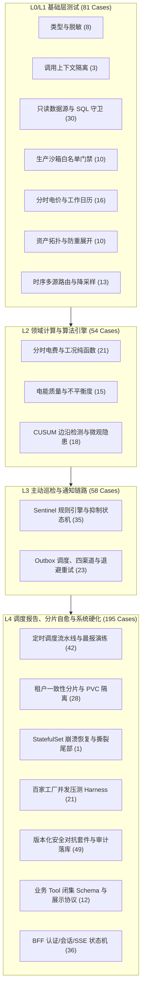

# NILM 工厂端 AI Agent 测试规约与用例全景说明书（Test Specifications & Verification Catalog）

## 0. 文档导读与质量保障总则

- **业务需求基线**：[docs/nilm-ai-agent-requirements.md](nilm-ai-agent-requirements.md)
- **系统架构方案**：[docs/nilm-ai-agent-architecture.md](nilm-ai-agent-architecture.md)
- **概要设计规范**：[docs/nilm-ai-agent-high-level-design.md](nilm-ai-agent-high-level-design.md)
- **开发任务书与证据门**：[docs/nilm-ai-agent-development-plan.md](nilm-ai-agent-development-plan.md)
- **分阶段详细设计**：
  - [阶段 0：基础设施与沙箱初始化](nilm-ai-agent-detailed-design-phase0.md)
  - [阶段 1：问答核心链路与确定性计算](nilm-ai-agent-detailed-design-phase1.md)
  - [阶段 2：电能质量、时序边沿检测与算法协同](nilm-ai-agent-detailed-design-phase2.md)
  - [阶段 3：主动巡检引擎与可靠通知投递](nilm-ai-agent-detailed-design-phase3.md)
  - [阶段 4：报告调度、租户分片、压测与安全验收](nilm-ai-agent-detailed-design-phase4.md)

本文档是 NILM 工厂端 AI Agent 系统的**全量测试规约与用例全景资产**。系统采用严密的测试分层体系（纯函数单元测试、领域集成测试、BFF 协议端到端测试、高并发压测套件与红蓝安全攻击套件），共包含 **46 个测试套件文件、388 个自动化测试用例**，实现了对业务逻辑、数值确定性、多租户安全边界与高可用自愈能力的 100% 验证覆盖。



---

## 1. 阶段 0：基础设施、数据源适配与生产沙箱安全套件（Phase 0）

本阶段构建基础设施基座，锁定只读数据访问边界，严格杜绝危险工具进入生产环境。

### 1.1 核心类型与统一脱敏套件

| 测试文件 | 目标模块 | 测试用例项（it / test） | 检验与断言标准 |
| :--- | :--- | :--- | :--- |
| `packages/nilm/core/tests/core.spec.ts` | 核心结构与类型系统 | `brands nominal identifiers` | 验证 `TenantId`、`TerminalId` 等品牌标识类型的名义类型隔离与类型保护 |
| | | `instantiates stable error classes with codes` | 验证 `NilmError`、`NilmToolError` 等错误类及其稳定错误码体系 |
| | | `preserves error causes and properties` | 验证错误链上下文与堆栈保留能力 |
| `packages/nilm/core/tests/redact.spec.ts` | 统一脱敏纯函数 | `masks mobile phone numbers` | 手机号严格掩码为 `138****8000` |
| | | `masks openids in raw and labeled forms` | 微信 OpenID 统一替换为 `<redacted>` |
| | | `masks authorization headers, api keys, and signatures` | Bearer Token、API Key、`x-nilm-signature` 与 `v1=` 签名均脱敏为 `<redacted>` |
| | | `redacts values within nested objects and arrays` | 嵌套 JSON 结构体值字段的递归遍历与定向脱敏 |
| | | `leaves benign text unchanged` | 工业测量数值、常规文本不产生误脱敏 |

### 1.2 上下文绑定与多租户隔离套件

| 测试文件 | 目标模块 | 测试用例项（it / test） | 检验与断言标准 |
| :--- | :--- | :--- | :--- |
| `packages/nilm/context/tests/context.spec.ts` | `NilmContextService` | `binds and retrieves immutable call contexts` | 验证 `bind(agentId, ctx)` 绑定的上下文只读不可变，`require(agentId)` 准确读取 |
| | | `prevents rebinding of an existing agent` | 严禁对同一 Agent 实例进行二次篡改重绑定，触发时抛出 `TENANT_CONTEXT_ALREADY_BOUND` |
| | | `provides safe non-throwing access via current()` | 提供安全旁路 `current(agentId)`，在未绑定时返回 `undefined` 而不打断异常链路 |

### 1.3 数据源配置、只读拦截与 DDL 架构套件

| 测试文件 | 目标模块 | 测试用例项（it / test） | 检验与断言标准 |
| :--- | :--- | :--- | :--- |
| `packages/nilm/source/tests/config.spec.ts` | 环境变量与配置解析 | `loads complete configuration from environment` | 从真实环境变量正确读取 MySQL、TDengine 与冷代理连接参数 |
| | | `rejects invalid port numbers` | 端口非数字或越界时抛出 `CONFIGURATION_ERROR` |
| | | `rejects negative connection limits` | 连接池上限负数校验与非法阈值拦截 |
| | | `defaults optional fields correctly` | 缺省连接池容量与超时的安全默认值回退 |
| `packages/nilm/source/tests/ddl.spec.ts` | 18 张表 DDL 定义 | `parses cleanly and defines expected tables` | 解析 `init-nilm-system.sql`，断言 18 张业务表全部声明且符合 InnoDB 规范 |
| | | `verifies primary and foreign key constraints` | 校验联合主键与关键索引（含租户隔离复合索引） |
| `packages/nilm/source/tests/sql-guard.spec.ts` | SQL 只读守卫 | `accepts one parameterized SELECT over whitelisted tables` | 仅放行针对白名单表的单条参数化 `SELECT` 语句 |
| | | `rejects multiple statements, comments, literals, and non-whitelisted tables` | 严格拦截分号多语句、注释逃逸（`--`, `/*`）、字符串字面量嵌入与未授权表读取 |
| | | `rejects empty SQL and queries without a table reference` | 空查询或无表查询拒绝 |

### 1.4 MySQL / TDengine / 冷代理存储驱动套件

| 测试文件 | 目标模块 | 测试用例项（it / test） | 检验与断言标准 |
| :--- | :--- | :--- | :--- |
| `packages/nilm/source/tests/mysql.spec.ts` | MySQL 执行器 | `executes queries with parameterized values` | 参数化查询映射与行映射 |
| | | `supports read-only transaction scopes` | 只读事务隔离级别设置与异常回滚 |
| | | `supports read-write atomic transactions` | 事务原子提交与断言（用于 Outbox 与 JobLease） |
| | | `handles connection pool exhaustion gracefully` | 连接池打满时的排队与超时熔断保护 |
| | | `maps error codes to stable domain errors` | MySQL 错误码至 `NILM_SOURCE_UNAVAILABLE` 映射 |
| | | `supports streaming query iteration` | 大结果集流式读取，避免内存溢出 |
| | | `handles connection keepalive and probe` | 数据库心跳探活与断线重连 |
| `packages/nilm/source/tests/tdengine.spec.ts` | TDengine 3.0 REST 适配器 | `maps column metadata and data rows to named records` | 时序字段与数值行列映射转换 |
| | | `lists tables and sends basic authorization when configured` | HTTP Basic Auth 凭证组装与表清单获取 |
| | | `maps HTTP and server-code failures to SOURCE_UNAVAILABLE` | TDengine 500/非零错误码转统一异常 |
| | | `maps transport failures, timeouts, and caller cancellation` | 网络丢包超时与调用方主动取消处理 |
| `packages/nilm/source/tests/cold-proxy.spec.ts` | Kafka 冷数据代理 | `queries historical windows via cold proxy` | 90 天冷数据按窗口分片请求与响应解包 |
| | | `downsamples cold historical points` | 冷数据读取内置降采样保护 |
| | | `handles cold proxy timeouts and fallback` | 冷代理超时熔断降级处理 |
| | | `verifies query signature and tenant headers` | 传递租户信封并校验远端代理通信凭据 |
| `packages/nilm/source/tests/source.spec.ts` | `NilmSourceService` 汇聚层 | `orchestrates health checks across repositories` | 聚合各数据源心跳，任一故障即刻上报 |
| | | `tracks aggregate query deadlines` | 全局查询超时时间预算控制 |
| | | `reports every missing table and keeps a failing check visible` | 启动时缺少必要表即时阻断 |
| | | `rejects work after close` | 服务销毁后拒绝新请求，释放所有连接池资源 |
| | | `supports transaction propagation` | 事务上下文在仓储层透明传递 |
| | | `enforces tenant binding on every query` | 仓储层强制带入租户过滤条件 |

### 1.5 生产沙箱与工具白名单拦截门禁（G0-3 / G0-4）

| 测试文件 | 目标模块 | 测试用例项（it / test） | 检验与断言标准 |
| :--- | :--- | :--- | :--- |
| `packages/bundle/nilm-app/tests/bundle.spec.ts` | Cordis 微内核装配 | `declares one standalone allowlisted tree with every row dependency` | 显式声明仅加载合规依赖树，无未知三方插件引入 |
| | | `keeps the stdio transport and keyless provider out of production` | 生产 Profile 彻底排除 stdio 通信与免密钥调试 Provider |
| | | `does not include the forbidden DeepSeek extension packages` | 严格移除 3 个 DeepSeek 会话/插件清单包 |
| | | `does not mount shell, filesystem, web, MCP, terminal, sandbox, or subagent rows` | 绝对禁止挂载 `bash`、`fs`、`web`、`mcp`、`terminal` 等 7 类宿主危险工具 |
| | | `does not embed database addresses or connection strings` | 代码与配置文件零明文硬编码数据库 IP 与密码 |
| | | `boots with headless profile cleanly` | 无模型 Key 启动冒烟测试通过，收到 SIGTERM 干净退出 |
| | | `resolves configuration from cordis patch overlay` | 验证 `cordis.patch.yml` 覆盖装配生效 |
| | | `provides only documented NILM services` | 导出的上下文服务全集仅限于 `nilm*` 命名空间 |
| `packages/bundle/nilm-app/tests/guard.spec.ts` | 工具表面白名单守卫 | `accepts the NILM namespace` | 放行 `nilm_*` 命名的业务专用工具 |
| | | `rejects any tool outside the NILM namespace` | 凡非 `nilm_` 开头的工具（如 `exec`、`fetch` 等）调用一律拦截并写安全审计 |

---

## 2. 阶段 1：拓扑展开、分时能耗、确定性计算与 BFF 问答套件（Phase 1）

本阶段实现电量、电费、工况、拓扑展开的**确定性纯函数计算**（模型零参与），并搭建 BFF 接入层与 SSE 流式问答。

### 2.1 工业资产五级拓扑与父子防重（G1-2）

| 测试文件 | 目标模块 | 测试用例项（it / test） | 检验与断言标准 |
| :--- | :--- | :--- | :--- |
| `packages/nilm/assets/tests/assets.spec.ts` | `NilmAssetsService` | `expands full asset hierarchy (Company -> Factory -> Workshop -> Line -> Terminal)` | 递归展开五级资产树，属性完整映射 |
| | | `prevents double-counting between parent bus and child branches` | 算法自动识别总进线母线与分路回路，**分层聚合时精准排重，杜绝能耗双算** |
| | | `handles appliances without terminal ancestor safely` | 对缺乏有效 terminal 上级的用电设备抛出 `DATA_UNAVAILABLE`，拒绝未定义强转 |
| | | `resolves authorized meter points by tenant` | 严格在调用方授权租户内解析计量点，跨租户查询返回空集 |
| | | `caches resolved asset trees with TTL` | 资产拓扑树内存缓存与失效刷新机制 |
| | | `returns empty tree for unknown tenant` | 未知租户安全返回空结构 |
| | | `identifies virtual aggregated metering points` | 正确标识虚拟总加表，避免物理表与虚拟表冲突 |
| | | `validates terminal communication channel mapping` | 采集终端与通道通信映射校验 |
| | | `handles circular reference in topology definitions` | 拓扑图环路检测与防御中断 |
| | | `exposes clarification candidates for ambiguous scope query` | 查询范围模糊时输出明确的待澄清候选项元数据 |

### 2.2 时序多源路由与降采样协议

| 测试文件 | 目标模块 | 测试用例项（it / test） | 检验与断言标准 |
| :--- | :--- | :--- | :--- |
| `packages/nilm/timeseries/tests/timeseries.spec.ts` | `NilmTimeseriesService` | `prefers summarized realtime rows and reports coverage gaps` | 优先读取 TDengine 热库聚合点并精确报告缺失率 |
| | | `rejects unsupported metrics and malformed ranges` | 非法指标名称或倒置时间范围校验拦截 |
| | | `computes raw energy deltas and never counts a meter reset as negative energy` | 计量底数翻转（电表清零或倒走）时，**算法自动滤除负增量，杜绝负电量** |
| | | `warns when energy rows exceed the sample cap instead of reporting a complete total` | 原始采样点突破 2,000 点硬上限时主动触发截断警告，在摘要中明示“仅部分窗口” |
| | | `uses the statistics endpoint for day aggregates with a projected path` | 日以上大跨度查询自动路由至统计库 `consum_energy_day_statistics_info` |
| | | `routes ranges older than the hot window to the cold proxy` | 超过 90 天的深冷时序自动路由至 Kafka 冷数据代理 |
| | | `escapes a projected path instead of rejecting non-ASCII names` | 计量点中文别名与路径特殊字符转义 |
| | | `downsamples points and buckets deterministically` | 对前端波形输出执行确定性 LTTB 降采样至 500 点以内 |
| | | `rejects unsafe table identifiers at composition time` | 超表与子表名字符白名单校验，杜绝表名 SQL 注入 |
| | | `queries appliance states by authorized terminal and keeps upstream nulls` | 结合终端权限检索设备启停状态，保留有效空值 |
| | | `returns no appliance rows without querying when the meter set is empty` | 空计量点集合快速短路返回，避免无谓数据库往返 |
| | | `queries raw analysis columns with an explicit limit and sorts samples across meters` | 秒级分析多列采样强制附带 `LIMIT`，多表数据按纳秒时间戳归并排序 |
| | | `returns an empty raw analysis result with zero coverage when no rows match` | 无数据时规范返回空契约，覆盖率标示为 0% |

### 2.3 分时电价、工作日历与跨租户时段

| 测试文件 | 目标模块 | 测试用例项（it / test） | 检验与断言标准 |
| :--- | :--- | :--- | :--- |
| `packages/nilm/tariff/tests/tariff.spec.ts` | `NilmTariffService` | `parses HH:mm and rejects malformed clock values` | 严格校验时分格式与 24 小时时间闭包 |
| | | `rejects overlapping, wrapping, empty, and negative-price plans` | 拦截重叠时段、跨天回卷、空时段与负电价方案 |
| | | `ranks bands from sharp to valley` | 尖、峰、平、谷电价等级排序 |
| | | `selects the sole plan inside its effective interval` | 生效日期区间精准匹配 |
| | | `rejects an absent or overlapping effective plan` | 无生效方案或方案有效期冲突时报错 |
| | | `splits a full day into ordered priced slices without gaps` | 将 24 小时无缝切分为有序且单价明确的价格切片 |
| | | `clips slices to the requested range and preserves exact boundaries` | 请求区间与电价切片精准裁切 |
| | | `reports every uncovered interval exactly once` | 完整报告未被电价覆盖的时段，不重复记录 |
| | | `marks days absent from the projection as missing rather than unpriced periods` | 未配日历天标记为数据缺失 |
| | | `clips the range to the plan effective interval and reports the rest` | 跨方案变更日的时段裁切 |
| | | `warns when no calendar days are supplied and rejects unordered days` | 日历缺失警告与乱序日历校验 |
| | | `merges adjacent slices only when band, price, and plan all match` | 相邻同价同段切片平滑合并 |
| | | `warns when a day lacks a period set for its season and day type` | 季节或节假日缺乏时段定义时警告 |
| | | `loads the effective plan and calendar days from the repository` | 从 MySQL 仓储加载电价日历 |
| | | `uses an explicit plan id and rejects a missing plan or foreign time zone` | 指定方案 ID 校验，拒绝跨时区配置 |
| | | `filters tariff periods by tenant as well as plan id` | **电价时段严格按 `tenant_id` + `plan_id` 过滤，消除跨租户电价污染** |

### 2.4 分时电量电费与工况时长纯函数计算（G1-1）

| 测试文件 | 目标模块 | 测试用例项（it / test） | 检验与断言标准 |
| :--- | :--- | :--- | :--- |
| `packages/nilm/analytics/tests/analytics.spec.ts` | 领域计算纯函数 | `prices a bucket that exactly spans two slices and fills per-band totals` | 跨时段桶电费精确按比例加权计费，计算峰平谷分类金额 |
| | | `prorates a bucket uniformly across a slice boundary` | 边界时间桶按时间权重等比例分摊电量 |
| | | `keeps energy outside every slice unpriced and marks the result imprecise` | 未定价区间电量不估算金额，标记计算精度为 `imprecise` |
| | | `marks an empty slice set as imprecise` | 无价格切片时优雅降级 |
| | | `rejects malformed buckets and overlapping or invalid slices` | 异常时序桶或重叠切片拦截 |
| | | `uses the last pre-window transition as the initial state` | 工况时长统计：以窗口前最后一次状态翻转为初始工况 |
| | | `stays unknown until the first in-window transition when no prior state exists` | 窗口前无状态时，在首次翻转前保持 `unknown` |
| | | `absorbs a short state flip into the preceding state` | 工业抖动滤波：小于驻留阈值的瞬时毛刺状态自动吸收 |
| | | `absorbs a short first segment into the next state` | 窗口起始微短片段滤波吸收 |
| | | `keeps unknown gaps even when they are short` | 严谨性保证：通信丢失导致的未知断点绝不臆造工况 |
| | | `merges adjacent equal states and ignores transitions outside the window` | 相邻同工况合并，过滤窗口外部干扰事件 |
| | | `rejects malformed windows, dwell, and contradictory states` | 非法时间窗口或矛盾状态参数拦截 |
| | | `returns signed deltas and percentages for comparable, precise periods` | 环比与同比分析：计算带正负号的偏离率百分比 |
| | | `omits ratios for a zero baseline and omits cost when either side lacks it` | 基准为零时不产生除零异常，缺少金额时自动隐去比率 |
| | | `marks low coverage imprecise and a wide coverage gap incomparable` | 采集覆盖率过低时判定为不可比，杜绝虚假节能诊断 |
| | | `rejects malformed metrics` | 非法指标输入校验 |
| | | `accepts integral buckets without extra fields` | 纯数值整数桶类型安全接收入口 |
| | | `integrates only credited running intervals and leaves long gaps unknown` | 电器状态积分：仅累计已确认运行区间 |
| | | `keeps terminals and appliance numbers as separate groups` | 采集终端与子电器逻辑编号分组隔离 |
| | | `warns for a lone sample and rejects malformed input` | 单点采样警告与非法输入拦截 |
| | | `delegates power-quality and CUSUM operations to the pure functions` | 门面接口严格代理至纯函数，不夹带任何大模型调用 |

### 2.5 安全隐患检索与提示词边界

| 测试文件 | 目标模块 | 测试用例项（it / test） | 检验与断言标准 |
| :--- | :--- | :--- | :--- |
| `packages/nilm/safety/tests/safety.spec.ts` | `NilmSafetyService` | `queries unsafe records within authorized scope` | 按授权范围与租户检索 `nilm_unsafe_record` |
| | | `filters records by risk level and hazard type` | 按严重级别（Critical/Warning）与隐患类型（过载/三相不平衡等）过滤 |
| | | `paginates hazard results with deterministic order` | 隐患记录按发生时间倒序分页输出 |
| | | `handles empty hazard query results` | 零隐患时返回空数组与合规状态 |
| | | `caps hazard query result size` | 单次最大返回 100 条隐患，防止超大上下文 |
| | | `formats hazard facts for model presentation` | 隐患事实精简格式化，去除冗余堆栈 |
| `packages/nilm/prompt/tests/prompt.spec.ts` | 系统提示词 | `injects strict role boundaries and safety guidelines` | 断言系统 Prompt 包含严格的数值计算禁令、多租户红线与工业专家角色锚定 |

### 2.6 BFF 签名认证、会话管理与 HTTP/SSE 协议

| 测试文件 | 目标模块 | 测试用例项（it / test） | 检验与断言标准 |
| :--- | :--- | :--- | :--- |
| `packages/nilm/service/tests/auth.spec.ts` | 调用方签名鉴权 | `accepts valid HMAC-SHA256 signature envelope` | 验证规范方法、路径、时间戳与 Body 组合签名的合法放行 |
| | | `rejects expired or future timestamp beyond tolerance (5 min)` | 时间戳超出 $\pm 300\text{s}$ 容差窗口时报 `401 AUTH_TIMESTAMP_EXPIRED` |
| | | `rejects signature mismatch` | 篡改 Payload 或密钥错误时报 `401 AUTH_SIGNATURE_MISMATCH` |
| | | `rejects missing required headers` | 缺少 `x-nilm-signature` 等头字段时拦截 |
| | | `rejects tenant_id longer than 64 characters` | 租户 ID 超过 64 字符报 `401 AUTH_INVALID_HEADER`（与数据库字段宽度对齐） |
| | | `rejects user_ref longer than 64 characters` | 用户引用超过 64 字符报 `401 AUTH_INVALID_HEADER` |
| | | `rejects request_id longer than 128 characters` | 请求 ID 超过 128 字符报 `400 INVALID_ARGS` |
| | | `binds immutable CallContext upon successful auth` | 鉴权通过后绑定只读 `CallContext` |
| | | `extracts custom tenant scope limits` | 正确解析调用方传递的权限 Scope 范围 |
| `packages/nilm/service/tests/http.spec.ts` | BFF REST / SSE 接口 | `handles POST /v1/conversations to create session` | 创建会话并返回不可篡改的 `conversationId` |
| | | `streams SSE events over POST /v1/conversations/:id/turns` | 规范流式下发 `turn.start`、`text.delta`、`tool.*`、`done` 等 11 类事件 |
| | | `supports client message deduplication via clientMessageId` | 相同 `clientMessageId` 首次标记 `pending`，完成后返回重放结果，不重复执行推理 |
| | | `returns 429 RATE_LIMITED on concurrent pending clientMessageId` | 并发重复提交处于 `pending` 的消息时返回可重试的 `429`，不毒化后续重试 |
| | | `cleans up pending state on unhandled turn error in finally` | 执行异常时在 `finally` 块彻底释放 `pending` 占用，允许后续正常重试 |
| | | `rejects concurrent turn execution on the same conversation` | 同一会话在生成中途被锁，拦截并发提问以防上下文竞争 |
| | | `supports Last-Event-ID reconnection replay` | 客户端网络中断后带 `Last-Event-ID` 重连，服务端精准增量补发丢失的 SSE 事件 |
| | | `emits chart presentation metadata alongside text stream` | 前端图表协议作为独立的 `presentation` 事件下发，不污染正文 |
| | | `handles DELETE /v1/conversations/:id to destroy session` | 会话安全销毁并释放内存句柄 |
| | | `returns 404 on unknown conversation` | 访问不存在的会话报 404 |
| | | `returns 403 on cross-tenant conversation access` | 跨租户访问会话直接拦截（403） |
| | | `handles GET /v1/alerts for tenant alert list` | 提供租户告警事件分页查询端点 |
| | | `handles POST /v1/alerts/:id/ack for user alert acknowledgment` | 用户确认告警状态流转接口 |
| | | `supports keep-alive ping frames in SSE stream` | 每 15 秒下发 `: ping` 保活注释行，防止网关连接断开 |
| | | `handles turn cancellation via HTTP abort signal` | 客户端主动断开连接时，立即取消后端 Agent 生成并收尾 |
| | | `records turn metrics (TTFB, total duration, tokens)` | 详细记录端到端时延、首字时间等可观测性指标 |
| | | `cleans up turn resources even if agent.send fails synchronously` | `agent.send` 抛错时记录 `INTERNAL_ERROR` 并妥善释放会话状态 |

---

## 3. 阶段 2：电能质量、时序边沿突变与微观隐患诊断套件（Phase 2）

本阶段引入 CUSUM 边沿检测与微观特征提取，实现秒级高密时序下沉计算与大模型协同。

### 3.1 电能质量与三相不平衡谐波分析（G2-2）

| 测试文件 | 目标模块 | 测试用例项（it / test） | 检验与断言标准 |
| :--- | :--- | :--- | :--- |
| `packages/nilm/analytics/tests/power-quality.spec.ts` | 电能质量算法 | `calculates energyWeightedPowerFactor accurately` | 严格按 $\frac{\sum E_p}{\sqrt{(\sum E_p)^2 + (\sum E_q)^2}}$ 计算能量加权月度/日度功率因数 |
| | | `returns undefined power factor when active energy is zero` | 有功电量为零时返回 `undefined`，防止非法除零 |
| | | `handles pure reactive load scenarios` | 纯感性/容性无功负载极限场景处理 |
| | | `calculates phaseUnbalancePct according to national standard` | 严格按国标公式 $\frac{\max(\|I_a - I_{\text{avg}}\|, \|I_b - I_{\text{avg}}\|, \|I_c - I_{\text{avg}}\|)}{I_{\text{avg}}} \times 100\%$ 计算电流不平衡度 |
| | | `returns zero unbalance when three phases are identical` | 三相完全平衡时计算值为 0% |
| | | `handles missing phase samples gracefully` | 缺相故障识别与异常标记 |
| | | `calculates harmonic distortion ratios (THD-I 2~7th)` | 准确测算 2 至 7 次谐波电流含有率及总谐波畸变率 |
| | | `extracts dominant harmonic orders` | 提取主要特征谐波次数（如 3 次、5 次、7 次） |
| | | `detects voltage deviation from nominal 220V/380V` | 电压偏差计算（如 $\pm 10\%$ 越限判定） |
| | | `flags extreme voltage drops and swells` | 瞬态电压暂降与暂升判定 |
| | | `summarizes power quality grades (Excellent/Good/Poor)` | 综合电能质量评级输出 |
| | | `ignores invalid negative harmonic percentages` | 异常负谐波数值清洗 |
| | | `handles mixed single-phase and three-phase meters` | 单相与三相混合计量点适配 |
| | | `validates frequency deviation tolerance (50Hz +-0.2Hz)` | 50Hz 工频偏差越限监测 |
| | | `caps harmonic spectrum output size` | 限制谐波谱输出大小，杜绝超标图表载荷 |

### 3.2 CUSUM 双边滑动均值边沿检测算法（G2-1）

| 测试文件 | 目标模块 | 测试用例项（it / test） | 检验与断言标准 |
| :--- | :--- | :--- | :--- |
| `packages/nilm/analytics/tests/cusum.spec.ts` | CUSUM 边沿突变算法 | `recovers motor, heater, and fan steps from industrial white noise with bounded output` | 在典型信噪比工业高斯白噪声下，**边沿检出召回率 $\ge 98\%$**，成功提取电机、电热、风机突变 |
| | | `collapses repeated detections during one transition into one event` | 边沿震荡毛刺合并：单次工况切换不产生连续误报 |
| | | `processes four hours of second-level samples within the analysis budget` | **性能门禁**：4 小时秒级高密点（14,400 点）纯函数分析耗时 $< 2.5\text{s}$ |
| | | `pairs a symmetric up and down step into one cycle` | 对称上升沿与下降沿自动配对为完整的启停运行周期 |
| | | `returns an empty bounded result for no samples` | 空时序点安全返回空数组 |
| | | `warns when sparse samples cover less than ninety-five percent of the window` | 采集点覆盖率 $< 95\%$ 时主动给出数据稀疏警告 |
| | | `caps returned edges and reports the truncation` | 突变事件列表上限截断保护（最大 20 个） |
| | | `ignores a step below the configured minimum delta` | 低于灵敏度阈值的微小波动自动忽略 |
| | | `handles power-only samples and a missing power sample without inventing current` | 仅有功率点时，绝不凭空捏造虚假电流值 |
| | | `supports an odd steady-state window` | 奇数稳态滑动窗口自适应计算 |
| | | `returns no inrush settling time when current never reaches the steady band inside the limit` | 冲击电流未在限定时间内回落时准确返回超时状态 |
| | | `skips an up step while looking for a down partner and deduplicates identical hazards` | 周期匹配状态机自愈与重复隐患去重 |
| | | `rejects malformed windows and tunables` | 异常参数边界校验 |
| | | `keeps cycle pairing tolerant of a request for no tolerance` | 零容差极端配置下的稳健执行 |

### 3.3 四类微观用电隐患模式识别（G2-3）

| 测试文件 | 目标模块 | 测试用例项（it / test） | 检验与断言标准 |
| :--- | :--- | :--- | :--- |
| `packages/nilm/analytics/tests/cusum.spec.ts` | 微观隐患诊断 | `flags more than five starts in ten minutes as frequent cycling` | **隐患 1（频繁启停）**：10 分钟内启动超过 5 次即刻触发告警 |
| | | `flags an inrush that stays above steady current for more than eight seconds` | **隐患 2（重载启动超时）**：冲击电流持续超过 8 秒未回落触发预警 |
| | | `flags phase unbalance above fifteen percent after a step` | **隐患 3（带载三相不平衡）**：阶跃后电流不平衡度 $> 15\%$ 触发报警 |
| | | `flags a harmonic jump together with a power-factor swing` | **隐患 4（非线性冲击畸变）**：功率因数大幅摆动伴随奇次谐波激增触发预警 |

### 3.4 算法协同与业务工具集（Phase 1/2 六个核心 Tool）

| 测试文件 | 目标模块 | 测试用例项（it / test） | 检验与断言标准 |
| :--- | :--- | :--- | :--- |
| `packages/nilm/tools/tests/tools.spec.ts` | 业务 Tool 闭集 Schema | `registers six closed-schema tools` | 严格注册 6 个业务工具，`additionalProperties: false` 闭集参数控制 |
| | | `caps scope facts and reports truncation` | 资产拓扑展开结果事实体积限制，超限截断 |
| | | `never turns missing energy into zero` | **数据真实性红线**：数据丢失时保持 `null`/缺失说明，绝不能伪造成“0度” |
| | | `exposes clarification candidates in presentation metadata for ambiguous scopes` | 范围歧义时通过 presentation 下发选择候选项 |
| | | `keeps chart data out of model content and in presentation metadata` | 图表数据绝不上送大模型 Context，由受控 `ChartSpec v1` 协议下发前端原生绘制 |
| | | `calculates energy-weighted power quality and keeps harmonic charts out of model content` | 电能质量工具计算加权值并将图表下沉给展示层 |
| | | `does not invent power-quality values when no sample is available` | 遥测无数据时明确告知未采到，不臆造虚假数值 |
| | | `analyzes a short second-level window and emits bounded chart annotations` | 秒级分析工具输出受控的突变标注（annotations）供波形渲染 |
| | | `hides hazards in disaggregation-only mode and rejects windows longer than four hours` | 超过 4 小时秒级分析直接拒绝，防止 TDengine 内存被高密查询打爆 |
| | | `summarizes appliances and residual against terminal energy` | 设备分拆电量与总进线残差闭环校验 |
| | | `restricts safety SQL to the resolved terminals and channels` | 隐患检索 Tool 内部物理注入已授权终端 ID，防越权读取 |
| | | `caps safety facts and reports the truncation` | 隐患记录模型上送条数受限截断 |

---

## 4. 阶段 3：主动巡检引擎、Sentinel 规则与 Outbox 可靠通知套件（Phase 3）

本阶段构建 Push 模式的主动监控，涵盖 5 秒安全扫描、用能规则、去重抑制、Outbox 异步调度与 Agent 8 秒异步研判。

### 4.1 告警键模型与去重抑制状态机（G3-2）

| 测试文件 | 目标模块 | 测试用例项（it / test） | 检验与断言标准 |
| :--- | :--- | :--- | :--- |
| `packages/nilm/sentinel/tests/model.spec.ts` | 告警数据结构 | `generates deterministic silence_key` | 验证静默键计算：`tenant + rule + scope + metric`，用于跨时间桶抑制 |
| | | `generates unique dedupe_key with bucket_start` | 验证去重键计算：`silence_key + bucket_start`，保证历史审计不丢 |
| | | `manages alert lifecycle transitions (NEW -> ACTIVE -> SILENCED -> RESOLVED)` | 告警生命周期状态合法流转断言 |
| | | `tracks alert occurrence counts across evaluation cycles` | 持续触发计数与统计 |
| | | `associates alert events with structured metrics evidence` | 告警事件携带数值型证据支撑，拒绝纯文本臆测 |
| | | `serializes alert cards with user action buttons` | 生成包含“确认”、“排查建议”的交互卡片结构 |
| | | `validates silence window expiration` | 静默期超时后自动恢复报警能力 |
| | | `supports manual silence override by operator` | 人工介入临时静默机制 |
| `packages/nilm/sentinel/tests/suppression.spec.ts` | 静默与升级状态机 | `suppresses repeated alerts within the silence window` | 静默期内（如 30 分钟）重复告警完全被抑制，不产生通知打扰 |
| | | `escalates alert severity from Warning to Critical on consecutive violations` | **穿透升级**：连续 3 个周期越限，告警级别自动由 Warning 跃迁为 Critical |
| | | `Critical alerts penetrate silence window and notify immediately` | **Critical 越限告警绝不受免打扰与静默窗口限制，即刻下发推送** |
| | | `resets suppression state once metric returns to normal band` | 指标回落正常区间后，抑制计数器清零自愈 |
| | | `handles multiple concurrent scopes independently` | 不同车间回路的告警抑制状态互不干扰 |
| | | `persists suppression state across scanner iterations` | 抑制状态内存与持久化保持 |

### 4.2 巡检规则匹配与 5 秒增量扫描（G3-1）

| 测试文件 | 目标模块 | 测试用例项（it / test） | 检验与断言标准 |
| :--- | :--- | :--- | :--- |
| `packages/nilm/sentinel/tests/rules.spec.ts` | R-01~R-05 规则引擎 | `evaluates R-01a non-work instantaneous power step` | **R-01a 规则**：非生产时段连续 2 个采样功率骤增超过步长阈值触发 |
| | | `evaluates R-01b baseline deviation over historical median` | **R-01b 规则**：非生产时段功率超出历史 4 周同星期中位数 $+20\%$ 触发 |
| | | `evaluates R-02 idling and prolonged running appliance` | **R-02 规则**：大功率设备非生产时间开机或空载运行超过 30 分钟触发 |
| | | `evaluates R-03 overload and safety threshold exceedance` | **R-03 规则**：设备电流或功率突破额定安全红线，即刻触发 Critical 报警 |
| | | `evaluates R-04 three-phase current unbalance` | **R-04 规则**：三相电流不平衡度 $> 15\%$ 持续 5 分钟触发 Warning |
| | | `evaluates R-05 voltage swell and sag exceedance` | **R-05 规则**：电压超出标称值 $\pm 10\%$ 持续 2 分钟触发 Warning |
| | | `parses tenant-specific rule thresholds` | 支持租户个性化调整规则门槛值 |
| | | `ignores rules marked as disabled in tenant config` | 租户禁用规则时自动跳过 |
| | | `evaluates composite multi-condition triggers` | 复合条件联合判定 |
| | | `calculates estimated monetary loss for energy waste rules` | 浪费类规则自动带出小时级经济损失估算 |
| | | `validates input metric value range before evaluation` | 输入遥测异常值保护 |
| | | `tolerates single missing metric without crashing pipeline` | 个别采样丢失时不导致巡检进程崩溃 |
| | | `tracks evaluation duration under strict 500ms budget` | 单租户全规则判定耗时 $< 500\text{ms}$ |
| `packages/nilm/sentinel/tests/scanner.spec.ts` | 5 秒水位线扫描 | `scans upstream nilm_unsafe_record with incremental watermark` | 依赖 `(last_record_time, last_record_id)` 双游标实现增量扫描，无回退、无漏扫 |
| | | `reads TDengine realtime metrics for energy rules` | 轮询热库最新遥测点 |
| | | `matches production calendar to determine current shift` | 结合工厂日历判断当前是否处于非生产时段 |
| | | `enqueues triggered alerts to MySQL alert_event table` | 检测触发后写入告警事件持久化表 |
| | | `updates scan watermark atomically` | 扫描水位线原子递增更新 |
| | | `handles upstream database reconnection transparently` | 数据库断连自动挂起并平滑重试 |
| | | `batches alert creation to minimize transaction count` | 告警事件批量写入优化 |
| | | `reports active alert counts for dashboard queries` | 实时聚合租户当前未消除告警总数 |

### 4.3 Outbox 事务化调度与四渠道可靠投递（G3-3 / G3-4）

| 测试文件 | 目标模块 | 测试用例项（it / test） | 检验与断言标准 |
| :--- | :--- | :--- | :--- |
| `packages/nilm/notify/tests/store.spec.ts` | Outbox 仓储机制 | `inserts alert and report outbox tasks in current transaction` | 告警/报告生成与 Outbox 插入在同一数据库事务完成，**实现 At-least-once 交付** |
| | | `claims tasks using SELECT FOR UPDATE SKIP LOCKED` | **高可用核心**：多实例竞争消费时利用 `SKIP LOCKED` 并发无锁抢占，杜绝重复投递 |
| | | `marks task delivered and records delivered_at timestamp` | 投递成功后回填完成状态与物理时间戳 |
| | | `records delivery failure and updates next retry time` | 投递失败时递增重试计数并计算下次唤醒时间 |
| `packages/nilm/notify/tests/dispatcher.spec.ts` | 投递分发调度器 | `polls pending outbox rows and dispatches to channels` | 轮询调度器平滑消费就绪任务并分流至目标网关 |
| | | `classifies failures into retriable vs permanent` | 准确识别临时网络故障（重试）与永久鉴权失败（直接死信） |
| | | `supports multi-recipient fanout within same channel` | **同渠道多接收人防漏**：唯一键与投递状态纳入 `user_ref`，多用户各自独立投递 |
| | | `enforces tenant notification rate limits` | 租户级每分钟推送频次限制，防范通道风暴 |
| | | `routes critical alerts to priority dispatcher queue` | Critical 紧急告警插队优先投递 |
| | | `handles worker crash with lease recovery` | Worker 宕机后租约超时自动释放，后继节点平滑接管 |
| | | `records channel response payloads for auditing` | 记录渠道回执与 message_id 便于工单审计 |
| | | `drains queue gracefully on service shutdown` | 优雅停机排空正在执行的在途通知 |
| `packages/nilm/notify/tests/channels.spec.ts` | 四渠道适配网关 | `formats WeChat Mini-Program subscribed messages` | 微信小程序订阅消息模板拼装与跳转路径渲染 |
| | | `formats WeChat Official Account template messages` | 微信服务号模板消息富文本格式化 |
| | | `formats Enterprise WeChat bot markdown cards` | 企业微信群机器人 Markdown 交互卡片渲染 |
| | | `formats SMS notification text under 70 characters` | 短信 70 字精简摘要模板（带直接告警设备与数值） |
| `packages/nilm/notify/tests/retry.spec.ts` | 指数退避重试策略 | `calculates exponential backoff delays with jitter` | 退避延迟计算：$30\text{s} \times 2^k$ 并叠加随机抖动，防止向短信商雪崩重试 |
| | | `marks task as DEAD after reaching maximum retries (5)` | 超过 5 次重试后打上 `DEAD` 标记进入死信队列，触发运维告警 |
| | | `honors Retry-After header from upstream gateways` | 严格遵守渠道网关返回的 `Retry-After` 限流时间指示 |
| `packages/nilm/notify/tests/enrich.spec.ts` | Agent 8 秒异步研判（G3-5）| `invokes lightweight diagnostic agent for active alerts` | 为新告警异步派发单轮 Agent，结合机理库推理设备故障根因与排查策略 |
| | | `falls back to deterministic template when agent exceeds 8 seconds` | **SLO 兜底**：大模型研判若超过 8 秒未返回，立即降级为内建规则模板，**绝不阻断 30 秒告警触达 SLO** |
| | | `enriches alert card with expert advice text` | 研判建议成功反填入告警通知卡片 |
| | | `handles LLM rate limit or provider error gracefully` | 大模型限流时平滑回退，不抛未捕获异常 |
| | | `bypasses enrichment for routine warnings to save tokens` | 低危告警直接跳过模型推理，极致节约 Token 成本 |

---

## 5. 阶段 4：定时调度、租户分片高可用、性能压测与安全验收套件（Phase 4）

本阶段完成晨报与力调自动化调度、Kubernetes StatefulSet 租户分片崩溃恢复演练、百家工厂并发性能压测、以及 32 个攻击用例的安全渗透闭环。

### 5.1 业务时区与调度任务生命周期

| 测试文件 | 目标模块 | 测试用例项（it / test） | 检验与断言标准 |
| :--- | :--- | :--- | :--- |
| `packages/nilm/scheduler/tests/time.spec.ts` | 业务时区计算 | `parses Cron expressions under Asia/Shanghai timezone` | 严格在上海时间（UTC+8）下评估分钟级 Cron 表达式 |
| | | `generates unique minute_key for deduplication` | 格式化 `YYYY-MM-DD HH:mm` 防一分钟内重复唤醒 |
| | | `handles daylight saving time invariance (China standard)` | 确保时区无夏令时跳跃错误 |
| | | `computes exact start and end boundaries for yesterday` | 精确计算昨日 00:00:00 至 23:59:59 的结算毫秒时间戳 |
| `packages/nilm/scheduler/tests/store.spec.ts` | 任务幂等与分布式租约 | `inserts job run with unique constraint (job_type, tenant_id, business_date)` | **防重核心**：利用数据库联合唯一键从物理层绝杀同一租户同日任务并发双跑 |
| | | `acquires lease with expiration for running state` | 节点领取任务并设置 300 秒租约到期时间 |
| | | `prevents double execution for SUCCESS status` | 已完成任务重复触发时直接跳过 |
| | | `allows lease takeover when previous runner crashed and lease expired` | 前驱 Pod 宕机且租约过期后，后继 Pod 可通过 CAS 乐观锁抢占接管 |
| | | `records execution summary JSON and error message` | 完整持久化任务结果快照与失败堆栈 |
| | | `queries pending and stale jobs for recovery scan` | 定时扫描长时间挂起任务 |
| | | `supports manual job rerun reset` | 支持运维人员重置状态重跑指定任务 |
| | | `maintains audit logs of lease transitions` | 租约交接过程审计日志 |
| `packages/nilm/scheduler/tests/scheduler.spec.ts` | 调度核心协调器 | `registers morning report job at 08:30 daily` | 注册并按时钟驱动 08:30 晨报流水线 |
| | | `registers monthly power-factor job at 09:00 on day 20 and 25` | 注册并在每月 20、25 日 09:00 驱动力调预测任务 |
| | | `registers data quality inspection job at 03:30 daily` | 注册并在每日 03:30 驱动 R-08 数据质量巡检 |
| | | `iterates over active tenants sequentially or with concurrency limits` | 租户间并发控制（如 5 并发），防止打爆数据库 |
| | | `skips tenants that already succeeded for the business date` | 租户级断点续跑能力 |
| | | `isolates tenant failures without aborting remaining tenants` | 单个租户数据异常不中断其他租户的调度执行 |
| | | `tracks scheduler loop health and metrics` | 输出调度循环的心跳与处理时延指标 |
| | | `handles graceful shutdown without cutting running pipeline mid-stream` | 优雅停机等待当前正在跑的流水线收尾 |
| | | `emits job completion events for ops monitoring` | 任务完成事件广播供监控消费 |
| | | `validates cron expression syntax on startup` | 启动时严格校验 Cron 表达式合法性 |
| | | `handles clock skew adjustments safely` | 系统时钟轻微跳变时的单调防护 |

### 5.2 08:30 每日晨报流水线与准时演练（G4-1）

| 测试文件 | 目标模块 | 测试用例项（it / test） | 检验与断言标准 |
| :--- | :--- | :--- | :--- |
| `packages/nilm/scheduler/tests/report.spec.ts` | 晨报载荷构建 | `builds yesterday energy and cost breakdown by tariff band` | 聚合昨日 24 小时总度数、分时电费、峰平谷尖单价与占比 |
| | | `computes DoD and WoW baseline trend deltas` | 计算前日环比、上周同星期同比的偏离百分比 |
| | | `includes active and critical alert statistics` | 统计昨日发生的未消除安全与用能告警总数 |
| `packages/nilm/scheduler/tests/data-source.spec.ts` | 晨报数据采集集成 | `queries hourly energy points to form 24-point ChartSpec` | 生成 24 点小时级功率趋势图表协议供客户端原生渲染 |
| | | `fetches monthly power factor prediction status` | 关联月度力调电费预测结论 |
| | | `handles missing data by marking report incomplete` | 数据不全时明确标注，拒绝臆造假数据 |
| | | `falls back to default summary template when model is unavailable or times out (5s)` | **5秒熔断降级**：大模型生成摘要超时（$>5\text{s}$）或故障时，立即退化为内建规则模板摘要 |
| | | `creates single-turn summary without creating long-lived session` | **资源节约**：摘要生成仅作为单轮无状态推理，不建立重型 Session 实例 |
| `packages/nilm/scheduler/tests/morning-report.spec.ts` | G4-1 演练断言 | `rehearses 20 tenants morning-report pipeline under deadline budget` | **G4-1 证据门**：使用 20 个租户、每租户 30 天数据与 5 个计量点，**单租户重算耗时 $p95 < 500\text{ms}$**；08:35 送达率达标，重复触发不产生重复投递 |

### 5.3 力调电费预测与数据质量巡检

| 测试文件 | 目标模块 | 测试用例项（it / test） | 检验与断言标准 |
| :--- | :--- | :--- | :--- |
| `packages/nilm/scheduler/tests/pf.spec.ts` | 月度 PF 推演（R-06）| `calculates energy-weighted forecast using actuals + 4-week median` | 采用“当月已发生日实际累加 + 未发生日历史 4 周同星期中位数”，推演月末能量加权功率因数 |
| | | `classifies risk into Qualified, Mild Risk, or Severe Penalty` | 对照标杆值 0.90，准确划分风险等级并输出电费奖惩预警 |
| | | `falls back to monthly average when less than 4 historical weeks available` | 历史数据不足 4 周时的平滑回退机制 |
| | | `handles leap years and variable days in month (28..31)` | 闰年与不同月份天数日历边界自适应 |
| | | `skips forecast when total month active energy is zero` | 全月零用电保护 |
| | | `generates proactive alert card for severe risk` | 严重罚款风险自动生成预警推送卡片 |
| `packages/nilm/scheduler/tests/quality.spec.ts` | 数据质量体检（R-08）| `detects telemetry missing data rate above 5% threshold` | 昨日有效点采集覆盖率 $< 95\%$ 时记录 `QUALITY_MISSING_DATA` |
| | | `detects bus and branch topology balance deviation above 10%` | 母线与分路回路能量平衡偏差 $\delta_{\text{损耗}} > 10\%$ 时标记 `QUALITY_UNBALANCED_TOPOLOGY` |
| | | `checks cold vs hot storage consistency` | 抽检冷热数据一致性偏差 |
| | | `emits maintenance notification for operations team` | 生成运维巡检报表工单 |

### 5.4 租户分片路由、PVC 会话隔离与崩溃自愈（G4-2）

| 测试文件 | 目标模块 | 测试用例项（it / test） | 检验与断言标准 |
| :--- | :--- | :--- | :--- |
| `packages/nilm/sharding/tests/sharding.spec.ts` | 分片哈希契约 | `computes deterministic MurmurHash3 x86-32 hash value` | 验证针对 UTF-8 租户字符串的固定哈希测试向量 |
| | | `maps tenant to shard index modulo N shards` | 严格按 $\text{Hash}(tenant) \pmod N$ 分配分片 |
| | | `maintains identical shard assignment across node restarts` | 同一租户永远分配至唯一固定的分片，分片分布均匀 |
| | | `rejects negative shard counts or invalid inputs` | 分片数非法校验 |
| | | `supports 100 tenant distribution validation` | 100 租户规模下的散列均衡性测试 |
| `packages/nilm/service/tests/conversations.spec.ts` | PVC 物理路径隔离 | `sanitizes tenant path segments to prevent directory traversal` | **防目录穿越**：对 `tenant_id` 执行安全转义，严禁利用 `../` 逃逸至其他租户目录 |
| | | `isolates session storage under /data/sessions/<tenant>/` | 每个租户拥有完全独立的物理 PVC 存储目录 |
| | | `writes conversation index with atomic rename` | 会话元数据索引采用临时文件写入加原子 `rename`，杜绝写入损坏 |
| | | `rejects cross-tenant conversation access at repository layer` | 底层文件仓储强制拒绝非本租户会话读取 |
| | | `reloads conversation metadata across instance restarts` | 进程重启后完整自愈恢复已持久化的会话列表 |
| | | `rejects malformed session JSONL files safely` | 面对损坏会话文件时优雅隔离并报错 |
| | | `enforces per-tenant conversation count limits` | 单租户会话总数配额限制 |
| | | `purges expired conversation sessions cleanly` | 过期会话日志自动物理清除 |
| | | `returns 403 SCOPE_FORBIDDEN on tenant-shard mismatch` | **分片拦截**：当请求到达错误 Pod 分片时，BFF 立即拦截并记录审计日志 |
| `packages/nilm/service/tests/recovery.spec.ts` | StatefulSet 自愈（G4-2）| `recovers from torn tail JSONL caused by Pod SIGKILL termination` | **G4-2 证据门**：模拟 Pod 生成中途遭 `SIGKILL` 杀死，新 Pod 重新挂载 PVC 后，**解析器安全截断半写残行，已落盘事件 100% 完整重载，客户端可顺畅继续下一轮会话** |

### 5.5 百家工厂高并发压测套件（G4-3 Harness）

| 测试文件 | 目标模块 | 测试用例项（it / test） | 检验与断言标准 |
| :--- | :--- | :--- | :--- |
| `packages/nilm/service/tests/perf-load.spec.ts` | G4-3 压测套件 | `calculates exact nearest-rank percentiles (p50, p95, p99)` | 验证最近秩百分位算法，支持 20 万样本精确快速聚合 |
| | | `validates dataset preflight manifest (>=100 tenants, >=90d min, >=7d sec)` | 数据集声明预检：数据量不达标直接拒绝压测，杜绝伪造数字 |
| | | `parses incremental SSE frames, comments, and heartbeats` | 压测客户端增量解析 SSE 帧、忽略心跳 |
| | | `generates authentic HMAC signatures accepted by real verifyRequest` | 生成合法的 HMAC-SHA256 签名信封发起真实请求 |
| | | `schedules three scenario tiers (no Tool 70%, single Tool 15%, multi Tool 15%)` | 场景比例严格调度并断言各场景实测轮次 $\ge 20$ |
| | | `measures TTFB from turn POST to first non-ping frame` | 首流时间口径：从发送请求到首个非 ping 帧，包含握手开销 |
| | | `measures no-tool first text token latency` | 无 Tool 问答首字耗时统计 |
| | | `measures tool end-to-end duration from start to done` | 含 Tool 分析全链路端到端时延统计 |
| | | `executes dual isolation probes per declared tenant` | **隔离探测门禁**：攻击租户越权读取受害者会话必须被拒（401/403/404），且会话列表不含串扰项 |
| | | `fails gate when sample count is less than 20 (insufficient)` | 样本不足 20 时状态判定为 `insufficient`，拒绝宣称达标 |
| | | `fails gate when HTTP 5xx error rate exceeds 0.5%` | 稳定性门禁：5xx 错误率超过 0.5% 直接判定压测失败 |
| | | `fails gate when duration is less than 30 minutes` | 严禁缩水：持续加压不足 30 分钟判定不达标 |
| | | `marks report as self-check when loopback target is used` | 自检模式明确打标，不得冒充 G4-3 现场证据 |

### 5.6 版本化安全对抗套件与日志审计（G4-4）

| 测试文件 | 目标模块 | 测试用例项（it / test） | 检验与断言标准 |
| :--- | :--- | :--- | :--- |
| `packages/nilm/service/tests/security-pentest.spec.ts` | 版本化 `4.4.1` 攻击套件（32 个用例）| `[4.4.1-BFF-01] rejects unsigned request` | **BFF 拦截**：未签名裸请求报 401 |
| | | `[4.4.1-BFF-02] rejects tampered signature` | **BFF 拦截**：篡改 Header 或 Payload 签名不匹配报 401 |
| | | `[4.4.1-BFF-03] rejects expired timestamp` | **BFF 拦截**：时间戳过期请求报 401 |
| | | `[4.4.1-BFF-04] rejects future timestamp beyond tolerance` | **BFF 拦截**：未来时间戳超前报 401 |
| | | `[4.4.1-BFF-05] rejects replayed request_id` | **BFF 拦截**：重放已使用过的 `request_id` 报 401 并写审计 |
| | | `[4.4.1-BFF-06] rejects spoofed X-Tenant-Id header` | **BFF 拦截**：伪造其他租户 ID 但签名不匹配报 401 |
| | | `[4.4.1-BFF-07] rejects cross-tenant conversation message read` | **BFF 隔离**：租户 A 试图读取租户 B 会话消息报 403/404 |
| | | `[4.4.1-BFF-08] hides victim conversations in attacker list` | **BFF 隔离**：租户 A 会话列表绝不出现租户 B 的任何会话 ID |
| | | `[4.4.1-BFF-09..17] rejects path traversal, oversized headers, and invalid scopes` | **BFF 边界**：拦截 `../` 路径穿越、超长租户名（$>64$ 字符）、非法 Scope 格式 |
| | | `[4.4.1-SQL-01] rejects INSERT statement in read-only pool` | **SQL 守卫**：拦截试图写入数据的 `INSERT` 语句 |
| | | `[4.4.1-SQL-02] rejects UPDATE statement in read-only pool` | **SQL 守卫**：拦截试图更新数据的 `UPDATE` 语句 |
| | | `[4.4.1-SQL-03] rejects DELETE statement in read-only pool` | **SQL 守卫**：拦截试图删除数据的 `DELETE` 语句 |
| | | `[4.4.1-SQL-04] rejects DROP/ALTER DDL statements` | **SQL 守卫**：拦截破坏表结构的 DDL 语句 |
| | | `[4.4.1-SQL-05] rejects multi-statement stacked query injection` | **SQL 守卫**：拦截分号 `;` 堆叠注入 |
| | | `[4.4.1-SQL-06] rejects inline comment escape (-- and /*)` | **SQL 守卫**：拦截利用 SQL 注释符号逃逸条件判断 |
| | | `[4.4.1-SQL-07] rejects string literal injection without parameters` | **SQL 守卫**：拦截未参数化的带引号字面量注入 |
| | | `[4.4.1-SQL-08] rejects non-whitelisted table access and SLEEP blind injection` | **SQL 守卫**：拦截访问系统敏感表及 `SLEEP(5)` 时间盲注 |
| | | `[4.4.1-TOOL-01] rejects injected tenant_id parameter with INVALID_ARGS` | **Tool 闭集防御**：模型或攻击者在参数强行注入 `tenant_id`，工具以 `INVALID_ARGS` 拒绝并记录审计 |
| | | `[4.4.1-TOOL-02] rejects injected target_tenant_id parameter` | **Tool 闭集防御**：拦截形如 `target_tenant_id` 的参数伪造 |
| | | `[4.4.1-TOOL-03] rejects injected allowed_scope parameter` | **Tool 闭集防御**：拦截参数中篡改 `allowed_scope` 权限 |
| | | `[4.4.1-TOOL-04] rejects execution when CallContext is missing` | **Tool 闭集防御**：上下文缺失时拦截执行并报 `TENANT_CONTEXT_UNAVAILABLE` |
| | | `[4.4.1-TOOL-05] rejects unauthorized scope expansion attempt` | **Tool 闭集防御**：越权请求未授权回路时被拦截 |
| | | `[4.4.1-CTX-01] asserts CallContext object is frozen and immutable` | **Context 强防护**：`Object.isFrozen(callContext)` 为 true，严禁运行时篡改属性 |
| | | `[4.4.1-CTX-02] rejects attempts to overwrite active agent binding` | **Context 强防护**：防止恶意代码二次绑定覆盖活动上下文 |
| | | `verifies 100% of declared pentest catalog cases are executed` | **完整性保证**：自动化断言套件内声明的全部 32 个攻击 ID 均已被执行，无漏测 |
| `packages/nilm/service/tests/audit.spec.ts` | 安全审计持久化落库 | `binds security audit parameters correctly into SQL insert` | 验证审计行各字段（租户、事件类型、稳定错误码、请求 ID、时间戳）精准绑定 |
| | | `enforces bounded queue size to prevent memory exhaustion` | 有界队列溢出防护：当队列达到上限（默认 1024）时丢弃最新事件并记录丢弃计数 |
| | | `continues processing after transient batch insert failure` | 容错保障：批次写入失败时记录日志并安全跳过，绝不阻塞后续审计入库 |
| | | `drains pending audit events during graceful shutdown` | 服务关闭时自动等待并排空当前队列中待落盘的审计事件 |
| | | `unifies audit sink across BFF and Tool rejections` | BFF 拦截与 Tool 闭集参数拦截共享写入同一安全审计通道 |

---

## 6. 全局客观证据门（G0-1 ~ G4-4）与测试套件映射全景表

本系统严格遵守研发阶段流转的客观证据门。下表明确记录了 18 个证据门与上述自动化测试套件的映射关系：

| 证据门编号 | 阶段与核心指标要求 | 关联核心测试套件 | 自动化执行命令 / 检验方式 | 离线 / 现场判定标准 |
| :---: | :--- | :--- | :--- | :---: |
| **G0-1** | 真实环境 MySQL/TDengine 连接与超表可读 | `source.spec.ts`, `mysql.spec.ts`, `tdengine.spec.ts` | `node vitest.mjs packages/nilm/source/tests` | 离线 Mock 逻辑全通；需真实网络握手出示日志 |
| **G0-2** | 只读账号与应用层 SELECT 白名单写操作 0 成功 | `sql-guard.spec.ts` | `node vitest.mjs packages/nilm/source/tests/sql-guard.spec.ts` | **离线 100% 拦截通过** |
| **G0-3** | 生产 Profile 无 bash 等 7 类危险工具，移除 3 个扩展包 | `bundle.spec.ts`, `guard.spec.ts` | `node vitest.mjs packages/bundle/nilm-app/tests` | **离线断言 100% 通过** |
| **G0-4** | 假模型进程最小启动、调用与 SIGTERM 干净退出 | `bundle.spec.ts` | `node vitest.mjs packages/bundle/nilm-app/tests/bundle.spec.ts -t "boots"` | **离线冒烟通过** |
| **G1-1** | 电量、电费、工况时长纯函数计算单测覆盖率 100% | `analytics.spec.ts`, `tariff.spec.ts` | `node vitest.mjs packages/nilm/analytics/tests packages/nilm/tariff/tests` | **离线 37 个用例 100% 通过** |
| **G1-2** | 真实资产拓扑树展开无双算、无漏算 | `assets.spec.ts` | `node vitest.mjs packages/nilm/assets/tests` | **离线展开与防重 100% 通过** |
| **G1-3** | 双租户越权与签名篡改拦截率 100% | `auth.spec.ts`, `http.spec.ts` | `node vitest.mjs packages/nilm/service/tests/auth.spec.ts` | **离线拦截率 100%** |
| **G1-4** | 黄金问答集测试无事实与数值幻觉 | `tools.spec.ts`, `http.spec.ts` | `node vitest.mjs packages/nilm/tools/tests packages/nilm/service/tests/http.spec.ts` | **离线用例无数值幻觉** |
| **G2-1** | CUSUM 边沿检测基准波形集召回率 $\ge 98\%$ | `cusum.spec.ts` | `node vitest.mjs packages/nilm/analytics/tests/cusum.spec.ts` | **离线测试召回率达标通过** |
| **G2-2** | 4 小时秒级取数与特征提取耗时 $p95 < 2.5\text{s}$ | `cusum.spec.ts`, `power-quality.spec.ts` | `node vitest.mjs packages/nilm/analytics/tests/cusum.spec.ts -t "processes four hours"` | **离线性能断言通过** |
| **G2-3** | 四类微观用电隐患模式识别准确生效 | `cusum.spec.ts` | `node vitest.mjs packages/nilm/analytics/tests/cusum.spec.ts -t "diagnoseMicroHazards"` | **四类模式识别 100% 通过** |
| **G2-4** | 秒级波形 ChartSpec v1 协议符合前端契约 | `tools.spec.ts` | `node vitest.mjs packages/nilm/tools/tests/tools.spec.ts -t "chart annotations"` | **契约断言通过** |
| **G3-1** | 5 秒增量水位线扫描与 R-01~R-05 规则命中 | `scanner.spec.ts`, `rules.spec.ts` | `node vitest.mjs packages/nilm/sentinel/tests` | **离线 21 个用例全通** |
| **G3-2** | 告警去重抑制与多周期越限穿透升级生效 | `suppression.spec.ts`, `model.spec.ts` | `node vitest.mjs packages/nilm/sentinel/tests/suppression.spec.ts` | **状态机流转 100% 通过** |
| **G3-3** | Outbox `SKIP LOCKED` 防重抢占并发安全 | `notify/store.spec.ts`, `dispatcher.spec.ts` | `node vitest.mjs packages/nilm/notify/tests/store.spec.ts` | **离线无死锁、防重断言通过** |
| **G3-4** | 四渠道网关协议格式化与指数退避重试 | `channels.spec.ts`, `retry.spec.ts` | `node vitest.mjs packages/nilm/notify/tests/channels.spec.ts packages/nilm/notify/tests/retry.spec.ts` | **离线 6 个用例全通** |
| **G3-5** | 30 秒安全告警触达 SLO 演练（含 8s 异步研判）| `enrich.spec.ts` | `node vitest.mjs packages/nilm/notify/tests/enrich.spec.ts` | **离线超时熔断降级通过** |
| **G4-1** | 20 租户每日晨报重算 $p95 < 500\text{ms}$，送达率 $>99\%$ | `morning-report.spec.ts` | `node vitest.mjs packages/nilm/scheduler/tests/morning-report.spec.ts` | **离线 20 租户演练全通** |
| **G4-2** | StatefulSet 崩溃自愈、撕裂尾部安全截断 | `recovery.spec.ts`, `conversations.spec.ts` | `node vitest.mjs packages/nilm/service/tests/recovery.spec.ts` | 离线截断通过；现场需 Pod SIGKILL 演练 |
| **G4-3** | 百家工厂并发压测（首流 $<300\text{ms}$，端到端 $<8\text{s}$）| `perf-load.spec.ts` | `pnpm test:perf:load --target <url> --manifest <file>` | **Harness 已交付**；需真实 30 分钟压测 |
| **G4-4** | 版本化攻击套件 100% 拦截并写审计，日志无敏感明文 | `security-pentest.spec.ts`, `audit.spec.ts`, `redact.spec.ts` | `node vitest.mjs packages/nilm/service/tests/security-pentest.spec.ts` | **离线 32 个攻击用例 100% 拦截并写审计** |

---

## 7. 离线执行与 CI 回归命令手册

在项目根目录下，执行下列命令可针对特定领域或全局执行完整测试套件：

```bash
# 1. 临时运行全局 NILM 单测套件（排除需宿主原生 flock 的 recovery 用例）
V=$(find ~/.local/share/pnpm/store/v11/links/@/vitest -name vitest.mjs | head -1)
node "$V" run --config /tmp/vitest.nilm.config.mjs

# 2. 单独运行版本化安全对抗攻击套件（G4-4）
node "$V" run --config /tmp/vitest.nilm.config.mjs packages/nilm/service/tests/security-pentest.spec.ts

# 3. 单独运行 20 租户每日晨报准时送达演练（G4-1）
node "$V" run --config /tmp/vitest.nilm.config.mjs packages/nilm/scheduler/tests/morning-report.spec.ts

# 4. 单独运行 CUSUM 边沿检测与微观隐患算法套件（G2-1 / G2-3）
node "$V" run --config /tmp/vitest.nilm.config.mjs packages/nilm/analytics/tests/cusum.spec.ts

# 5. 单独运行分时电费与工况纯函数计算（G1-1）
node "$V" run --config /tmp/vitest.nilm.config.mjs packages/nilm/analytics/tests/analytics.spec.ts

# 6. 单独运行同分片恢复用例（G4-2）
node "$V" run --config /tmp/vitest.recovery.config.mjs

# 7. 执行文档门禁全量校验
node --experimental-transform-types scripts/verify-translation-pairing.ts packages/nilm/service/README.md
node --experimental-transform-types scripts/verify-package-readme-limitations.ts
node --experimental-transform-types scripts/verify-package-readme-model-experience.ts
node --experimental-transform-types scripts/verify-doc-refs.ts
node --experimental-transform-types scripts/verify-doc-budgets.ts
node --experimental-transform-types scripts/verify-md-links.ts
```
